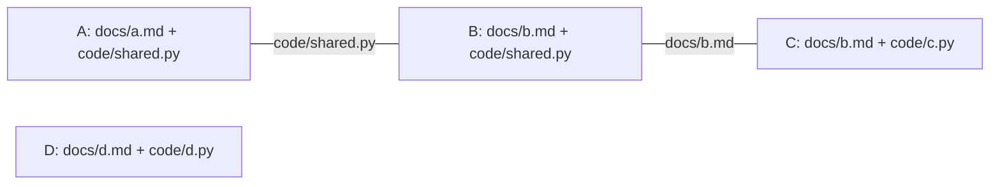

# Обязательное рассмотрение по пересекающимся разделам

Пятнадцатый этап развивает [обязательное рассмотрение содержания](content-gate.md): администратор может задать несколько комплектов документов и кода, а Store выбирает все относящиеся к предложению разделы. Выбор выводится из фактических записей предложения и пересечений комплектов. Автор не передаёт удобный список разделов и не может ограничиться первым совпадением.

Цель — позволить независимым частям портала проходить свой обязательный процесс, сохраняя все требования там, где разделы связаны общими файлами. Это локальный прототип на SQLite. Возможное сокращение конфликтов является инженерной гипотезой; сравнительная производительность и предельное количество агентов здесь не измерены.

Практические материалы сохраняются в [отдельном примере](../../examples/content-routing/README.md) и [отчёте выполнения](../../examples/content-routing/results/report.md). Отчёт содержит результаты конкретного запуска; ограничения формата и описание алгоритма ниже не являются экспериментальными результатами.

## 1. Почему одного комплекта недостаточно

Предыдущая политика задаёт один точный комплект. Для сайта с независимыми разделами это неудобно: изменение справки одного модуля не должно требовать включать в предложение документацию всех других модулей. При этом разделы часто используют общую конфигурацию, определения форматов или таблицы совместимости. Простое правило «возьми раздел изменённого файла» может пропустить второе обязательство того же общего файла.

В новой схеме каждый раздел содержит прежний строгий комплект. Если предложение затрагивает несколько разделов, они обязательны одновременно. Если включение одного раздела приводит к файлу другого, второй тоже включается. Алгоритм продолжает расширение до устойчивого множества.

| Ситуация | Требуемое поведение |
| --- | --- |
| Предложение затрагивает только отдельный комплект D | Рассмотреть D |
| Один файл входит в A и B | Рассмотреть A и B |
| A связан с B, B связан с C | Рассмотреть A, B и C, даже без прямого пересечения A и C |
| В предложении есть файл вне всех разделов | Заблокировать непокрытую запись |
| В предложении отсутствует часть выбранного замкнутого комплекта | Заблокировать неполный комплект |
| Один раздел проходит, другой показывает mismatch | Заблокировать всё предложение |

Маршрутизация определяет объём обязательного рассмотрения. Право записи, происхождение, формальная review и право принятия остаются отдельными условиями [authorship](authorship.md) и [governance](governance.md).

## 2. Политика schema 2

Верхний уровень новой политики имеет ровно два поля:

~~~json
{
  "schema_version": 2,
  "sections": [
    {"id": "reference-a", "policy": {}},
    {"id": "reference-b", "policy": {}}
  ]
}
~~~

Это схема структуры, а не пригодный для загрузки пример: каждый объект `policy` должен содержать полную непустую [политику schema 1](content-gate.md#3-политика-задаёт-конечный-комплект). Пустой объект намеренно не удовлетворяет валидатору. В рабочем файле на его месте находятся `schema_version`, `artifact_ids`, `spec` и `inventory`.

Вложенный комплект сохраняет прежние правила:

1. Объявляет безопасные ID документальных и программных артефактов.
2. Задаёт непустые обязательства над обоими видами артефактов.
3. Содержит непустую опись обещаний с точными цитатами и ссылками на обязательства.
4. Требует точного совпадения дескриптора обещания с каждым связанным обязательством.
5. Объявляет `artifact_ids`, точно равные объединению сторон обязательств.
6. Связывает каждое обязательство хотя бы с одним обещанием.

Администратор задаёт разделы, их имена и полный состав. В политике нет приоритетов, выражений маршрутизации, правила первого совпадения, необязательных разделов или списка исключений от автора.

ID раздела содержит 1–64 символа, начинается со строчной латинской буквы; далее допустимы строчные латинские буквы, цифры, `_`, `.` и `-`. Разделы нормализуются по `id`, а файлы каждого комплекта — по ID. Порядок разделов во входном JSON не создаёт приоритета. Внутренние обязательства и обещания сохраняют свой определённый порядок.

### 2.1. Локальные имена и повторение правил

Идентификаторы обязательств и обещаний локальны для раздела. Например, в A и B может существовать обязательство `maximum-attempts`. Они остаются двумя записями: `(A, maximum-attempts)` и `(B, maximum-attempts)`. Они не сливаются по одному имени и не подменяют друг друга.

Это относится и к одинаковым проверкам над одним общим файлом. Два совпавших результата показывают выполнение двух объявленных требований, но не являются независимыми источниками доказательства. Предел числа обязательств учитывает каждое такое вхождение.

### 2.2. Ограничения размера

| Уровень | Предел |
| --- | --- |
| Разделы одной политики | 1–8, уникальные `id` |
| Различные файлы в объединении всей политики | Не более 32 |
| Вхождения обязательств во всех разделах | Не более 32 суммарно |
| Вхождения обещаний во всех разделах | Не более 32 суммарно |
| Один вложенный комплект | Прежние пределы: 1–16 файлов, обязательств и обещаний |
| Каноническая политика | Не более 1 МБ |
| Канонический пакет с адресом | Не более 4 МБ |

Это ограничения входа и работы реализации. Они не означают, что система обслуживает 32 независимых автора одновременно или восемь промышленных редакционных подразделений. Ограничения предложений, графа происхождения, grants и извлечения AST действуют дополнительно.

## 3. Маршрут выводится из реальных writes

Обозначим через `W` множество фактических `write_id` предложения, а через `F(s)` — множество файлов раздела `s`.

Сначала Store выбирает **все** разделы, в которых встречается хотя бы одна запись предложения:

~~~text
S₀ = { s | F(s) ∩ W ≠ ∅ }
~~~

Затем добавляет каждый раздел, пересекающийся с любым уже выбранным:

~~~text
Sₙ₊₁ = Sₙ ∪ { s | существует t ∈ Sₙ: F(s) ∩ F(t) ≠ ∅ }
~~~

Когда множество перестаёт расти, объединение его файлов образует обязательный комплект:

~~~text
R = объединение F(s) для всех выбранных s
~~~

Для пригодного пакета требуется точное равенство `W = R`, а также отсутствие записей вне всех административных комплектов. Все выбранные разделы должны пройти собственные сравнения и привязки обещаний.

Число разделов ограничено восемью. Расширение монотонно: разделы только добавляются. Поэтому устойчивое множество находится за ограниченное число проходов; алгоритм не обходит произвольный неограниченный граф портала.

### 3.1. Пример цепочки пересечений

Пусть администратор объявил:

~~~text
A = {docs/a.md, code/shared.py}
B = {docs/b.md, code/shared.py}
C = {docs/b.md, code/c.py}
D = {docs/d.md, code/d.py}
~~~

Предложение с единственной записью `docs/a.md` сначала выбирает A. Через `code/shared.py` включается B, затем через `docs/b.md` включается C. Итоговый обязательный комплект:

~~~text
code/c.py
code/shared.py
docs/a.md
docs/b.md
~~~

D остаётся вне этого маршрута. Само предложение только с `docs/a.md` не проходит: остальные три файла отсутствуют. Добавление `docs/outside.md` также не помогает — эта запись не покрыта политикой.

Если автор включает файлы двух непересекающихся компонентов, выбираются оба компонента. Это допустимый общий маршрут при полном покрытии, но он снова объединяет соответствующую работу в одно предложение и одно принятие.

### 3.2. Почему нельзя выбрать только прямые совпадения

При маршрутизации исключительно по исходным writes файл `docs/a.md` мог бы выбрать A, после чего обязательный `code/shared.py` оказался бы в комплекте без применения B. Так был бы пропущен договор B об этом же программном файле. Транзитивное замыкание предотвращает такую потерю соседних требований.

Обратная сторона: длинная цепочка общих файлов может связать большую часть портала. Алгоритм делает эту связанность обязательной; он не умеет автоматически выяснить, что два требования к одному файлу затрагивают разные независимые функции. Для такого различения понадобится новая модель областей содержимого и конфликтов, а не ослабление текущего выбора разделов.

## 4. Все разделы видят один полный кандидат

Store захватывает текущее состояние артефактов в своей SQL-транзакции, разбирает фактическое предложение и получает полный кандидат `current + writes`. Каждый выбранный раздел вычисляется над **тем же кандидатом и тем же полным множеством writes**.

Реализация не создаёт искусственное предложение на каждый раздел и не отфильтровывает соседние записи перед сравнением. Это сохраняет общее основание:

- Общий файл имеет одно и то же предложенное тело для всех разделов.
- Селекторы разрешаются против одного кандидата.
- Связи обещаний проверяются против собственных правил раздела.
- Объявленные зависимости всех результатов собираются без скрытой подмены записей.
- Любое противоречие или неразрешимая связь остаётся видимой на уровне всего пакета.

Проверка равенства `W = R` относится ко всему маршруту. Внутри отдельного раздела не требуется равенство полного `W` только его локальному комплекту: для связанной цепочки это ошибочно запретило бы соседние обязательные записи. Локальный вычислитель сохраняет прежние проверки содержания, а маршрут отвечает за полноту общего набора.

## 5. Пакет schema 2

Для многосекционной политики строится пакет с `schema_version: 2` и `content_rules_version: "content-routing-1"`. Он закрепляет:

- Точный proposal ID и digest.
- Поколения и digest политик содержания и governance.
- Фактические writes, требуемый замкнутый комплект и объяснение маршрута.
- Ожидаемые и действующие адреса read/query оснований.
- Вложенные результаты каждого выбранного раздела.
- Совокупные зависимости, причины препятствий и `eligible`.
- Явные ограничения предмета проверки.

Результаты обязательств и обещаний находятся внутри своих разделов. Имена не сводятся к одному плоскому словарю, в котором одинаковый локальный ID мог бы затереть чужую запись.

В `routing` сохранены `initial_section_ids`, `selected_section_ids`, `uncovered_write_ids`, `missing_write_ids` и `extra_write_ids`. Список `sections` содержит выбранные разделы с `section_id`, `section_policy_digest`, `artifact_ids` и собственными `relations`, `promises`, `dependencies`, `eligible`, `reasons`. Причины раздела на верхнем уровне дополнены `section_id`, поэтому одинаковое локальное имя правила остаётся различимым.

Адрес пакета по-прежнему имеет вид `cgp_<sha256>`. Digest вычисляется от канонического тела без полей собственного адреса. Пакет детерминирован по закреплённому предложению, политике и наблюдаемым основаниям; текущие часы, число работников и порядок высказывания мнений не становятся частью результата сравнения.

### 5.1. Пригодность — совместное условие

Прохождение всех отношений выбранного A не компенсирует `mismatch` в B. Полное покрытие комплекта также не компенсирует `unresolved` цитаты или селектора.

Пригодность требует одновременно:

1. Правильного полного маршрута и точного состава записей.
2. Актуальных объявленных read/query оснований.
3. Разрешимых селекторов и точных уникальных цитат.
4. Совпавших объявленных отношений.
5. Корректных связей обещаний с обязательствами внутри каждого раздела.
6. Отсутствия других препятствий самого пакета.

Даже пригодный пакет не является отдельным разрешением принятия. Runtime проверяет другие действующие условия отдельно.

| Причина маршрутизации | Значение |
| --- | --- |
| `content_routing_no_sections` | Ни один раздел не выбран |
| `content_routing_uncovered_writes` | Есть записи вне всей административной описи |
| `content_routing_missing_writes` | Не хватает файлов замкнутого комплекта |
| `content_routing_extra_writes` | Фактические записи выходят за требуемое замыкание |

Причины могут присутствовать одновременно. Например, файл вне описи одновременно непокрыт и избыточен относительно выбранного замыкания. Такое повторение описывает два свойства одной записи; его нельзя выдавать за число независимых ошибок или источников доказательства.

## 6. Принятие и мнения остаются транзакционными

Новый маршрут использует прежний интерфейс предметного закрепления governance: решение schema 2 ссылается на точный digest пакета, а квитанция нового принятия schema 3 сохраняет ту же привязку. Отдельный вид голосования для каждого раздела не вводится.

Проверяющие рассматривают записи целого proposal в пределах своих grants. Набор решений должен удовлетворить действующему кворуму по всем writes и ссылаться на текущий полный пакет. Мнение по прошлому или иному маршруту не становится мнением по новому автоматически.

В транзакции нового принятия Store:

1. Проверяет предложение и исходные runtime-ограничения.
2. Проверяет происхождение всего графа компонентов.
3. Строит маршрут и полный пакет по действующей политике.
4. Проверяет последние мнения и их точные привязки.
5. Повторно вычисляет финальный пакет.
6. После обхода происхождения и содержания получает свежее время проверки полномочий.
7. Перепроверяет выбранный кворум и координатора.
8. Сохраняет принятие и квитанцию в той же транзакции.

Повторный расчёт содержания предшествует свежей проверке срока grants. Если допуск истёк во время расчёта, раннее время не даёт ему пройти финальную проверку. Это проверка на записанный момент авторизации внутри транзакции, а не обещание действия допуска бесконечно после неё.

### 6.1. Происхождение отделено от маршрута

Все авторы компонентов и промежуточные интеграторы исключаются из рассмотрения и нового координирования **глобально для предложения**. Разбиение политики на разделы не разрешает автору A согласовать B в том же составном proposal. Новый grant того же principal это ограничение не снимает.

Чтобы два независимых раздела имели независимые коллективы рассмотрения и принятия, нужны отдельные предложения. Добавление обоих разделов в один proposal намеренно объединяет их происхождение и требования к разрешениям.

## 7. Несвязанные разделы и актуальность

Пусть два предложения подготовлены на одной ревизии: одно покрывает D, другое — замкнутый комплект A–B–C. Принятие D увеличивает общую ревизию, но само по себе не обязано менять пакет A–B–C.

Общий номер ревизии не входит в хеш пакета. Если собственные read/query основания второго предложения не изменились, тела его writes и политика прежние, пакет может остаться побайтно тем же. Тогда прежние решения, привязанные к этому пакету, не становятся устаревшими лишь из-за номера ревизии.

Условие существенно: query по широкой области, чтение файла D или иная явная зависимость могут сделать второе предложение устаревшим. Маршрут не стирает исходные readset и queries и не обещает независимость на основании разных имён разделов.

### 7.1. Изменение политики глобально

Описанное ниже поведение сохраняется без отдельно включённого [режима continuity шестнадцатого этапа](review-continuity.md). В этом режиме требуется совпадение полного локального основания и проверенная цепочка каждого промежуточного перехода; прямой сброс governance и изменение выбранного раздела остаются барьерами.

Административное изменение содержания повышает поколение политики содержания и поколение governance. В пакет входит глобальный digest политики. Поэтому изменение даже несвязанного D делает прошлые пакеты и голоса непригодными для нового принятия в остальных разделах.

Локальное сохранение голосов при обновлении чужого раздела в этом этапе не реализовано. Оно потребует отдельного контракта: как удостоверять неизменность выбранного подграфа, какие глобальные ограничения остаются значимыми и когда новая политика должна отзывать прежние согласования.

## 8. Совместимость с прежним комплектом

Политика schema 1 сохраняет прежнюю проверку единого точного комплекта. Её пакеты остаются schema 1 с правилами `content-gate-1`, прежними полями и прежним смыслом. Новая версия не переписывает старые пакеты и не выдаёт их за маршрутизированные.

Политика schema 2 обрабатывается отдельным модулем [content_routing.py](../../agentwiki/content_routing.py). Общие ограниченные сравнения переиспользуют [content_gate.py](../../agentwiki/content_gate.py), сохраняя `obligations-1` и `coverage-1`. Это позволяет развивать выбор разделов без скрытого изменения определения равенства или смысла старой проверки цитаты.

Действующий режим может получить schema 2 через обычное административное обновление политики. Изменение поколения требует новых голосов. Исторические принятия сохраняют свои прежние квитанции; миграция политики не создаёт им новую историю рассмотрения.

## 9. Исторический пакет не пересчитывается по живой базе

`content show` читает сохранённый пакет по точному адресу. Для schema 2 загрузчик проверяет ограниченную форму, каноническое тело, digest и привязки к сохранённым предложению и политикам. Он также сверяет маршрут с фактическими writes исторического proposal и исторической политикой.

Загрузчик не подставляет новые живые значения, чтобы задним числом изменить старое `eligible`. Исторический пакет может показывать положительный результат прошлого состояния и одновременно не давать никакого разрешения на новое принятие сейчас.

Проверка согласованности адресов не является цифровой подписью. Владелец SQLite и реализация приложения остаются доверенной границей; прямое согласованное изменение базы находится за пределами гарантий этого API.

## 10. Команды оператора

Маршрутизация использует существующие команды `content`. Ниже указаны шаблоны для уже подготовленной рабочей базы с включёнными governance и authorship. Значения в верхнем регистре нужно заменить данными своей базы; `N` — текущее поколение **governance**, а не номер политики содержания.

Проверить действующее состояние:

~~~bash
python3 -m agentwiki content status --workspace /tmp/my-agentwiki
python3 -m agentwiki governance status --workspace /tmp/my-agentwiki
~~~

Впервые включить содержание с подготовленным строгим файлом schema 2:

~~~bash
python3 -m agentwiki content enable \
  --workspace /tmp/my-agentwiki \
  --credential /tmp/private/admin.credential \
  --policy /tmp/routing-policy.json \
  --expected-policy-generation N
~~~

Если режим уже включён, изменить политику:

~~~bash
python3 -m agentwiki content policy \
  --workspace /tmp/my-agentwiki \
  --credential /tmp/private/admin.credential \
  --policy /tmp/routing-policy.json \
  --expected-policy-generation N
~~~

Получить текущий пакет конкретного предложения:

~~~bash
python3 -m agentwiki content status \
  --workspace /tmp/my-agentwiki \
  --proposal PROPOSAL_ID
~~~

Записать мнение с точным digest пакета:

~~~bash
python3 -m agentwiki governance decide \
  --workspace /tmp/my-agentwiki \
  --credential /tmp/private/reviewer.credential \
  --proposal PROPOSAL_ID \
  --artifact docs/a.md \
  --verdict approve \
  --rationale 'Рассмотрены заявленные связи и основания этого пакета.' \
  --expected-proposal-digest PROPOSAL_DIGEST \
  --content-packet-digest PACKET_DIGEST \
  --expected-policy-generation N \
  --operation review-a-001
~~~

Это пример первого мнения данного principal по записи. Для обновления последнего мнения нужен `--previous-decision` с его точным ID; каждый учитываемый файл требует своего решения. После изменения поколения или пакета нельзя подставлять старые значения из примера.

Прочитать уже сохранённый пакет из решения или квитанции:

~~~bash
python3 -m agentwiki content show \
  --workspace /tmp/my-agentwiki \
  --packet cgp_PACKET_DIGEST
~~~

`status` является текущим наблюдением; чтение статуса не резервирует право будущего принятия. `show` возвращает исторический предмет рассмотрения. Наличие пригодного JSON в файловой системе не заменяет эти операции Store.

Допуски читаются из закрытых POSIX-файлов. Их содержимое и хеши не следует добавлять в команды, отчёт или Git. Сами пути в примере не являются созданными здесь credentials.

## 11. Прикладной сценарий

Отдельная команда запускает обычный воспроизводимый процесс на свежем пути:

~~~bash
python3 -m agentwiki routing-demo \
  --workspace /tmp/infod10-content-routing-example-01 \
  --workers 3
~~~

Сценарий связывает авторские задания, композицию, выдачу локальных разрешений, предметные пакеты и принятие. Его предметы — цепочка A–B–C и несвязанный D. Предложения позволяют увидеть различие между прямым выбором, полным замыканием, неполным комплектом, непокрытым файлом и расхождением одного из соседних разделов.

Новая рабочая директория нужна для отдельного результата; повторный запуск не должен перезаписывать сохранённые примеры прошлого этапа. Частная база и credentials остаются за пределами публикуемых материалов. Человекочитаемые отчёты используют Europe/Berlin; технические время и epoch сохраняют свою явную шкалу.

[Фактический запуск](../../examples/content-routing/results/report.md) сохранил восемь авторских заданий, пять композиций, 16 этапов, 16 решений и 97 событий. Шесть ожидаемых отказов API и шесть заблокированных принятий зафиксированы явно. D принят на ревизии 2, A/B/C — на ревизии 3. Пакет и одобрения A/B/C, подготовленные до принятия D, остались действующими. Один пакет schema 1 сохранён и прочитан после перехода к каталогу schema 2. Дополнительные [CLI-результаты](../../examples/content-routing/README.md) также включают чтение реального пакета предыдущего выпуска. Число `--workers 3` задаёт размер пула Python-потоков этого процесса. Оно не означает три независимые LLM, три человека или измеренный предел масштабирования.

## 12. Что это даёт многоагентной документации

Для технического портала раздел может представлять отдельный модуль, семейство API или конфигурацию продукта. Автор документа, автор кода и интегратор могут готовить свои компоненты параллельно; выбранное замыкание определит, что нужно собрать перед совместным рассмотрением.

Разные несвязанные компоненты могут проходить отдельными предложениями. Это уменьшает искусственный объём одного комплекта и создаёт предпосылку для меньшего числа конфликтов. Величина эффекта зависит от фактических read/query зависимостей, распределения задач, частоты административных обновлений и размера общих файлов. Для вывода об ускорении нужны измерения одинаковой нагрузки и стоимости.

Для Википедии или энциклопедии свободного текста этот модуль пока слишком узок. Он не определяет достоверность источника, нейтральность изложения, полноту темы, наличие противоречий между абзацами или качество перевода. Он обеспечивает обязательное рассмотрение выбранных структурированных договоров и сохранение предмета мнения. Для энциклопедического содержания нужны дополнительные модели утверждений, источников, применимости и редакционной ответственности.

## 13. Цена строгого замыкания

| Ограничение | Практическое следствие |
| --- | --- |
| Общий файл связывает разделы целиком | Большой связный компонент может вернуть почти глобальный комплект |
| Требуется точное равенство writes комплекту | Иногда придётся включать неизменённые тела файлов |
| Разделы задаются по целым артефактам | Независимые параметры одного файла пока не разделены |
| Происхождение учитывается для всего proposal | Автор одного компонента не может согласовать соседний в том же proposal |
| Глобальный digest политики входит в пакет | Изменение чужого раздела требует свежих голосов |
| Сохраняются все read/query основания | Разные маршруты ещё не гарантируют независимые принятия |
| Полноту определяет администратор | Неполная опись может пропустить незаявленные требования |
| Проверяется ограниченная литеральная грамматика | Поведение произвольного кода не установлено |

Неизменённая запись остаётся настоящим элементом proposal: требует допустимой роли и области записи, участвует в происхождении и рассмотрении. Нельзя одновременно требовать полного комплекта и считать такие файлы несущественными для полномочий.

## 14. Границы гарантий

- Маршрут устанавливает покрытие фактических writes объявленной политикой; полноту всего знания он не определяет.
- `match` относится к выбранным полям и отношениям; истинность прозы и корректность программы требуют других оснований.
- Точная цитата устанавливает присутствие фрагмента, но не правильность перевода её смысла в дескриптор.
- Различные principal и grants обеспечивают локальные правила разделения; личность, независимость людей или моделей ими не удостоверяются.
- Пакет и квитанция фиксируют согласованное внутреннее состояние; внешняя сертификация истории отсутствует.
- Код предложения разбирается как данные; автоматическое исполнение и внешняя LLM в этот путь не добавлены.
- SQLite-принятие не является общей транзакцией с Git, порталом документации или внешними источниками.
- Количество разделов, workers или завершённых заданий отдельного примера не является нагрузочным измерением.

## 15. Дальнейшая работа по шагам

1. **Описать реальную опись разделов.** Для выбранного проекта назначить владельцев требований и показать граф общих файлов. Зафиксировать, какие смысловые темы ещё не покрыты.
2. **Измерить цену замыкания.** На повторяемом наборе задач считать размер выбранного компонента, долю неизменённых writes, повторные рассмотрения и причины устаревания. Отделять логическую связанность от широкой query-зависимости.
3. **Определить более узкие области.** Спроектировать версии селекторов и правила конфликта внутри файла. Критерий перехода — отсутствие пропуска соседнего требования при разделении одного артефакта на области.
4. **Рассмотреть поколения по разделам.** Сначала задать явный протокол совместимости и глобального отзыва, затем решать, какие мнения можно сохранять после несвязанного административного изменения. До этого действует глобальная инвалидизация.
5. **Управлять изменением обязательств.** Показывать удаление, ослабление и расширение правила с помощью [разбора изменения требований](requirement-delta.md). Само административное право редактировать политику не доказывает предметную обоснованность изменения.
6. **Расширить предметное рассмотрение.** Отдельно описать проверку соответствия прозы полям, проверку источников и проверку свойств программы. Сохранить разные виды доказательств и причины отказа.
7. **Добавить внешнюю идентификацию.** Связать principal с удостоверенной учётной записью и определить организационную независимость. Сохранить конкретные grants, историю отзыва и исключение всех contributors.
8. **Подготовить долговечную публикацию.** Определить повторяемый протокол SQLite → Git → сайт с восстановлением после частичного отказа. Квитанция принятия должна сохранять свой точный прежний смысл.

Общий план — в [roadmap](roadmap.md). Следующий этап должен сопровождаться конкретными материалами и критериями перехода: соответствие источникам, независимость рассмотрения и масштабирование требуют разных наблюдений и не выводятся из одного положительного пакета.
