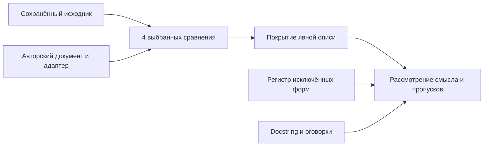

# Расширение предметного исследования urllib3 Retry

Сорок третий этап agentwiki расширяет набор выбранных объявлений сохранённого urllib3 Retry 2.5.0 с двух до четырёх. Используются существующие форматы `source-adapter-1` и `source-promise-coverage-1`: грамматика, прежние reports и правила принятия сохраняются.

Предметная задача — отдельно показать проверяемые значения, явно исключённые объявления и смысловую ошибку авторского текста. Число совпавших значений и полное покрытие выбранной описи имеют собственные ограниченные значения. Рассмотрение содержания остаётся работой редактора.

- [Исходный закреплённый корпус](../../corpora/urllib3-retry-v2.5.0/README.md).
- [Новый предметный корпус](../../corpora/urllib3-retry-source-study-v2.5.0/README.md).
- [Обычный сценарий](../../examples/retry-source-study/README.md).
- [Извлечение выбранных объявлений](source-adapter.md).
- [Опись обещаний и структурное покрытие](source-promise-coverage.md).
- [Разбор реального контракта](real-contract-urllib3.md).
- [Дорожная карта](roadmap.md).

## 1. Предметный пробел

В предшествующем примере рассмотрены `Retry.DEFAULT_ALLOWED_METHODS` и default `Retry.__init__.total`. Сохранённый исходник содержит другие подходящие объявления и более сложные значения. Чтобы расширить предметное основание, нужны явный выбор следующего материала и учёт оставшегося за границей анализа.

Новый сценарий добавляет набор заголовков `DEFAULT_REMOVE_HEADERS_ON_REDIRECT` и синтаксическое значение default `backoff_factor`. Оба доступны прежней грамматике. Отдельный авторский реестр перечисляет ещё четыре выбранных объявления, которые в анализатор не включаются. Этот реестр делает конкретные пропуски доступными для рассмотрения; полнота всех обещаний класса не установлена.

Дополнительно рассматривается намеренная ошибка единицы в авторской прозе: значение `total=10` описано как число всех попыток. Число и структурные связи остаются прежними. Этот случай показывает, какую работу должен выполнить смысловой reviewer после успешного структурного анализа.

## 2. Источник и историческая область

Используется сохранённый [retry.py](../../corpora/urllib3-retry-v2.5.0/upstream/retry.py) из закреплённого коммита urllib3 `aaab4eccc10c965897540b21e15f11859d0b62e7`, тег 2.5.0. URL, прежнее время загрузки, размеры и hashes находятся в исходном [manifest.json](../../corpora/urllib3-retry-v2.5.0/manifest.json). Материалы были загружены 16 октября 2026 года; время нового исследования относится к его отчётам.

Исходный код и [MIT license](../../corpora/urllib3-retry-v2.5.0/upstream/LICENSE.txt) рассматриваются как данные. Новый запуск не устанавливает актуальность upstream, подпись издателя или runtime behavior. Авторские adapter, profile, Markdown и inventory создаются отдельно с явным происхождением.

Все выбранные объявления принадлежат одному проекту и одному сохранённому исходнику. Повтор их использования разными инструментами не увеличивает число независимых источников.

## 3. Четыре выбранных объявления

| Предмет | Синтаксический selector | Сохранённое значение | Область утверждения |
|---|---|---|---|
| Default allowed methods | `class_frozenset_strings`, Retry, DEFAULT_ALLOWED_METHODS | HEAD, GET, PUT, DELETE, OPTIONS, TRACE | Объявленный class attribute |
| Total default | `parameter_default`, Retry, __init__, total | Integer 10 | Default expression в сигнатуре |
| Default removed headers | `class_frozenset_strings`, Retry, DEFAULT_REMOVE_HEADERS_ON_REDIRECT | Cookie, Authorization, Proxy-Authorization | Исходный набор строк class attribute |
| Backoff factor default | `parameter_default`, Retry, __init__, backoff_factor | Integer AST literal 0 | Синтаксическая форма default expression |

Каждая связь имеет собственные scope, annotation, adapter symbol и document selector. В inventory отдельно названы цитата и полное ожидаемое requirement. Равенство ID или числа само по себе этих связей не устанавливает.

### Набор методов

В исходнике `DEFAULT_ALLOWED_METHODS` содержит шесть перечисленных строк. Отсутствие POST в этом наборе сохраняется как наблюдение выбранного значения. Документация параметра `allowed_methods` отдельно говорит: `Set to a ``None`` value to retry on any verb.` Эта оговорка требует предметного рассмотрения вместе с условиями повторов.

Проверка набора не устанавливает универсального запрета повторять POST и не исследует все ветки ошибок HTTP-клиента. Scope ограничен class attribute сохранённой версии.

### Total и единица

В сигнатуре конструктора default expression `total` равен integer 10. В docstring параметра сказано: `Total number of retries to allow. Takes precedence over other counts.` Далее отдельно описаны значения None, 0 и False.

Единица retries имеет текстовое основание в docstring. Из самого integer 10 она не выводится. Общее число попыток зависит от выбранного сценария и не вычисляется новым анализатором.

### Заголовки

Class attribute содержит строки `Cookie`, `Authorization`, `Proxy-Authorization`. В теле конструктора имеется отдельное преобразование `h.lower() for h in remove_headers_on_redirect` при формировании instance attribute.

Выбранное сравнение сохраняет исходные имена из class attribute. Нижний регистр instance values, условия redirect и фактическая обработка HTTP-заголовков требуют отдельного рассмотрения. Нормализация string_set в отчёте сортирует элементы для сравнения; она не воспроизводит работу конструктора.

### Backoff factor

Параметр аннотирован как float, а default записан синтаксическим integer literal `0`. Прежняя грамматика разрешает integer default expression и извлекает именно эту форму.

В profile явно указывается `value_type=integer` для выбранного literal. Это не описание полного типа параметра или разрешённых пользователю значений. Float 0.0, вычисление задержек, jitter и sleep остаются за пределами этой связи.

## 4. Реестр выбора и исключений

Явно составленный ИИ-авторами проекта реестр содержит восемь выбранных позиций: четыре включены в profile, четыре явно исключены. Поле выбора и его обоснование являются авторскими метаданными. Новые источники и обещания автоматически не обнаруживаются.

| Исключённое объявление | Наблюдаемая форма | Причина исключения из profile |
|---|---|---|
| RETRY_AFTER_STATUS_CODES | `frozenset([413, 429, 503])` | Прежний selector поддерживает набор строк |
| DEFAULT_BACKOFF_MAX | Class integer literal 120 | Class integer selector в прежней версии отсутствует |
| __init__.backoff_max | Name reference DEFAULT_BACKOFF_MAX | Default expression требует связывания имени |
| __init__.backoff_jitter | Float literal 0.0 | Прежний parameter-default selector требует integer |

Неподдерживаемому объявлению не назначается искусственный тип ради получения отчёта. Для него сохраняются наблюдённая форма и причина исключения в реестре. Подсчёт четырёх выбранных mappings остаётся отдельным от восьми позиций реестра.

Даже восемь позиций реестра не задают полный знаменатель документации Retry. В классе остаются другие параметры, ветвления, исключения, взаимодействия и ограничения применимости. Следующее расширение должно назвать конкретный предмет и обосновать требуемую грамматику.

## 5. Авторские материалы

Новый Markdown связывает каждое выбранное объявление с точным предложением и полем JSON fence. Литеральный adapter содержит отдельно объявленные значения для четырёх сравнений. Profile описывает соответствия; inventory задаёт обещания и ссылки на mapping IDs.

Эти документы составлены ИИ-авторами нашего проекта. Даже при совпадении значений они не становятся исходной документацией urllib3. Английские фрагменты docstring сохраняют предметное основание для обсуждения единиц и применимости; соответствие авторского русского текста этим фрагментам требует рассмотрения.

Источник, ручной adapter и Markdown образуют три синтаксических endpoint. Происхождение ручного переноса остаётся видимым. Независимая экспертная разметка человеком не заявляется.

Новый корпус содержит ровно десять файлов: README, manifest, selection register, две точные upstream-копии (source и MIT license), два авторских Markdown-варианта, литеральный Python adapter, profile и promise specs. Manifest закрепляет девять остальных файлов по bytes/hash и отдельно указывает прежнее время получения двух upstream-файлов. Для авторских материалов не придумывается upstream acquisition time.

Promise specs содержат четыре описания S42 Promise5 и авторство выбора. ID/digest будущих parents в корпусе не выдумываются: demo получает их после создания и полной валидации двух новых source reports, затем явно составляет шесть inventories. Формат прежних inventories не конвертируется.

Selection register сохраняет восемь точных expression spans из source: assignment values либо constructor default expressions. Для каждого доступны quote, UTF-8 SHA-256, character offsets и line numbers. Его selector metadata имеют собственную форму class/member/parameter; исключённые позиции не выдаются за поддерживаемые selectors анализатора. Четыре отдельные caveats закрепляют docstring о retries, allowed_methods=None, lowercase-преобразование headers и аннотацию/default backoff_factor.

| Переносимый файл | Назначение |
|---|---|
| [manifest.json](../../corpora/urllib3-retry-source-study-v2.5.0/manifest.json) | Pins файлов и происхождение двух upstream-копий |
| [selection-register.json](../../corpora/urllib3-retry-source-study-v2.5.0/selection-register.json) | Выбор четырёх mappings и четыре excluded-before-analysis позиции |
| [profile.json](../../corpora/urllib3-retry-source-study-v2.5.0/authored/profile.json) | Четыре поддерживаемых требования сравнения |
| [promise-specs.json](../../corpora/urllib3-retry-source-study-v2.5.0/authored/promise-specs.json) | Четыре явно составленных обещания без выдуманных parent IDs |
| [contract.md](../../corpora/urllib3-retry-source-study-v2.5.0/authored/contract.md) | Авторский baseline с точными цитатами |
| [contract-misstated-total-unit.md](../../corpora/urllib3-retry-source-study-v2.5.0/authored/contract-misstated-total-unit.md) | Явно обозначенная намеренная ошибка единицы |
| [retry_config.py](../../corpora/urllib3-retry-source-study-v2.5.0/authored/retry_config.py) | Литеральные данные авторского адаптера |

## 6. Смысловая ошибка при полном покрытии

В отдельном авторском варианте фраза о `total=10` намеренно изменена: вместо retries указаны все попытки. Исходник, adapter literal, JSON-значение, scope и selectors сохраняются. Inventory привязывается к точной новой цитате и к собственному полному parent report.

Baseline quote:

> У конструктора Retry значение total по умолчанию равно 10; параметр считает повторы, а не все попытки.

Намеренно ошибочная авторская quote:

> У конструктора Retry значение total по умолчанию равно 10; параметр задаёт общее число попыток, включая первоначальную.

Второй Markdown получается ровно одной заменой этого предложения. Другие bytes, включая JSON fields, сохраняются. В обоих документах указано авторское происхождение иллюстрации; текст ошибочного варианта не приписывается upstream.

Существующие анализаторы видят совпавшие значения и полные структурные связи. Для этого варианта ожидается 4/4 coverage и `current_for_human_review`; `prose_semantics_verified=false` сохраняется. Этот статус обозначает готовность материала к рассмотрению человеком.

Редактор может обнаружить ошибку, сопоставив новую фразу с исходным docstring о retries. Сохранённая цитата доказывает расположение авторского текста внутри captured документа; hash и endpoint не устанавливают правильность единицы.

Случай сконструирован авторами проекта, его ожидаемая проблема известна заранее. Он не измеряет распространённость таких ошибок, precision/recall или качество независимого semantic review. Здесь нет выполнения LLM, редакторского голосования либо записи одобрения.

## 7. Согласованный обычный сценарий

| Случай | Ожидаемое покрытие | Предмет наблюдения |
|---|---:|---|
| Baseline |4/4 | Четыре точные цитаты и требования |
| Uncovered headers |3/4 | Обещание заголовков сохранено без ссылки |
| Wrong scope headers |3/4 | Ссылка известна, requirement не совпадает |
| Missing quote headers |3/4 | Значения совпали, цитата отсутствует |
| Shared headers duplicate |5/5 promises, 4/4 unique requirements | Повтор той же связи показан явно |
| Misstated total unit |4/4 | Неверная единица прозы остаётся предметом review |

Методика предусматривает создание двух source-adapter parents обычными CLI и шести coverage reports. Каждый analyze сопровождается show с тем же captured summary. Затем обе directory inputs и source-reports скрываются целиком для исторического show; обе возвращаются в finally. Собственный coverage report остаётся online. Занятый output вызывает безопасный отказ без изменения bytes/metadata прежнего отчёта.

Планируется 18 вызовов CLI: четыре source analyze/show, двенадцать coverage analyze/show, один offline show и один expected output-collision refusal. Это 17 успешных вызовов и один ожидаемый отказ. Public tree планируется из 29 файлов: 14 inputs, два source reports, шесть coverage reports и семь flat artifacts. По форматам — 23 JSON, три Markdown, два Python data files и одна лицензия.

```sh
python3 -m agentwiki retry-source-study-demo \
  --workspace /tmp/agentwiki-retry-source-study-01
```

Команда [retry_source_study_demo.py](../../agentwiki/retry_source_study_demo.py) использует API `run_retry_source_study_demo(workspace)`. Отдельного workers parameter нет. Для повторения нужен новый пустой workspace; прежние reports и частичные остатки не ремонтируются и не перезаписываются.

До и после workflow фиксируются byte pins прежних 11 corpus files, 26 source-adapter example files и 31 source-promise example file. Новые родители создаются из новых явно выбранных материалов; старые demo drivers не повторяются.

Фактическое время запуска, file counts, exit codes и результаты независимых аудитов приведены в разделе 10. Число процессов в последовательности не измеряет параллельность или предел числа агентов.

## 8. Работа нескольких участников

| Роль | Конкретная работа | Сохраняемый результат |
|---|---|---|
| Автор описи | Выбрать объявление и точно ограничить scope | Profile, inventory и реестр исключений |
| Автор адаптера | Явно перенести выбранные литералы | Собственный captured adapter |
| Проверяющий происхождения | Рассмотреть endpoints, snippets и selectors | Замечания к конкретному report ID/digest |
| Проверяющий содержания | Оценить единицы, применимость и пропуски | Обоснование со ссылками на источник |
| Интегратор | Сопоставить замечания и подготовить исправление | Новая версия авторского материала |

Участники могут работать над разными записями одного captured материала. Полные reports позволяют возвращаться к одному точному основанию. Изменение цитаты, источника или requirement требует нового отчёта; прежнее обсуждение автоматически не переносится.

Один shared mapping для двух promise labels остаётся одним выбранным сравнением. Разные роли, PID и отдельные ответы моделей сами по себе не удостоверяют независимость участников. В данном этапе исполнение обычного сценария остаётся последовательным, предел масштабирования не измеряется.

## 9. Дальнейшее предметное исследование

Следующий материал следует выбирать по наблюдаемому пробелу: например, связывание default с class constant либо набор integer status codes. Для расширения грамматики нужны отдельная версия правил, точная область допустимых форм и сохранение прежнего смысла исторических reports.

Смысловое исследование требует заранее определённых вопросов, независимо составленных аннотаций и фиксации разногласий. Отдельно надо учитывать пропущенные обещания и труд редактора. Подготовленные авторами случаи дают воспроизводимое основание для такого исследования; качество и полнота не выводятся из количества формальных проверок.

Технические направления — изоляция writer, политика принятия и измерение очередей — сохраняют собственные задачи и протоколы. Этот corpus study не создаёт Store writes, новых credentials, DB, внешних LLM-вызовов или права публикации.

## 10. Выполненный запуск и сверка оснований

Первый ordinary demo завершился с exit 0 и пустым stderr. Время отчёта — **2026-10-23T17:38:41.838149+02:00**, Europe/Berlin; workspace — `/tmp/infod10-retry-source-study-development-01`. Переносимые основания: [читаемый отчёт](../../examples/retry-source-study/results/report.md), [машинная сводка](../../examples/retry-source-study/results/report.json), [полные случаи и analyze/show](../../examples/retry-source-study/results/case-observations.json).

Все 29 public files скопированы byte-for-byte: 14 inputs, два полных source reports, шесть полных coverage reports, семь flat artifacts. Форматы: 23 JSON, три Markdown, два Python DATA и одна MIT license. Отдельный новый корпус содержит десять файлов и manifest с девятью nonself pins. Его source/license совпали с прежним корпусом; прежние 11 corpus, 26 source-adapter и 31 source-promise result files сохранились.

В двух source reports рассмотрены одни и те же четыре объявления с двумя вариантами документа. Получены восемь mapping match, 24 pair match и 24 resolved endpoints. Различие parents закреплено собственными ID/digest и полными captured documents; source, adapter и profile совпадают. Это восемь наблюдений четырёх повторно использованных объявлений.

| Выполненный случай | Covered / total | Unique covered / total | Matching | State |
|---|---:|---:|---:|---|
| Baseline |4/4 |4/4 |4 |current_for_human_review |
| Uncovered headers |3/4 |3/4 |3 |blocked |
| Invalid headers scope |3/4 |3/4 |3 |blocked |
| Missing headers quote |3/4 |3/4 |3 |blocked |
| Shared headers |5/5 |4/4 |5 |current_for_human_review |
| Misstated total unit |4/4 |4/4 |4 |current_for_human_review |

В шести авторских случаях 25 promise rows: 24 assigned, 23 mapped, 24 anchor_verified, 22 covered и matching. Отдельно одна uncovered, одна invalid_mapping и одна unresolved_anchor; три local blockers. Из 24 references одна имеет неверный scope, сохраняя actual requirement digest и полный match Comparison4; остальные 23 valid. Один shared mapping и один duplicate requirement group явно показывают повтор. Суммы относятся к повторяющимся иллюстрациям; знаменатель всей документации не установлен.

В [misstated-total-unit](../../examples/retry-source-study/results/coverage-reports/misstated-total-unit.json) неправильная фраза об общем числе попыток действительно получила 4/4 coverage, четыре match и current_for_human_review. Prose semantics осталась непроверенной: `prose_semantics_verified=false`, `requires_human_review=true`, `auto_accept=false`. Основание возражения — docstring о retries в [четырёх source caveats](../../corpora/urllib3-retry-source-study-v2.5.0/selection-register.json); анализаторы не выводят его смысл из JSON10. Это известная заранее авторская иллюстрация, без оценки частоты таких ошибок или качества независимой разметки.



[Журнал CLI](../../examples/retry-source-study/results/cli-outcomes.json) содержит 18 завершённых последовательных процессов с разными PID: 17 success и один ожидаемый source_promise_coverage_io_failed. Это четыре source CLI и 14 coverage CLI, девять analyze и девять show. Две source и шесть coverage analyze/show пар дали одинаковые captured summaries. Дополнительный [historical show](../../examples/retry-source-study/results/offline-observations.json) пересчитал own baseline report при отсутствии всей inputs directory и всей source-reports directory; оба каталога возвращены в finally. [Отказ перезаписи](../../examples/retry-source-study/results/output-collision.json) сохранил прежние baseline bytes/metadata. Емкость, throughput и перекрытие процессов не измерялись.

Все три read-only аудита прошли с первого исполнения: exit 0, stderr empty. Новый public audit выполнил 36531 проверку сохранённых данных без product imports/execution: десять corpus files, девять manifest pins, восемь register AST expressions, четыре caveat spans. Независимо реконструированы два source и шесть coverage reports, включая шесть полных nested parents: всего 96 parent endpoint instances, 25 promise anchors и 25 document endpoints. Проверены шесть exact inventory derivations, canonical IDs/digests, полные counts/fractions/groups/comparisons/blockers, 29 byte copies, 27 strict JSON (23 result files и четыре corpus JSON), 78 полей summary, 18 ordered CLI outcomes и 22 ссылки report.md. Прежние standalone drivers этапов 41–42 не запускались; их неизменённые generic validators используются только в новой области. Число сравнений не измеряет semantic accuracy.

Первый preservation/privacy audit подтвердил 7630 прежних files byte-for-byte, 135 прежних tracked Python sources кроме ровно init/main integration, 58 frozen recovery/source modules и десять неизменённых schema literals. Прочитаны 7165 JSON, разобраны 123 agentwiki Python AST, проверены 8666 локальных Markdown links. В 7859 publication files не найдены 598 известных credentials с hashes и 457 private hashes. Прежний sealed runtime и его 503 public copies имеют отдельную старую область проверки; новых private controls, keys и DB нет. После final docs выполняется повторный preservation/privacy pass.

Proof audit подтвердил прежние пять full packets, четыре transition bodies, шесть content policy и восемь governance policy versions, 3798 proof references, один audit root и три checkpoints (два pending, один history_complete). Эти записи относятся к прежней истории принятия и не одобряют новые отчёты. Проверка всех 45 частей архива также прошла; 524 непустых canonical messages и одна точная пустая final-запись в metadata имеют явно обозначенную границу снимка и происхождение.

Систематические tests/suites, fault workers, порча reports, аппаратные отказы, независимая человеческая разметка и нагрузочные измерения не проводились. До ordinary demo произошёл краткий сбой соединения облачной среды; после восстановления проверены source pins и отсутствие прежнего рабочего каталога назначения, первый запуск завершился без исправления runtime. Следующий содержательный шаг — заранее заданные вопросы смысловой разметки и сохранение обоснованных разногласий на отдельном материале.
