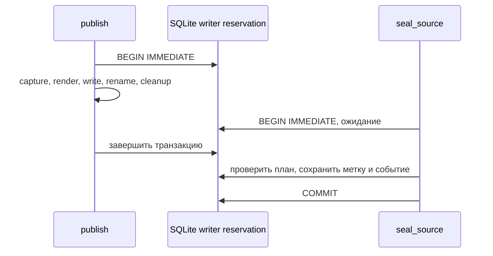

# Постоянный запрет записи в исходной среде

Статус: двадцать первый этап локального прототипа, правила `source-fence-1`. Это кооперативный запрет новых изменений через обновлённый Store. Карантинные копии сохраняют прежний режим чтения; новая действующая среда этим этапом не создаётся.

- [Предыдущий этап: сверка восстановления](recovery-reconciliation.md).
- [Частные снимки и карантин](store-backup.md).
- [Прикладной сценарий](../../examples/source-fence/README.md).
- [Фактический отчёт запуска](../../examples/source-fence/results/fence-report.md).

## 1. Решение и его назначение

Сверка предыдущего этапа сопоставляет два наблюдения, но не резервирует источник. После успешной `revalidate` другой worker может продлить аренду, отправить предложение или принять изменение. Для дальнейшего переключения требуется отдельный устойчивый факт: прежний источник больше не принимает новые изменения через согласованный интерфейс.

`seal_source` получает административный credential, точный частный план и operation ID. Под блокировкой записи SQLite он проверяет актуальное полное состояние, сохраняет метку запрета и одно публичное событие в общей транзакции. После подтверждения этой транзакции обновлённый Store отказывает записывающим операциям и публикации.

Метка хранится как зарезервированная запись `meta` с ключом `__source_write_fence__`. Новая таблица или изменение SQL-схемы не нужны. Существующий fingerprint предыдущего этапа уже охватывает `meta`, поэтому установка метки меняет закреплённое состояние и делает прежний план устаревшим для обычной сверки.

API снятия запрета нет. Источник остаётся доступным для чтения истории, квитанций и аудитов. Отдельный путь точного повтора `seal_source` возвращает ранее записанный результат.

## 2. Граница кооперативного протокола

Участники должны использовать обновлённый Store и один согласованный файл SQLite. Проверка выполняется при каждом новом соединении и внутри записывающей транзакции, поэтому объект Store, созданный до установки метки, также должен увидеть запрет.

Это требование к участникам приложения. Прежние версии Store, не знающие зарезервированного ключа, и прямой SQL владельца файла способны изменить базу. Метка не объявляется защитой от владельца SQLite или глобальным запретом записи для произвольных программ.

Локальные часы, реализация приложения и владелец файла остаются доверенными. Credential подтверждает владение локальным административным допуском; он не удостоверяет человека или независимость экспертов. Поле `source_epoch` — сохранённый случайный идентификатор этого запрета, без внешнего арбитра и глобальной монотонности.

В частности, этап не устанавливает единственного действующего писателя во внешней распределённой системе. Для этого требуются отдельные соглашения участников, доверенный идентификатор рабочей среды и протокол выдачи новых полномочий.

## 3. Частная метка и публичная квитанция

Значение зарезервированного ключа — ограниченный канонический JSON со следующими полями:

| Поле частного envelope | Назначение |
| --- | --- |
| `schema_version` | Версия структуры метки |
| `rules_version` | Правила `source-fence-1` |
| `request_digest` | Частная привязка к точному запросу, включая исходный план |
| `receipt` | Безопасная квитанция установленного запрета |

`request_digest` и весь envelope не включаются в события, CLI-ответы, status, отчёты или Git. Он зависит от частных оснований плана и не является публичным идентификатором операции. Наличие зарезервированного ключа распознаётся независимо от успешного разбора: повреждённая, неоднозначная или неподдерживаемая запись не разрешает дальнейшую запись. При чтении корректной метки также проверяется, что закреплённое событие `source_write_fenced` содержит точно ту же публичную квитанцию.

Публичная квитанция содержит:

| Группа | Поля |
| --- | --- |
| Формат | `schema_version`, `rules_version` |
| Локальные идентификаторы | `fence_id`, `source_epoch`, `operation_id`, `plan_id`, `administrator_grant_id` |
| Сохранённое основание | `created_at`, `revision`, `event_high_water_before`, `event_count_before` |
| Событие запрета | `fence_event_seq` |
| Действие | `source_writes_blocked=true`, `publication_blocked=true`, `irreversible=true` |
| Границы | `snapshot_activation_allowed=false`, `external_fencing_established=false`, `trusted_database_owner_can_bypass=true` |

Ответ `seal_source` добавляет `replayed`: `false` для первой подтверждённой операции и `true` для точного повтора. Сама сохранённая квитанция не меняется при повторном чтении. Случайные `fence_id` и `source_epoch` связывают наблюдения с одной меткой; они не являются подписями, доказательством личности или внешним подтверждением полноты истории.

## 4. Первая установка запрета

Входной частный план уже должен быть создан через `store-recovery assess` для того же источника. Его fingerprint охватывает все доверенные строки, схему и `sqlite_sequence`. Сверка только ревизии или числа событий здесь недостаточна: например, heartbeat меняет `lease_until` без нового события.

Operation ID использует грамматику `[a-z][a-z0-9_.-]{0,100}`. Bearer-подобные подстроки, голый 64-значный hex, текущий credential и его digest не принимаются как идентификатор публичной операции.

Последовательность первой операции:

1. Проверить пути, структуру и частные права плана, operation ID и существующий источник. Новая база не создаётся, bootstrap не выполняется.
2. Открыть существующую базу напрямую в режиме `rw` и получить `BEGIN IMMEDIATE`.
3. Проверить отсутствие карантина и существующей метки запрета. Убедиться в точной поддерживаемой схеме и ограничениях объёма данных.
4. Авторизовать действующего администратора относительно источника. Его исходный grant должен совпасть с привязкой плана.
5. В той же транзакции пересчитать полный частный fingerprint и метаданные. Они должны совпасть с планом.
6. Снова проверить административный допуск по свежей отметке часов после обхода данных.
7. Подготовить безопасную квитанцию, вставить частную метку и событие `source_write_fenced` в одной SQL-транзакции.
8. Подтвердить транзакцию и вернуть публичную квитанцию.

`BEGIN IMMEDIATE` резервирует запись до сравнения fingerprint. Другой кооперативный writer не может изменить данные между этой проверкой и сохранением метки. Если ранее начатая запись успела завершиться первой, seal увидит новое состояние и отклонит устаревший план.

Счётчик ревизии принятого содержания от установки запрета не увеличивается. Новая запись `meta` и событие отражают изменение режима работы, сохраняя прежние предложения, решения, отзывы допусков, аренды и квитанции.

Ошибка до подтверждения транзакции не должна оставлять отдельную подтверждённую метку без соответствующего события. Это атомарность SQLite. Она не распространяется на файловую систему, Git или произвольные внешние эффекты.

## 5. Точный повтор после потери ответа

Клиент может не получить ответ уже подтверждённого seal. Повтор выполняется с тем же исходным планом, operation ID и действующим credential первоначального администратора.

В существующей метке сверяются точная привязка запроса, operation ID и исходный grant; текущая авторизация проверяется заново. При совпадении возвращается прежняя квитанция с `replayed=true`. Новая метка и событие не записываются.

Повтор не сравнивает прежний fingerprint с текущей базой как условие нового seal: сама подтверждённая операция уже добавила метку и событие. Вместо этого он восстанавливает точный записанный факт по сохранённому запросу. Применение другого плана, замена входных оснований или повтор с иным operation ID конфликтуют.

Этот путь является отдельным API. Обычный повтор `accept`, grant или другой записывающей операции не получает исключения из запрета, даже если раньше он возвращал исторический результат без новых записей.

## 6. Как Store соблюдает запрет

### 6.1. Раннее открытие

Конструктор проверяет метки через read-only чтение до настройки WAL и исполнения схемы. При установленном запрете он не выполняет обычную инициализацию базы. Соединения для чтения получают режим `ro` и `query_only=ON`.

Присутствие испорченного зарезервированного ключа вызывает безопасный отказ. Объект Store, уже видевший запрет, также не должен снова стать записывающим при исчезновении метки. Такая потеря состояния распознаётся как ошибка, а не как разрешение продолжить работу.

Карантин snapshot проверяется отдельно и сохраняет свои прежние правила. Согласованная копия подтверждённых строк SQLite, содержащая запись `meta`, также сохраняет запрет. Произвольное копирование одного главного файла WAL-источника без его подтверждённых изменений не является поддержанным способом экспорта; оно отличается от переноса готового standalone snapshot предыдущего этапа.

### 6.2. Записывающие методы

Каждая `write=True` транзакция проверяет метку после получения writer reservation и до выполнения тела операции. Поэтому запрет охватывает новые задачи, claim, heartbeat, submit, compose, решения, изменения политик и принятие, включая исторические повторы.

| Действие | Поведение после seal |
| --- | --- |
| Читать состояние, события, задания и квитанции | Остаётся доступным в пределах read API |
| Читать или восстанавливать исторический audit | Остаётся доступным при требуемой авторизации |
| Выполнить обычную `write=True` операцию | Отказ `store_source_fenced` до тела операции |
| Выполнить её исторический replay | Тот же отказ |
| Выпустить файлы через `publish` | Отказ до новых файловых эффектов |
| Восстановить точный результат seal | Допустим отдельный авторизованный replay |
| Снять метку или активировать snapshot | Такого API нет |

`snapshot_access` показывает совокупный режим карантина и source fence. Это описание доступа, без выдачи новых полномочий. Полная частная метка через него не экспортируется.

### 6.3. Конструктор и схема

Прежний конструктор применял `executescript`. Этот вызов способен завершить текущую транзакцию перед исполнением скрипта, что не подходит для общей блокировки с seal. Теперь доверенные SQL-определения приложения разделяются на завершённые statements и выполняются под одним writer reservation с повторной проверкой меток.

Для уже инициализированной базы текущий journal mode сохраняется. Это устраняет переключение режима файла после проверки запрета.

У действительно новой базы переход к WAL требует отдельной последовательности: соединение получает `locking_mode=EXCLUSIVE`, начинает `BEGIN EXCLUSIVE`, снова проверяет метки и отсутствие прежней инициализации. После `COMMIT` exclusive connection удерживает файловую блокировку на время перехода режима журнала; затем начинается `BEGIN IMMEDIATE` и выполняются защищённые statements. Закрытие соединения освобождает удержанные блокировки.

Если другой initializer успел первым, повторные проверки должны увидеть его состояние до изменения journal mode. Эти правила относятся к локальному механизму SQLite и согласованным участникам, без заявления о внешнем распределённом fencing.

## 7. Публикация и файловые эффекты

Ранее `publish` захватывал данные в read-транзакции, закрывал её и затем рендерил файлы. Проверка метки только до такого захвата оставляла гонку: seal мог завершиться, пока прежняя публикация ещё записывала результат.

Теперь публикация удерживает `BEGIN IMMEDIATE` через весь захват данных, проверку оснований, рендеринг, создание staging, запись файлов, rename и cleanup. Seal получает тот же тип writer reservation. Их порядок сериализуется:



Если публикация получила reservation первой, её файловые действия заканчиваются до подтверждения seal. Если первой получила его операция seal, последующая публикация обнаруживает запрет и отказывает. Уже созданные внешние выпуски сохраняются; операция их не удаляет и не отзывает.

Удержание writer reservation во время файловой работы увеличивает время ожидания других writers. Это выбранная цена локальной границы остановки. Она не делает SQL и файловую систему одной транзакцией и не устанавливает гарантии восстановления после произвольной аварии диска или процесса.

## 8. Backup, сверка и ранее начатые чтения

Новые `create_backup`, `assess` и `revalidate` отклоняют остановленный источник как действующую рабочую среду. Полная проверка уже существующего исторического bundle и его восстановление для чтения сохраняют прежний договор.

Формат SQLite-схемы и прежние manifest не изменяются из-за метки в `meta`. Старые комплекты без source fence сохраняют совместимость; новые поля не подставляются в их сохранённые доказательства или JSON.

Ранее начатое read-only создание backup или оценка восстановления может завершить частный исторический файл после seal. Между последним живым чтением и завершением файлов остаётся последовательность действий. Такой результат остаётся карантинным или совещательным; он не предоставляет новых полномочий остановленному источнику.

Поэтому запрет не описывается как прекращение вообще любых файловых действий. Сильная сериализация этого этапа относится к доменным writes обновлённого Store и его `publish`.

## 9. API и CLI

Основные функции:

```python
seal_source(database_path, plan_path, *, credential, operation_id)
source_fence_status(database_path)
```

`source_fence_status` не требует credential и возвращает только `rules_version`, `source_fenced`, `source_writes_blocked`, `publication_blocked`, `irreversible` и безопасную `receipt` либо `null`. Требуется существующий инициализированный источник с точной поддерживаемой схемой. Для неостановленного источника flags ложны и квитанции нет. Это описание source fence, без общего разрешения выполнять доменные действия. Карантинный путь отклоняется как неподходящий источник.

Из корня существующего checkout:

~~~sh
python3 -m agentwiki store-fence status --workspace /tmp/my-source/private/source

python3 -m agentwiki store-fence seal \
  --workspace /tmp/my-source/private/source \
  --plan /tmp/my-source/private/recovery-plan-03.json \
  --credential /tmp/my-source/private/admin.credential \
  --operation-id recovery-source-seal-01
~~~

Команды используют существующий источник и не вызывают его обычный Store-конструктор для bootstrap. Credential читается из частного файла. CLI проверяет точные публичные поля и не печатает частный envelope, fingerprint, request digest или тело плана.

Частный план имеет права 0600 в каталоге 0700. Путь связан с источником и не может совпадать с его базой или вспомогательными SQLite-файлами. Эти данные хранятся вне публикации, как и исходные DB, manifest, intent и credential-файлы.

## 10. Ограничения объёма и отказы

Обход источника использует ограничения сверки предыдущего этапа:

| Ограничение | Значение |
| --- | ---: |
| Размер базы | До 256 MiB |
| Размер загружаемой строки | До 4 MiB |
| Число строк, включая `sqlite_sequence` | До 100 000 |
| Размер частного плана | До 1 MiB |
| Размер JSON метки | До 64 KiB |
| Общий срок операции seal | 60 секунд |

Проверки размеров и типов предшествуют загрузке ограничиваемых тел, включая строки, которые используются авторизацией. Эти пределы ограничивают конкретную операцию локального инструмента и не являются измерением производительности или гарантией времени ответа на любом оборудовании.

| Код | Причина |
| --- | --- |
| `source_fence_invalid_input` | Недопустимый operation ID, путь или другой вход |
| `source_fence_source_invalid` | Неподдерживаемый источник, карантин или неподходящий режим |
| `source_fence_conflict` | Существующая метка связана с другим точным запросом |
| `source_fence_limit_exceeded` | Превышен объём или срок операции |
| `source_fence_io_failed` | Ошибка обработки или ввода-вывода |
| `store_source_fence_invalid` | Сохранённая метка отсутствует после наблюдения запрета либо не принимается как корректная |
| `store_source_fenced` | Обычная запись или публикация запрещена установленной меткой |

Ошибки текущей авторизации сохраняют коды governance, а недопустимый или устаревший частный план — соответствующие коды `recovery_plan_*`. Устаревший план не переоформляется автоматически: требуется новое явное основание до первой установки запрета.

Новый backup остановленного источника получает `store_source_fenced`, а использование его как действующего источника `assess` или `revalidate` — `recovery_source_invalid`. CLI дополнительно использует `unknown_source_fence_command`, `source_fence_summary_invalid` и безопасный общий отказ `source_fence_command_failed`.

## 11. Прикладной сценарий

Демонстратор начинает со сценария предыдущего этапа: snapshot в карантине, продолживший работу источник, три плана и выявленное устаревание после heartbeat и нового события. Его публичные результаты сохраняются без изменения.

Новая часть наблюдает исходный статус, отказы устаревшему плану и неподходящему credential, а затем запускает конкурирующие публикацию и seal. Допустимы два результата: публикация завершилась первой либо получила отказ после установления метки. Сохраняется фактический наблюдённый исход; запуск не объявляется измерением всех возможных расписаний.

После seal проверяются точный replay, конфликт другого запроса, неизменность квитанции, чтение истории и отказы обычным writes из существующего и вновь открытого Store. Карантинная копия сохраняет прежнее состояние. Новые backup и сверки не используют остановленную базу как действующий источник.

Запуск с новым пустым каталогом:

~~~sh
python3 -m agentwiki source-fence-demo --workspace /tmp/agentwiki-source-fence-01 --workers 3
~~~

Фактическое число этапов, процессов, отказов, время и исход конкуренции находятся в отчёте конкретного запуска. Пул workers относится к локальному Python-исполнению; внешние LLM, независимая человеческая экспертиза и измерение предельной ёмкости этим примером не устанавливаются.

## 12. Следующий протокол

Устойчивый запрет старых записей является одной частью будущего переключения. Далее потребуются:

1. Доверенно связать источник и новую среду, определить внешнее поколение восстановления и действующего владельца перехода.
2. Перенести актуальные отзывы, operation IDs, результаты уже выполненных внешних эффектов и зависимости принятого содержания.
3. Инвалидировать прежние попытки и явно переоформить полномочия и аренды по текущей политике.
4. Проверить конфликты неперенесённых кандидатов и необходимость нового рассмотрения.
5. Согласовать выпуск файлов, Git refs и другие внешние действия с повторяемым восстановлением результата каждого шага.

Этот этап не активирует старые grants, leases или snapshot. При недоступном источнике одной старой копии недостаточно для установления актуальных отзывов и эффектов; потребуется внешнее доверенное состояние. Локальная квитанция source fence сама по себе такую инфраструктуру не создаёт.
