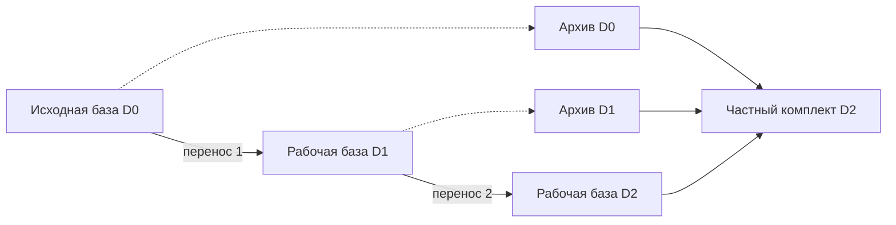

# Цепочка переносов с полным архивом происхождения

Статус: двадцать третий этап локального прототипа. Повторный перенос сохраняет все предшествующие архивы в новом частном каталоге и создаёт очередную рабочую базу со свежими полномочиями. Публичные квитанции `source-transfer-1` сохраняют прежний формат; частные метаданные нового переноса используют schema 2.

Продолжение в версии 0.24.0: [полный workspace backup](workspace-backup.md) сохраняет рабочую DB и все внешние архивы в одном проверяемом частном комплекте. Обычный DB-only backup и сохранённые результаты этого этапа остаются прежними.

- [Предыдущий этап и исходный протокол переноса](source-transfer.md).
- [Прикладной сценарий цепочки](../../examples/source-transfer-chain/README.md).
- [Фактический отчёт запуска](../../examples/source-transfer-chain/results/chain-report.md).

## 1. Задача повторного переноса

Первый перенос разделил активную базу и полный архив её источника. После новой работы активная база содержит собственные предложения и решения, импортированные материалы и зависимости, которые могут ссылаться на более раннюю историю. При следующем переносе одного снимка этой активной базы недостаточно для сохранения всех прежних оснований.

Двадцать второй этап поэтому отклонял уже импортированный источник. Новый протокол сохраняет ограниченную цепочку архивов целиком: прежние архивы копируются побайтно, а остановленный непосредственный источник получает новый согласованный SQLite backup.

Перед каждым переходом непосредственный источник останавливается по обычному протоколу source fence. После переноса он остаётся остановленным. Архивы также сохраняют запрет записи; новой действующей средой становится отдельная база назначения.

Цепочка относится к последовательному локальному происхождению. Она не является механизмом слияния нескольких рабочих ветвей или распределённой службой выбора действующего писателя.

## 2. Что именно переносится

| Часть результата | Правило |
| --- | --- |
| Принятое содержание | Текущие sources и accepted artifacts непосредственного источника |
| Начальная ревизия | Текущая ревизия непосредственного источника R |
| Зависимости | Исходные пять полей каждого текущего dependency record, привязанные к digest |
| Предшествующие архивы | Полные самостоятельные файлы SQLite, скопированные с точным совпадением байтов |
| Новый ближайший архив | Native SQLite backup остановленного источника после reservation |
| Активные полномочия | Новый административный grant; остальные роли выдаются явно |
| Запрет старых секретов | Объединение прежнего denylist и всех credential hashes непосредственного источника |

Старые grants, leases, tasks, proposals, opinions, heads, operations и receipts сохраняются в соответствующих исторических архивах. Активные таблицы назначения начинают новый цикл работы. Исторический proposal ID в dependency record сохраняет значение в контексте происхождения; его наличие не создаёт действующее предложение новой очереди.

## 3. Один каталог с полной цепочкой

### 3.1. Порядок и имена

Опись `archives` упорядочена от самого раннего архива к ближайшему источнику. Последний файл всегда называется `history.sqlite3`; более ранние получают имена `history-0001.sqlite3`, `history-0002.sqlite3` и далее по порядку.

| Каталог после переноса | Файлы истории |
| --- | --- |
| Первый переход D0 → D1 | `history.sqlite3` с остановленной D0 |
| Второй переход D1 → D2 | `history-0001.sqlite3` с D0 и `history.sqlite3` с D1 |
| Третий переход D2 → D3 | `history-0001.sqlite3` с D0, `history-0002.sqlite3` с D1 и `history.sqlite3` с D2 |

Рядом находятся новая `state.sqlite3`, частные intent и manifest и постоянный `.agentwiki-transfer.lock`. Каталог имеет права 0700, частные файлы — 0600. Символические ссылки и неподдерживаемые файловые объекты не заменяют ожидаемые частные файлы.

Завершённый комплект содержит собственные копии всех архивов. Для его проверки не требуется читать прежние каталоги. Сохранённые внутри исторических метаданных старые пути описывают происхождение; они не становятся файловыми зависимостями нового комплекта.

Активная рабочая база по-прежнему привязана к собственному каноническому пути. Самодостаточность истории не разрешает активировать произвольную копию `state.sqlite3` по другому адресу.

### 3.2. Частная запись архива

Каждая запись описи содержит точный набор полей:

| Поле | Назначение |
| --- | --- |
| `name` | Каноническое имя файла в текущем комплекте |
| `bytes` | Закреплённый размер самостоятельного SQLite-файла |
| `sha256` | Частная контрольная сумма точных байтов |
| `receipt` | Публичная квитанция переноса, сохранённого в этом архиве |

Контрольные суммы, полный manifest, origin, denylist и request digest остаются частными. Команда просмотра цепочки возвращает только безопасные квитанции и счётчик архивов.

В origin и manifest поле `archives` содержит полную цепочку. В source reservation оно закрепляет только унаследованную часть с будущими именами назначения: ближайший архив будет создан после сохранения самой reservation и события. Для первого переноса унаследованная часть пуста.

Последняя запись совпадает с ближайшим `history` в manifest и квитанцией текущего переноса. Transfer IDs и workspace IDs не повторяются внутри описи. Сам порядок записей проверяется по содержимому архивов; одного возраста файла или сортировки имени недостаточно.

## 4. Проверка цепочки

### 4.1. Проверка непосредственного источника

Для нового переноса источник обязан находиться по своему первоначальному каноническому адресу. Если он уже импортирован, проверяются его origin, intent, manifest и весь комплект архивов.

Эта проверка выполняется явно даже после source fence. Обычное историческое чтение fenced или quarantine базы сознательно не требует файлов первоначального активного комплекта. Такой режим осмотра не заменяет проверку полноты источника новой миграции.

До закрепления нового назначения проверяются доступность и действующая авторизация исходного администратора, source fence, ограниченные частные метаданные, размеры, контрольные суммы и содержимое всех предшествующих архивов. Подготовленная опись входит в частную привязку нового запроса.

### 4.2. Связи между архивами

Полная проверка каждой исторической базы подтверждает самостоятельный режим `DELETE`, ожидаемую поддерживаемую схему, сохранённую source fence, transfer binding и соответствующее событие с квитанцией. Квитанция должна совпадать с записью описи.

У самого раннего архива нет импортированного предка. У следующего origin указывает на рабочую среду, созданную предыдущим переносом. Для schema 2 закреплённая архивная опись должна совпадать с соответствующим префиксом проверяемой цепочки.

При сравнении префиксов используются квитанция, размер и контрольная сумма. Локальное поле `name` исключается: прежний ближайший `history.sqlite3` закономерно получает порядковое имя при следующем переходе. Содержимое этого файла остаётся побайтно тем же.

Так проверяется сохранённая локальная последовательность переходов. Хеши и квитанции не являются внешней подписью, подтверждением личности администратора или доказательством полноты сведений за пределами доверенной базы.

## 5. Последовательность нового переноса

1. Проверить поддерживаемый источник, частные пути, текущего администратора и source fence.
2. Для импортированного источника строго проверить его исходный комплект и всю предшествующую цепочку.
3. Получить текущие artifacts, источники, зависимости, политики и объединённый набор запрещённых старых credential hashes.
4. Проверить новый административный секрет и все применимые пределы, включая будущие частные метаданные.
5. Закрепить под `BEGIN IMMEDIATE` одно назначение и один точный запрос. Сохранить одно безопасное событие переноса; source fence остаётся прежней.
6. Создать собственный intent назначения и получить частный POSIX `flock` на материализацию.
7. Скопировать предшествующие архивы с точным совпадением байтов и проверить их частные привязки.
8. Создать согласованный native SQLite backup непосредственного источника после reservation как новый `history.sqlite3`.
9. Построить новую базу с импортной ревизией R, anchors, свежим администратором и заново включёнными текущими режимами защиты.
10. Сохранить постоянный ready origin в транзакции новой базы, завершить частный manifest последним и проверить полный результат.
11. Выдать новые роли и аренды для дальнейшей работы; новые предложения проходят обычное рассмотрение и принятие.

Копирование предшествующих архивов использует точные байты самостоятельных файлов. Повторный SQLite backup для них мог бы изменить физическое представление и нарушить уже закреплённую контрольную сумму. Для непосредственного источника новый native backup нужен, чтобы согласованно включить подтверждённое состояние SQLite и только что сохранённую reservation.

SQLite источника и файловая система назначения не образуют общую атомарную транзакцию. После reservation может остаться незавершённая собственная попытка; дальнейший шаг зависит от её распознаваемых частных файлов.

## 6. Зависимости и свежие полномочия через несколько переходов

### 6.1. Сохранение исходного основания

Переносятся `proposal_id`, `baseline_revision`, `readset`, `queries` и `write_ids`. Формат dependency record и формат публичного выпуска не расширяются полями служебной цепочки.

Для неизменённого импортированного артефакта сохраняется прежний anchor с точным digest и dependency record. Если артефакт после прошлого переноса уже принят заново, его очередное основание вычисляется по обычному локальному proposal непосредственного источника. В следующей базе оно становится новым импортным anchor.

Поэтому два документа одной новой среды могут сохранять основания из разных исторических поколений. Их история остаётся доступной в полном наборе архивов. Несовпадение закреплённого digest не превращается в пустой readset или query map.

Ревизия R при каждом переносе равна текущей ревизии непосредственного источника. Это сохраняет ограничение `baseline_revision <= revision` существующего загрузчика выпуска. Прежние промежуточные ревизии остаются в архиве, а новая активная база продолжает собственную историю от импортного основания.

Сохранённые read/query pins поддерживают объявленные проверки актуальности. Они не устанавливают полноту зависимостей для смысла документа, истинность текста или соответствие всей прозы структурированным полям.

### 6.2. Запрет секретов всех предков

Новый denylist объединяет credential hashes непосредственного источника с его унаследованным denylist. Повторный перенос не забывает секреты самых ранних поколений.

Новый административный credential должен отличаться от всех этих значений. При дальнейшей выдаче grant действует тот же запрет повторного использования старых секретов. Private hashes не включаются в CLI, события или публичные отчёты.

Один свежий административный grant не переоформляет прежние leases, opinions или кворум. Авторы, интеграторы, reviewers и координатор получают новые роли и конкретные новые аренды. Новое принятие опирается на текущую политику, точный пакет и свежие полномочия.

## 7. Совместимость форматов и исторические статусы

| Слой | Поддерживаемый договор |
| --- | --- |
| Публичная квитанция и create/status | `source-transfer-1`, прежние поля |
| Новый запрос и частное завершение | Envelope, intent, origin и manifest schema 2 |
| Полная цепочка в новом комплекте | Частная `archives` с безопасными вложенными квитанциями |
| Прежние завершённые комплекты | Чтение schema 1 и точный replay по прежней привязке |
| Публичный просмотр цепочки | `source-transfer-lineage-1` |

Существующий комплект schema 1 не переписывается автоматически. Для него единственный ближайший архив восстанавливается из прежнего manifest и квитанции. Новый переход формирует новый комплект schema 2.

После следующего перехода прежнее назначение становится fenced источником. Его `status` и исторический replay по-прежнему отражают первоначальный факт собственного импорта. Сам факт успешного старого импорта не означает, что база сейчас допускает запись; текущая граница доступности читается отдельно через Store.

`create`, включая replay, требует доступного источника и по-прежнему действующего исходного административного допуска соответствующей source fence. `status` и `lineage` проверяют готовое назначение и его собственные частные архивы. Они не обращаются к прежним исходным каталогам и не предоставляют новые полномочия.

Карантинный snapshot остаётся исторической копией для осмотра. Разрешение читать schema 2 origin в таком файле не превращает его в источник нового активного переноса.

## 8. CLI и Python API

Для каждого перехода новый credential заранее сохраняется в отдельный частный файл с правами 0600. Пример повторного переноса уже остановленной среды:

~~~sh
python3 -m agentwiki store-transfer create \
  --workspace /tmp/my-run/private/new-workspace \
  --destination /tmp/my-run/private/next-workspace \
  --credential /tmp/my-run/private/new-admin.credential \
  --new-administrator next-administrator \
  --new-credential /tmp/my-run/private/next-admin.credential \
  --operation-id source-transfer-02
~~~

Просмотр первоначального результата и всей сохранённой цепочки:

~~~sh
python3 -m agentwiki store-transfer status \
  --workspace /tmp/my-run/private/next-workspace

python3 -m agentwiki store-transfer lineage \
  --workspace /tmp/my-run/private/next-workspace
~~~

Python API сохраняет `transfer_source(...)` и `transfer_status(destination)` и добавляет `transfer_lineage_status(destination)`.

Безопасный ответ `lineage` содержит только:

| Поле | Значение |
| --- | --- |
| `rules_version` | `source-transfer-lineage-1` |
| `workspace_id` | Локальный ID проверенного назначения |
| `archive_count` | Число архивов, равное длине `receipts` |
| `receipts` | Безопасные квитанции от самого раннего переноса к текущему |
| `dependencies_preserved` | `true` |
| `old_authority_transferred` | `false` |
| `external_fencing_established` | `false` |

Имена частных файлов, пути, размеры, контрольные суммы, origin, denylist и request digest в этот ответ не входят. Набор квитанций описывает происхождение рабочего пространства; он не перечисляет все предметные события его SQL-журнала.

## 9. Пределы и стоимость полного архива

| Ограничение | Значение |
| --- | ---: |
| Число архивов в одном комплекте | До 16, включая ближайший источник |
| Суммарный объём архивов | До 1 GiB |
| Размер одного архива и входной базы | До 256 MiB |
| Общий срок отдельной операции | 60 секунд, включая ожидание блокировки |
| Origin JSON | До 1 MiB |
| Manifest и source reservation JSON | До 64 KiB каждый |
| Intent | До 4000 байт |
| Совокупные dependency records | До 512 KiB |
| Artifact anchors и retired credential hashes | До 10 000 каждого вида |
| Канонический путь | До 4096 байт UTF-8 |

Сохраняются ограничения SQL-обхода: до 100 000 строк с `sqlite_sequence`, до 4 MiB на строку. Превышение любого предела вызывает отказ; усечение списка предков, зависимостей или запрещённых credentials не допускается.

Полная копия делает происхождение локально проверяемым и исключает зависимость завершённого комплекта от доступности прежних каталогов. Цена — повторное чтение, проверка и хранение прежних архивов при каждом следующем переносе.

Если условно все архивы имеют одинаковый размер B, один комплект после n переходов хранит около nB байт истории. Если дополнительно сохранять все прежние комплекты без удаления, сумма их архивных частей будет около `B × n(n+1)/2`. Это арифметическая модель при фиксированном B, без учёта роста базы и накладных расходов; фактическое время и стоимость хранения здесь не измерялись.

Ссылка на прежний файловый путь уменьшила бы число копий, но потребовала бы отдельного устойчивого хранилища, правил доступа, удержания и восстановления. Такое внешнее хранилище и дедупликация в текущем протоколе не реализованы.

Обычные транзакции активного Store проверяют метаданные, частные файлы и закреплённые размеры архивов. Полные SHA и SQL-связи цепочки проверяются операциями переноса и просмотра цепочки/статуса; первоначальная контрольная сумма изменяемой активной базы не сравнивается после её нормальной дальнейшей работы.

## 10. Незавершённые попытки и резервирование

Одна source reservation сохраняет одно назначение и точную привязку запроса, включая унаследованные archive pins для нового формата. Другое назначение или отличающийся запрос конфликтуют. Точный повтор сохраняет первоначальную квитанцию и не создаёт ещё одно событие источника.

Локальный `flock` сериализует материализацию одного назначения. Поддерживаемое продолжение требует собственного корректного intent и распознаваемого состояния файлов. Пустая или полностью откатившаяся база, проверенный архив и готовый импорт до manifest могут использоваться как собственные промежуточные результаты в пределах предусмотренного пути.

Ранее скопированный архив предка повторно используется только при полном совпадении размера и SHA. Частичный файл такого архива, включая пустой, не дописывается и автоматически не заменяется.

Непустой повреждённый файл, непроверяемый архив и чужой существующий каталог автоматически не заменяются. При остановке между созданием каталога и записью intent может сохраниться reservation без достаточного файлового подтверждения владения. Автоматического усыновления такого остатка или изменения назначенного пути нет.

Обычный `store-backup` по-прежнему сохраняет одну SQLite-базу. Backup новой среды включает её текущий снимок, origin и собственную SQL-историю, но не внешние файлы `history-*.sqlite3` и `history.sqlite3`. Его restore остаётся в карантине и не активирует прежние полномочия.

Для сохранения всей предшествующей истории требуется отдельно удерживать полный частный комплект архивов и метаданных. Копирование одного main-файла живой WAL-базы не заменяет согласованный SQLite backup. Протокол не предоставляет универсального восстановления после всех точек падения или аппаратных отказов.

## 11. Прикладной сценарий и границы результата

Новый сценарий продолжает первый перенос, затем останавливает полученную рабочую среду, переносит её повторно и выполняет новую работу под свежими полномочиями. Проверяются сохранность текущих материалов и зависимостей, безопасный просмотр цепочки, неизменность прежних архивов и запрет использования старых секретов обоих поколений.

Фактические команды, время, число созданных файлов, решения, ревизии, выполненные отказы и непроверенные случаи находятся в [отчёте запуска](../../examples/source-transfer-chain/results/chain-report.md). Статический обзор механизма не выдаётся за воспроизведение всех аварий и расписаний параллельных операций.

Запуск с новым пустым каталогом:

~~~sh
python3 -m agentwiki source-transfer-chain-demo \
  --workspace /tmp/agentwiki-source-transfer-chain-01 --workers 3
~~~

Участники этого сценария являются программируемыми локальными ролями. Внешние LLM, независимая человеческая экспертиза и измерения предельного числа агентов не входят в заявленный результат. Предлагаемый Python остаётся данными и не исполняется автоматически.

## 12. Дальнейшая работа

Управление архивами требует отдельной политики хранения, наблюдаемости объёма и процедуры работы с частичными остатками. Снятие текущего предела глубины должно сохранять полноту происхождения и запрещённых credentials, а выбранная схема внешнего хранения — явные гарантии доступности и удержания каждого архивного объекта.

Для промышленного переключения также нужны внешняя маршрутизация, доверенные поколения полномочий и согласование уже выполненных внешних эффектов. Старые бинарные версии и прямой SQL доверенного владельца способны обойти кооперативные ограничения приложения. Git, SQLite и удалённая публикация по-прежнему не образуют одну транзакцию.

Содержательная исследовательская задача сохраняется: оценить полноту объявленных зависимостей и пользу рассмотрения на независимо размеченных документах. Полная цепочка истории предоставляет основания для такого анализа; её существование не измеряет смысловую точность документации.
