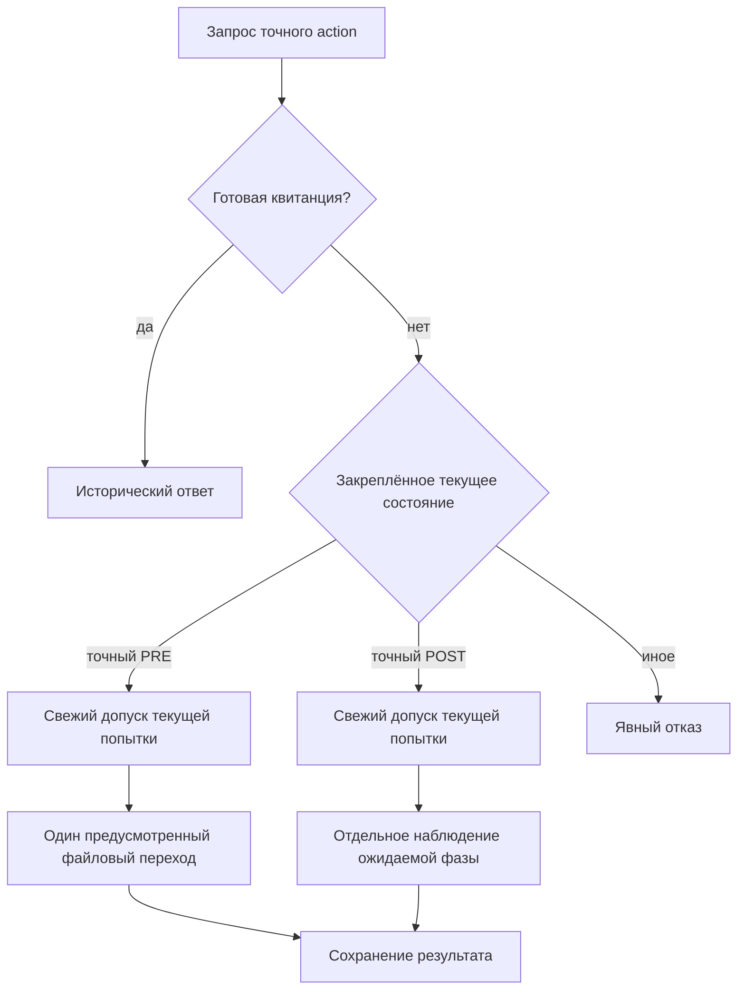

# Шаг записи review с проверкой локального назначения

Статус: тридцать пятый этап локального прототипа. Отдельная запись action связывает одну явно выбранную фазу write job с конкретной попыткой назначения. Action сохраняет компактное неизменяемое намерение и отдельный результат одной фазы; текущее назначение проверяется перед новым выполнением либо фиксацией нового наблюдения.

- [Поэтапная запись review](workspace-restore-case-retention-review-write.md).
- [Явный каталог write jobs](workspace-restore-case-retention-review-write-catalog.md).
- [Локальные аренды позиций каталога](workspace-restore-case-retention-review-write-leases.md).
- [Рассмотрение плана и отдельная актуальность основания](workspace-restore-case-retention-review.md).
- [Дорожная карта](roadmap.md).

## 1. Какую связь добавляет action

Каталог закрепляет исторический предмет, а ledger назначает позицию конкретной локальной попытке. Прежний write job отдельно хранит неизменяемый intent и текущую файловую фазу. Получение claim само по себе не вызывало step и не проверялось прежним прямым step API.

Action добавляет явную связь между выбранным назначением и одной ограниченной операцией записи управляющего review. Caller указывает ledger, индекс, worker, lease ID и поколение; предмет должен соответствовать историческому descriptor выбранной позиции. Проверка этой связи выполняется в собственном протоколе action.

Это действие над сохранением рассмотрения retention plan. Оно не принимает изменение предметного документа, не архивирует и не удаляет данные. Сохранённые actor, verdict и review остаются совещательными фактами прежнего протокола. Worker исполняющего caller и actor исторического мнения — разные сведения: шаг не переписывает actor, verdict либо точное основание review от имени нового обработчика.

## 2. Четыре разных момента

Для разбора результата нужны отдельные события:

| Момент | Что он устанавливает |
| --- | --- |
| Получение claim | Успешное назначение позиции в одном ledger |
| Допуск action | Проверку текущей попытки непосредственно перед поддержанным действием |
| Наблюдение файловой фазы | Состояние закреплённого write job и review destination |
| Сохранённая квитанция action | Исторический результат конкретного запроса, доступный для точного повторения |

Точная старая квитанция claim не подтверждает действительность аренды сейчас. Точное историческое повторение законченного action также не выдаёт новую аренду и не разрешает ещё один шаг. Текущее состояние job и исторический ответ относятся к разным вопросам. Свежая проверка назначения не обновляет сохранённый plan и не выполняет отдельную `revalidate_review`; актуальность предметного основания проверяется своим протоколом.

## 3. Граница локальной координации

Проверка относится к одному ledger и точному поколению его позиции. Независимый ledger может назначить тот же job другой попытке. Копия базы и произвольный процесс вне поддержанного протокола также не становятся частью общей блокировки.

Прежний прямой write step сохраняет собственную job lock и не требует action либо lease. Caller может воспользоваться этим API отдельно. Поэтому новый путь проверяет назначение для своих действий, сохраняя явную границу совместимости со старыми callers.

Worker остаётся самозаявленной строкой. Совпадение worker, lease ID и поколения не удостоверяет principal, личность человека либо независимость модели. Владение доступом к частным файлам не заменяет аутентификацию участника и предметную политику принятия.

## 4. Время допуска и истечение срока

Проверка срока относится к свежему моменту допуска под локальной блокировкой ledger. Wall clock может изменяться, а файловый шаг может занимать время. Такая проверка не является обещанием, что срок не закончится во время fsync или что уже начавшееся действие будет отменено по clock.

Пока поддержанный action удерживает ledger lock, другие соблюдающие этот протокол операции того же ledger ожидают завершения его критической области. Это свойство сериализации одного центра координации. Оно не останавливает старый прямой step, другой ledger либо процесс с прямым доступом к файлам.

Новое поколение позволяет отличить прежнюю попытку от текущей. Для внешнего эффекта поколение должно проверяться там, где эффект выполняется. Локальные проверки не устанавливают распределённого fencing для произвольного внешнего хранилища.

## 5. Две системы сохранения

SQLite ledger и файловые controls write job не образуют одну общую транзакцию. Между проверкой назначения, изменением фазы и сохранением ответа могут существовать отдельные durable границы.

Повтор запроса должен иметь фиксированный предмет и определённое поведение для каждого поддержанного состояния. Он не может просто вызвать следующий step после любого отсутствующего ответа: предыдущий эффект мог уже сохраниться.

Равенство текущей фазы ожидаемому результату само по себе не устанавливает, какой процесс её достиг. Прежний API либо другой допустимый caller мог продвинуть тот же intent. Точный исторический ответ, наблюдение состояния и доказательство исключительного причинения следует описывать отдельно.

Неподдержанный остаток должен оставаться явной причиной остановки. Наличие operation ID не позволяет восстанавливать недостающие случайные identity, усыновлять чужие inode либо перезаписывать несовпадающие записи.

## 6. Много обработчиков и стоимость

Несколько callers могут выбирать разные позиции каталога. Их предметные вычисления могут выполняться независимо, но проверки назначения и ограниченные управляющие переходы одного ledger сериализуются. Ledger lock удерживается и во время файловой фазы: action над другой позицией того же ledger ожидает, даже если его job отдельный. Поэтому новый путь может иметь более длинную критическую область, чем короткий claim/release. Число процессов не определяет число одновременно полезных LLM и не измеряет throughput.

Нужны отдельные измерения ожидания ledger lock, времени файлового шага, доли исторических повторов, отказов stale generation и затрат на полную проверку ограниченного журнала. Эти показатели следует связывать с полезным результатом: сохранённым корректным рассмотрением либо принятым предметным изменением по соответствующей политике.

Прежний предел каталога — до 256 позиций — ограничивает выбранный набор, а не число полезных агентов. У одного ledger может быть несколько действующих назначений, но новый защищённый файловый action проходит их общую критическую область последовательно. Общего численного лимита callers либо action directories этот уровень не задаёт.

Общая job lock по-прежнему ограничивает одновременно выполняемый файловый переход одного intent. Назначение разных позиций не делает их смысловые основания независимыми и не устраняет общие ресурсы файловой системы.

## 7. Применение к технической вики

Для документации единицей назначения может быть рассмотрение конкретного плана, проверка ссылки, обновление примера либо анализ зависимости. У такой единицы должны быть явная identity и точное основание, чтобы поздний ответ не переносился на изменившийся материал.

Action текущего этапа относится к записи review retention plan. Он не распространяет предметные полномочия автоматически на все разделы портала. Для принятия документа нужны прежние проверки proposals, источников, объявленной описи, межфайловых обязательств и действующей политики.

Например, обновление параметра программного API и исправление его описания могут быть двумя отдельными назначениями с общим содержательным требованием. Корректные lease/action receipts не устанавливают, что обе стороны выбрали одну единицу измерения либо что проза полно и истинно описывает поведение программы.

Количество совпавших мнений агентов и квитанций не является независимой экспертизой. Содержательное качество требует отдельно обоснованных источников, полноты предметной описи и независимого оценивания результата при сопоставимом бюджете.

## 8. Частные данные и доверие

Частные source pins, filesystem bindings, request digests и управляющие записи находятся вне Git. Публичный результат должен содержать безопасную identity action, исторический предмет и явные границы полномочий.

Проверка канонических записей и собственных inode устанавливает внутреннюю согласованность поддержанного протокола. Владелец файловой системы может напрямую изменить controls, SQL либо создать копию вне API; эта модель не предоставляет внешнего заверения полноты или авторства истории.

Исходные reviews, plans и каноническая runtime Store сохраняют свои правила. Новое локальное действие не активирует старые grants, не снимает карантин и не превращает самозаявленный verdict в разрешение изменения данных.

## 9. Повтор и наблюдение достигнутой фазы

Протокол различает выполнение своего поддержанного перехода и сохранение наблюдения ожидаемой следующей фазы. Если предыдущий вызов не оставил готовой квитанции, точное соответствие текущего состояния ожидаемому POST позволяет сохранить `expected_phase_observed` после свежей проверки той же действующей попытки. Такой результат не вызывает ещё один файловый шаг и не приписывает прежнее изменение этому action.

Наблюдаемое POST могло появиться в результате старого прямого API, другого caller либо файлового syscall до завершения предусмотренной последовательности fsync. Поэтому само наблюдение не доказывает исключительное причинение, полную последовательность прежних sync-вызовов либо сохранность после потери питания.

Если текущее состояние остаётся сохранённым PRE, новый поддержанный переход получает outcome `phase_performed` и требует свежей проверки той же действующей попытки. Та же проверка нужна для нового `expected_phase_observed`; отсутствие изменения job не превращает pending action в бессрочное разрешение сохранять результат.

Истёкший либо сменившийся исходный claim блокирует новое сохранение результата даже при наблюдаемом POST. При отдельном файловом эффекте и отсутствии durable result такой action может остаться pending; новый claim не переносится в прежний action автоматически.

Для action с before_state=prepared также поддерживается распознанный `staging`: прежний протокол проверяет собственный inode и точный допустимый prefix, после чего заполнение достигает ready. Это продолжение предусмотренного stage, не разрешение менять чужие файлы либо приписывать себе прежние байты.

Если состояние ушло дальше ожидаемого POST либо перестало удовлетворять закреплённым привязкам, протокол отказывает и не выполняет очередной шаг ради совпадения.

| Доступное свидетельство | Поддержанное значение повтора |
| --- | --- |
| Полная сохранённая квитанция | Прежний исторический ответ из собственных controls |
| Нет квитанции, текущий job точно PRE | Возможность одного перехода после свежего допуска |
| Нет квитанции, текущий job точно POST | Свежий допуск, затем отдельное `expected_phase_observed`, без следующего шага и приписывания причины |
| Более поздняя либо неподдержанная фаза | Явный отказ вместо вывода недостающей истории |

## 10. Компактное намерение и пределы реконструкции

Action не копирует полное тело write intent, review либо большой status17. Частный intent15 закрепляет собственную identity, выбранный member6 исходного каталога, ledger/catalog anchors6, точный claim27 и пару фаз before/target. Публичные данные остаются компактными даже при большом историческом плане внутри job.

Полные filesystem pins связывают action с конкретными управляющими файлами. Они служат opaque anchors: по одному SHA, размеру и inode нельзя восстановить отсутствующее тело исходного каталога или job intent. При живом захвате membership проверяется по закреплённому каталогу; историческое собственное чтение action не выдаётся за offline-реконструкцию полного отсутствующего источника.

Каждый собственный intent, result и публичный ответ отдельно ограничен 64 KiB; сохраняются прежние ограничения структуры JSON: 200000 value nodes, глубина 64 и общий cooperative deadline 60 секунд. Ограничение action не расширяет лимиты прежних write jobs либо ledger. В этом же общем времени проверяются прежний job intent до 16 MiB, catalog до 2 MiB, ledger manifest до 3 MiB и DB до 8 MiB с историей не более 1024 успешных операций. Весь вызов отказывает при превышении границы; содержимое не обрезается ради успешного ответа. Глобального реестра action directories и общего ограничения их числа этот уровень не создаёт. Шесть action в прикладном примере — число данного сценария; общая дисковая квота, срок хранения и автоматическое обнаружение action не реализованы.

Готовая сохранённая запись результата читается по собственным controls до новых проверок часов и живого назначения. Pending execute требует текущего доступного закреплённого ledger, выбранного job и review destination. Исходный write catalog после prepare заново не открывается: его сохранённые anchors сверяются с источником неизменяемого manifest ledger. Живой каталог нужен для первоначального захвата prepare; по компактному action его полное отсутствующее тело не реконструируется. Частичный intent либо result остаётся неподдержанным состоянием; протокол не усыновляет такой остаток и не угадывает пропущенные поля.

## 11. Публичные формы

Правила этого уровня имеют имя `workspace-restore-case-retention-review-write-action-1`; `action_id` имеет вид `wrrwa_` и 32 шестнадцатеричных символа. Существующие вложенные write descriptor7 и claim27 сохраняют версии своих прежних протоколов.

### Action22

Неизменяемая квитанция action содержит восемь полей предмета и четырнадцать flags:

- `rules_version`, `action_id`, `operation_id`, `created_at`.
- `write`: компактный исторический descriptor7 выбранного job.
- `lease`: точная исходная квитанция claim27.
- `before_state`, `target_state`: закреплённая пара фаз.

Поддержаны переходы `prepared → ready`, `staging → ready`, `ready → linked` и `linked → completed`. Создание action из `completed` не поддерживается: текущий протокол описывает один новый ограниченный переход.

Квитанция сохраняется при prepare и при точном prepare replay. Она не утверждает, что шаг уже выполнялся или аренда продолжает действовать сейчас. Вложенный исходный claim остаётся историческим фактом своего ledger.

### Wrapper18

Show и execute возвращают четыре поля и те же четырнадцать flags: `rules_version`, `action`, `state`, `result`. Значение `action` — action22; `state` имеет вид `prepared` либо `recorded`. Пока результат не сохранён, `result` равен null. При `recorded` он содержит observation7. Здесь `prepared` обозначает отсутствие сохранённого результата action, а не сегодняшнюю фазу job: job мог уже измениться отдельным caller. `recorded` означает наличие сохранённого action outcome; target ready или linked также даёт recorded action, хотя весь write job ещё не completed.

Show читает сохранённый action и его результат. Он не подменяет этот факт текущим status job. Исторический wrapper не является сегодняшним общим снимком action, lease и файлового назначения.

### Observation7

| Поле | Значение |
| --- | --- |
| `rules_version` | Версия action-протокола |
| `action_id` | Точная identity action |
| `recorded_at` | Сохранённое время записи результата |
| `lease_checked_at` | Свежий момент проверки назначения для этого результата |
| `outcome` | `phase_performed` либо `expected_phase_observed` |
| `observed_state` | Закреплённая target-фаза |
| `effect_performed` | True только для `phase_performed` |

Времена удовлетворяют `created_at ≤ lease_checked_at ≤ recorded_at`, а `lease_checked_at` находится в интервале исходного claim. Сам `recorded_at` может наступить после expires_at: срок проверялся при свежем допуске, не обещал отмену уже начатого файлового шага.

`effect_performed=false` при `expected_phase_observed` означает, что данный вызов не выполнял файловый переход job. Оно не отрицает существование прежних эффектов других callers. Наблюдение не устанавливает их автора либо полную последовательность fsync.

### Четырнадцать flags

Сохраняются тринадцать признаков lease-уровня: `advisory_only=true`, `inspection_only=true`, `domain_writes_allowed=false`, `original_files_modified=false`, `archival_authorized=false`, `deletion_authorized=false`, `actor_authenticated=false`, `old_authority_activated=false`, `external_fencing_established=false`, `coordination_only=true`, `job_steps_enforced=false`, `same_ledger_only=true`, `worker_authenticated=false`.

Добавлен `lease_required_for_new_execution=true`: новый путь требует свежего соответствующего назначения перед выполнением либо фиксацией нового результата. `job_steps_enforced=false` сохраняет общую границу: прежний прямой write step остаётся доступен без этой проверки. Запись result control не является доменным изменением предметного содержания. Унаследованный `inspection_only` относится к полномочиям над предметными данными: подготовка action, фазовая запись review и сохранение результата создают либо изменяют собственные управляющие metadata в предусмотренных местах.

## 12. API и команды

Программный интерфейс `agentwiki.workspace_restore_case_retention_review_write_action`:

- [Реализация](../../agentwiki/workspace_restore_case_retention_review_write_action.py).
- [CLI и публичные формы](../../agentwiki/workspace_restore_case_retention_review_write_action_cli.py).
- [Демонстрационный сценарий](../../agentwiki/workspace_restore_case_retention_review_write_action_demo.py).

~~~python
prepare_review_write_action(
    action, ledger, index=index, worker=worker, lease_id=lease_id,
    generation=generation, operation_id=operation_id, expected_state="prepared",
)
inspect_review_write_action(action)
execute_review_write_action(action)
~~~

Prepare получает точную квитанцию актуального claim и явно ожидаемую before-фазу. Путь job выбирается из закреплённого участника каталога; caller не задаёт произвольное новое назначение внутри execute.

~~~sh
python3 -m agentwiki workspace-restore-case-retention-review-write-action prepare \
  --action /tmp/agentwiki-private/action-position-1-ready \
  --ledger /tmp/agentwiki-private/write-leases \
  --index 1 --worker operator-a \
  --lease-id wrrwl_00000000000000000000000000000000 --generation 1 \
  --operation-id action-position-1-ready --expected-state prepared
~~~

Показанный lease ID иллюстрирует форму аргумента. Для обычного вызова нужны фактические значения успешного claim; произвольный ID не соответствует текущей голове.

~~~sh
python3 -m agentwiki workspace-restore-case-retention-review-write-action show \
  --action /tmp/agentwiki-private/action-position-1-ready
python3 -m agentwiki workspace-restore-case-retention-review-write-action execute \
  --action /tmp/agentwiki-private/action-position-1-ready
~~~

Один action закрепляет одну пару фаз. Operation ID сопоставляется запросу внутри явно выбранного action directory. Общей уникальности ID между разными директориями и автоматического поиска по одному ID здесь нет. Для следующего перехода caller подготавливает отдельный action с новой операцией и явно ожидаемым состоянием. Точный повтор recorded action возвращает старый observation7, даже если job уже ушёл дальше, аренда освобождена либо исходные пути недоступны.

## 13. Частные controls и порядок блокировок

Action размещается в отдельном private sibling directory с правами 0700. Собственные regular controls имеют права 0600, одного владельца и одну ссылку.

| Control | Назначение |
| --- | --- |
| `.agentwiki-restore-case-retention-review-write-action.json` | Неизменяемый intent15 |
| `.agentwiki-restore-case-retention-review-write-action.lock` | Постоянный пустой файл локальной координации |
| `.agentwiki-restore-case-retention-review-write-action.result.json` | Отдельный result6 после успешного сохранения результата |

До сохранения результата предусмотрены intent и lock; после — ровно эти три файла. Неполный либо неподдержанный набор вызывает отказ. Отсутствие result означает pending action; присутствующий частичный result не считается отсутствующим и не перезаписывается.

### Intent15

Точный набор полей: `schema_version`, `rules_version`, `action_id`, `operation_id`, `created_at`, `action_path`, `parent`, `action_directory`, `ledger_anchor`, `catalog_anchor`, `member`, `lease`, `before_state`, `target_state`, `request_digest`.

`ledger_anchor6` содержит `ledger_path`, `ledger_directory`, `ledger_manifest`, `ledger_lock`, `database_pin`, `ledger_id`. Manifest и пустой lock закреплены полными pins; изменяемая SQLite DB — static identity, потому что её поддержанная история может пополняться. Перед новым результатом исходный claim должен оставаться единственным соответствующим последним unreleased claim выбранной позиции.

`catalog_anchor6` содержит `catalog_path`, `catalog_directory`, `catalog_record`, `catalog_lock`, `catalog_request_digest`, `catalog`. Последнее поле — прежняя public catalog16. При prepare живой catalog проверяется под своей lock и сопоставляется с полным закреплённым порядком ledger; выбранный `member6` копируется точно. Новый action должен быть отделён от всех известных job paths этого каталога, в том числе отсутствующих и не выбранных текущим индексом. Для этой проверки используются закреплённые пути membership без дополнительных чтений чужих jobs.

`member6` содержит `index`, `job_path`, `write`, `job_directory`, `job_record`, `job_lock`. `write` — descriptor7; job intent и пустой lock закреплены полными pins. При новом исполнении pins проверяются до разбора текущего job intent, затем его descriptor должен совпасть с выбранным участником и исходным claim27.

Сохранённый `request_digest` связывает остальные поля intent. Он не опубликован и не является внешней подписью. Own show/replay проверяет структуру и канонические привязки action, не обращаясь к этим прежним путям.

### Result6

Точный набор полей: `schema_version`, `rules_version`, `action_id`, `intent_digest`, `observation`, `result_digest`. `intent_digest` должен совпасть с собственным request digest intent; `observation` имеет public observation7. `result_digest` связывает остальные поля result.

Result сохраняется отдельным exclusive созданием канонического файла и fsync собственного каталога. Между изменением job и записью result сохраняется отдельная граница. Готовая квитанция позволяет исторический replay; протокол не называет эти две системы общей транзакцией и не чинит частичный result.

### Блокировки и время

Порядок нового выполнения — action lock → ledger lock → job lock → review lock. SQLite history ledger читается и валидируется под ledger lock; действие не добавляет lease operation и не освобождает назначение автоматически. Запись результата остаётся внутри соответствующей критической области.

Prepare выполняет preflight capture до резервирования action, затем повторяет захват под собственным action lock. В capture порядок — ledger lock → временная catalog lock; catalog lock освобождается до job/review locks. Последняя проверка clock и исходного claim делается в захваченной области перед сохранением intent либо новым действием.

Кооперативный deadline 60 секунд передаётся вложенным операциям. Старый публичный step с новым отдельным deadline не вызывается поверх уже взятых locks: новый путь использует предусмотренные одиночные фазовые primitives при удержании прежних job/review locks.

Истечение срока не освобождает job, не отменяет уже начатый файловый syscall и не записывает release. Поддержанный action не выполняет доменную запись в Store и не меняет историю назначений; отдельные последующие claim/release остаются операциями своего ledger.

## 14. Выполненный development-сценарий

Обычный сценарий завершился с первой попытки 22 октября 2026 года в 17:19:06 Europe/Berlin. Машинный отчёт сохранил `2026-10-22T17:19:06.796838+02:00`. Это выполненный локальный запуск; прерывание процесса, ожидание expiry, регресс часов и частичный result в нём не воспроизводились.

| Показатель | Фактический результат |
| --- | --- |
| Экспорт | 413 плоских публичных файлов: 396 JSON и 17 Markdown |
| Повторённое основание | 395 файлов прежнего lease-сценария |
| Добавлено этим этапом | 18 файлов: шесть stages, десять data JSON и два отчёта |
| Action intents | Шесть; четыре с результатом и два pending |
| Outcomes | Три `phase_performed`, одно `expected_phase_observed` |
| Новый write job и review | По одному; всего четыре write jobs и шесть reviews |
| Новый write catalog и ledger | По одному; всего три каждого вида |
| Lease history | Четыре новых события; всего шестнадцать в трёх ledgers |
| Lease pages | Четыре нового ledger и две совместимости прежних ledgers |
| Catalog pages | Две нового каталога |
| Новые ordinary CLI | 74: 55 успешных и 19 ожидаемых отказов |
| Action-команды | 45: 29 успешных и 16 ожидаемых отказов |
| Составной сценарий | 587 ordinary CLI и 14 прежних interrupt workers, 601 различный дочерний PID |
| Новые fault workers, injected partial writes | Ноль |

### Последовательность

Новый job закрепил точный исторический minimum plan и verdict `defer`. Его actor — `simulated-action-review-operator`; workers двух поколений — `simulated-action-worker-a` и `simulated-action-worker-b`. Эти разные самозаявленные метки сохранились отдельно; action не переписал мнение от имени исполнителя.

Новый одноэлементный catalog и ledger выбрали этот job. Claim поколения 1 позволил подготовить action `fill` для prepared→ready. Начальный show вернул prepared wrapper с result null; точный prepare replay сохранил action22.

Два обычных execute процесса запущены до сбора ответов для одного `fill`. Они вернули одну и ту же сохранённую квитанцию `phase_performed`, а job достиг только ready. Show и следующий execute вернули тот же результат; ledger сохранил одно claim-событие. Перекрытие выполнения, задержка ожидания и throughput не измерялись.

Action `stale` был подготовлен для ready→linked по поколению 1. После release и claim поколения 2 его execute отказал `lease_changed`, не изменив job и не сохранив result. Собственный show остался prepared, хотя job находился в ready.

Три action поколения 2 — `link`, `observe`, `beyond` — закрепили ready→linked. `link` выполнил переход; `observe` затем сохранил `expected_phase_observed` с effect_performed=false, и job остался linked. `Beyond` сохранился pending до последующей проверки более поздней фазы. Отдельный `finish` закрепил linked→completed.

Для `finish` исходный write catalog временно отсутствовал. Execute завершил поддержанный переход по собственным captured anchors и доступным ledger/job/review controls. Настоящий ответ отброшен после проверки и затем восстановлен точным replay; сравнительный digest остался в памяти демонстратора. Повтор не изменил action/job/review metadata и не продлил lease.

После completed попытка execute `beyond` отказала `phase_changed`: нынешняя фаза ушла дальше его target linked. Result этого action не создан. После release поколения 2 одновременно отсутствовали четыре пути: catalog, ledger, job и review destination. Исторические show/execute четырёх recorded actions, prepare replay `fill` и show двух pending intents работали по собственным controls. Все пути возвращены в finally; прежние blocked restore jobs не перемещались.

### Согласованность и границы наблюдений

Конечный job — completed, записанный review равен прежнему intended_review. Четыре action results описывают ready, linked либо completed по своей фиксированной паре; их число не означает четыре независимых рассмотрения или четыре review records. Два pending actions не описывают job как невыполненный.

Девятнадцать ожидаемых отказов включают девять action invalid_input, четыре конфликта точного prepare replay, два lease_changed, один phase_changed и три прежних blocked restore status. Проверены scalar bounds, malformed IDs, несовместимые повторные параметры, освобождённый claim, устаревшее поколение и фаза за пределом target.

Прежние три write jobs и lease pages сохранились. Source остался R4/36 событий, live — R5/59. Публичное Store-сравнение исключало только верхний вычисляемый governance observed_at. Новые action не добавляли SQL lease events, не обновляли срок и не вызывали старый direct step для нового job.

Metadata прежних private controls захватывались после инициализации Store и начальных публичных Store-наблюдений. Сравнение доказывает неизменность относительно этой явной границы; оно не относится к состоянию до открытия Store. Directory times, меняющиеся при rename, не использовались как доказательство нарушения статической identity.

Демонстратор читает public API ответы и lstat metadata. Private intents/results, SQL lease rows и stage contents он не открывает. Реальное прерывание, повреждённый либо частичный result, потеря питания, отказ хранилища, истечение аренды и регресс часов этим запуском не проверены. Описанный source-supported staging continuation также не выдаётся за выполненную демонстрацию прерывания.

### Публичные основания

- [Читаемый отчёт](../../examples/workspace-restore-case-retention-review-write-action/results/restore-case-retention-review-write-action-report.md) и [машинный отчёт](../../examples/workspace-restore-case-retention-review-write-action/results/restore-case-retention-review-write-action-report.json).
- [Шесть action](../../examples/workspace-restore-case-retention-review-write-action/results/restore-case-retention-review-write-action-actions.json), [четыре recorded results](../../examples/workspace-restore-case-retention-review-write-action/results/restore-case-retention-review-write-action-recorded.json) и [два pending intents](../../examples/workspace-restore-case-retention-review-write-action/results/restore-case-retention-review-write-action-pending.json).
- [Выполнение, фазы и controls](../../examples/workspace-restore-case-retention-review-write-action/results/restore-case-retention-review-write-action-execution-observations.json), [lease observations](../../examples/workspace-restore-case-retention-review-write-action/results/restore-case-retention-review-write-action-lease-observations.json) и [восстановление ответа](../../examples/workspace-restore-case-retention-review-write-action/results/restore-case-retention-review-write-action-reply-recovery.json).
- [CLI-исходы](../../examples/workspace-restore-case-retention-review-write-action/results/restore-case-retention-review-write-action-cli-outcomes.json), [отказы](../../examples/workspace-restore-case-retention-review-write-action/results/restore-case-retention-review-write-action-rejections.json), [source](../../examples/workspace-restore-case-retention-review-write-action/results/restore-case-retention-review-write-action-source-observations.json) и [live](../../examples/workspace-restore-case-retention-review-write-action/results/restore-case-retention-review-write-action-live-observations.json).

## 15. Отдельные сверки завершённого запуска

После обычного сценария аудиторы читали завершённые результаты. Прикладной запуск для этих сверок повторно не выполнялся.

- Новый частный аудитор с первой попытки проверил шесть intent15, четыре result6 и два pending action, их canonical bindings и доступные исходные anchors. Согласованы новый write intent13, завершённый review14 с точной реконструкцией известного исторического plan14, закреплённый inode и single link. Новый catalog11/member6 и ledger11 с четырьмя SQL-событиями соответствуют сохранённым данным. SQLite открывалась read-only; integrity/fk, private bytes и metadata до/после согласованы. Компактный action сам по себе не выдавался за реконструкцию полного отсутствующего каталога либо job intent.
- Прежний частный аудитор подтвердил сохранность прежних restore/case/retention/review/write/catalog привязок без ремонта. Отдельная прежняя lease-сверка прошла с первой попытки: 504 проверки, двенадцать прежних SQL operations и 25 повторных представлений страниц двух исходных ledgers. Четыре события нового ledger проверены отдельно; их сумма с прежними даёт шестнадцать.
- Proof-сверка с первой попытки восстановила пять полных packets, четыре перехода, шесть content-политик, восемь governance-политик, один audit root и три checkpoint edges/scopes. Подтверждены 3318 повторных acceptance/continuity references; два checkpoint pending и один history_complete. Счётчик повторных ссылок не измеряет число независимых решений либо истинность текста.
- Независимый публичный schema-аудит с первой попытки проверил 413 файлов: 396 strict JSON, 17 Markdown и 391 относительную ссылку результатов. Согласованы все 74 новых CLI labels/actions, ожидаемые коды отказов и 601 различный PID. Во всём публичном forest проверены 72 вхождения action22, 50 wrapper18 и 39 observation7; это повторные представления шести action и четырёх результатов. Вложенные 119 write catalog16, 47 catalog page9, по 108 entry/current3, 53 ledger20, 113 lease operation27, 37 lease page22, 382 descriptor7, 179 write17, 378 review16, 405 plan17 и по 1765 retention row/observation согласованы с сохранёнными данными.
- Отдельный публичный обзор прежнего основания также прошёл с первой попытки: 167430 логических сравнений и 395 побайтных сравнений прежних публичных копий. Он сохраняет границу унаследованного сценария; новая action-сверка рассматривает добавленный уровень отдельно.

- Новый focused public обзор также прошёл с первой попытки: 2767 логических сравнений и 18 побайтных сравнений новых копий, всего 2785. Строго разобраны 17 новых JSON, проверены один Markdown и восемнадцать ссылок. Согласованы все 74 CLI, 82 поля summary, шесть полных stage payloads и повторные 72 action22/50 wrapper18/39 observation7. Суммарно два публичных comparison-обзора дали 170197 логических и 413 побайтных сравнений, всего 170610. Это счётчики сравнений сохранённых данных, не измерение независимой экспертизы либо качества текста.
- Privacy/preservation-сверка с первой попытки подтвердила побайтную сохранность 4769 прежних защищённых файлов и 413 экспортированных копий. Разобраны 4835 JSON и 101 Python-исходник; 34 прежних модуля и десять прежних SCHEMA-литералов не изменились. В 5342 кандидатах публикации не обнаружены 374 известных credentials, их хеши и 303 частные контрольные суммы/привязки. Шесть action intents, четыре result, три lease DB с шестнадцатью операциями, четыре write intents, шесть reviews и три write catalogs остались частными. Пересчитаны адреса 214 full packet instances, 3318 continuity chains, 228 transitions, 11 audit headers и 13 checkpoints.

Обычный прикладной сценарий и все восемь отдельных read-only путей сверки прошли с первой попытки. Исходники продукта и результаты запуска не ремонтировались, повтор прикладного выполнения после ошибки не потребовался. Публичные аудиторы не импортировали продукт и не читали runtime private files; частные аудиторы работали отдельно и не выводили private values.

## 16. Дальнейшее развитие

Следующая самостоятельная задача — определить аутентифицированного исполнителя action и область его допустимых эффектов. Она требует явного источника identity, проверки действующего допуска и правил, связывающих этот допуск с точной попыткой. Подтверждение локального principal также должно сохранять границу между правом действия, личностью человека и независимостью экспертизы.

Отдельно нужны обоснованные состояния между файловым эффектом и durable action result, правила для истёкшего исходного claim без результата, частичного bootstrap/result и отказов хранилища. Предусмотренный PRE/POST и точный replay не устанавливают обработку всех аварийных расписаний либо аппаратную сохранность.

Практическое масштабирование требует измерить длительность ledger critical section с реальным размером review, ожидания других позиций и полезный результат при одинаковом бюджете. Сокращение этой области потребует новой доказанной связи поколения и места эффекта. Несколько независимых ledgers, старый direct step и прямой файловый доступ остаются отдельными границами координации.

Нужны также дисковые квоты и жизненный цикл множества action directories, политика удержания завершённых и pending records и работа с заполненной lease history. Текущий per-control размер не ограничивает общий объём всех созданных actions.

Для технической вики дальнейшая предметная работа — полнота описи, источники, связи между затронутыми разделами и независимое оценивание смысловых изменений. Сохранённый action делает ход управляющей записи обозримым; истинность и полезность документации требуют своих проверяемых оснований.
