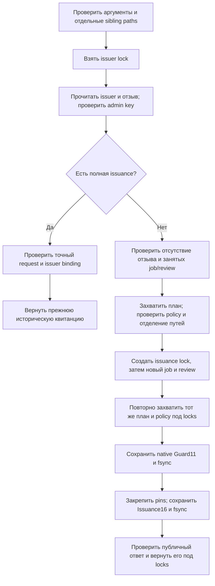

# Политика выдачи ключа для guarded review write job

Тридцать девятый этап agentwiki добавляет отдельного локального издателя для [guarded задания записи review](workspace-restore-case-retention-review-write-guarded.md). Администратор закрепляет неизменяемую политику, а управляемая выдача создаёт новое native guarded job с отдельным ключом держателя и сохраняет собственную историческую квитанцию.

Реализация остаётся локальным прототипом. Политика управляет выбранным способом выдачи; поддержанный native `step` продолжает проверять ключ держателя и его отзыв по правилам предыдущего этапа. Издатель не проверяется при каждом шаге. Содержательное принятие документации и внешнее удостоверение личности этим протоколом не устанавливаются.

- [Прикладной сценарий](../../examples/workspace-restore-case-retention-review-write-guarded-issuer/README.md).
- [План развития](roadmap.md).
- [Журнал разработки](activity.md).

## 1. Зачем нужен отдельный издатель

Guarded job требует credential непосредственно в своём поддержанном `step`. Предыдущий `prepare` позволяет владельцу частной файловой среды создать такой credential и зафиксировать будущий review. Для организованной работы нескольких участников нужен ещё один явный договор: какой principal, actor и verdict разрешено выдать по какому сохранённому плану.

Новый issuer хранит этот договор отдельно от job. Его admin key разрешает новую управляемую выдачу; holder key разрешает дальнейшие шаги одного созданного job. Разные ключи позволяют независимо остановить будущую выдачу и доступ к уже созданному заданию.

Прежний самостоятельный guarded `prepare` сохраняется как отдельный поддержанный путь владельца среды. Новый issuer не превращается в обязательный глобальный реестр всех заданий.

## 2. Точная область политики

Политика содержит от одного до шестнадцати упорядоченных правил. Каждое правило имеет ровно пять полей:

| Поле | Что закрепляется |
|---|---|
| `rule_id` | Локальный ID правила |
| `principal` | Самозаявленная метка будущего держателя |
| `actor` | Самозаявленный actor фиксируемого review |
| `verdict` | `reviewed`, `defer` либо `request_fresh_plan` |
| `plan_id` | Точный retention plan ID вида `wrrp_` и 32 hex |

Новая выдача требует ровно одного точного совпадения всех четырёх полей scope. Списка приоритетов, wildcard и выбора первого подходящего правила нет. Повторные ID и два правила с одинаковым scope отвергаются, даже если их `rule_id` различается. Порядок списка сохраняется и участвует в точном повторе создания issuer.

Политика ссылается на identity сохранённого плана. При выдаче считывается и проверяется полный private plan, а его публичный `plan_id` сопоставляется с правилом. Это не перепроверка текущих cases, баз либо смысла текста: создаваемый review сохраняет историческое основание того плана.

Пути, pins, контрольные суммы и ключи в публичную policy не включаются.

## 3. Какие полномочия разделены

| Локальный ключ | Поддержанные возможности |
|---|---|
| Issuer administrator | Новая управляемая выдача, точный её повтор при сохранённом issuer, отзыв issuer |
| Native guard holder | Три фазы своего guarded job, защищённый повтор сохранённых phase responses, отдельный отзыв guard |
| Чтение собственных публичных квитанций | `show` issuer и `receipt` issuance не требуют admin secret |

Holder key должен отличаться от admin key по SHA-256; сравнение выполнено через `compare_digest`. Публичные labels `administrator`, `principal` и `actor` не удостоверяют человека, организацию или отдельную модель.

Все процессы здесь работают в одной доверенной файловой среде. Owner FS может читать свои ключи, обращаться к частным helpers и выполнять прямые системные вызовы. Отдельные UID, OS sandbox, внешняя identity и распределённое fencing не реализованы. Базовая граница native guarded step остаётся обязательной среди его известных поддержанных API.

## 4. Частные каталоги и форматы

Пять нормализованных путей issuer, issuance, plan, review и job должны быть различными соседними каталогами одного private parent. Parent и каталоги имеют режим0700. Записи и пустые постоянные locks имеют режим0600, текущего владельца и одну ссылку; symlink отвергается.

Issuer содержит:

```text
.agentwiki-restore-case-retention-review-write-guarded-issuer.json
.agentwiki-restore-case-retention-review-write-guarded-issuer.lock
.agentwiki-restore-case-retention-review-write-guarded-issuer.revoked.json  # после отзыва
```

Issuance содержит только:

```text
.agentwiki-restore-case-retention-review-write-guarded-issuance.json
.agentwiki-restore-case-retention-review-write-guarded-issuance.lock
```

Native job создаётся в прежнем guarded формате. Прежние legacy write intent и lock в него не добавляются. Его staging и три phase-result slots сохраняют правила предыдущего этапа.

Новые immutable records создаются эксклюзивно, записываются каноническим JSON, проходят fsync файла и каталога. Частичные issuer, issuance, guard bootstrap и чужие entries не усыновляются и не ремонтируются.

### Issuer12 и Revoke7

Issuer12 содержит `schema_version`, `rules_version`, `issuer_id`, `operation_id`, `created_at`, `issuer_path`, `parent`, `issuer_directory`, `administrator`, `credential_hash`, `policy`, `request_digest`.

Revoke7 содержит `schema_version`, `rules_version`, `issuer_id`, `operation_id`, `revoked_at`, `grant_digest`, `request_digest`. `grant_digest` закрепляет исходный issuer record; `revoked_at` не раньше его `created_at`. Digest записи вычисляется без собственного поля digest.

### Issuance16

Сохранённая квитанция имеет ровно шестнадцать полей:

```text
schema_version, rules_version, issuance_id, operation_id, created_at,
issuance_path, parent, issuance_directory,
issuer_anchor, issuer, rule, guard_anchor, guard, plan_id, request,
request_digest
```

Request7 хранит точные `plan_path`, `review_path`, `job_path`, `principal`, `actor`, `verdict`, `holder_credential_hash`.

IssuerAnchor4 хранит путь, static directory pin и полные file pins issuer record/lock. GuardAnchor4 хранит путь job, static directory pin и полные file pins native guard record/lock. Пустые locks и максимальные размеры проверяются отдельно.

Эти private anchors фиксируют файловые привязки при выдаче. Самостоятельное последующее чтение issuance проверяет их закрытую структуру, собственный digest и публичные связи. Оно не читает живые указанные targets и не реконструирует отсутствующие полные issuer/guard bodies. При создании проверяется полный native guard; отдельный private audit может сопоставить его с сохранённой квитанцией.

## 5. Почему в квитанции отдельный plan_id

Native Guard22 намеренно компактен: он содержит descriptor будущего review, principal и время, но не весь захваченный план. Новый receipt добавляет scalar `plan_id`, полученный из полного captured native guard при выдаче.

Pure validator сопоставляет этот scalar с выбранным правилом; principal, actor, verdict, operation ID и времена сопоставляются с Guard22. Private audit отдельно устанавливает равенство с `guard.write.review_record.plan_snapshot.plan_id` и проверяет полный private план по прежней offline-реконструкции.

Так сохраняется компактная квитанция до64КиБ. Полный plan17 не дублируется и не маскируется неполным объектом с прежней rules version. Компактная квитанция остаётся историческим свидетельством выполненного протокола выдачи в доверенной файловой среде.

## 6. Порядок новой выдачи



Неверный admin credential отказывает до чтения issuance либо live plan/job/review. Holder secret должен иметь допустимый формат и отличаться от admin. Для новой выдачи отзыв issuer проверяется до обращения к живому плану. Занятые native job/review отвергаются; уже существующий guard не становится новой managed issuance.

Preliminary capture валидирует полный сохранённый plan. Policy mismatch отказывает до mkdir. Issuer, issuance и job исключаются из известных source/catalog/case bindings по прежним правилам разделения; review проверяется capture helper.

После резервирования выполняется повторный захват. Он должен точно совпасть с preliminary capture; правило проверяется заново. Native guard получает время не раньше issuer и captured plan; issuance получает время не раньше native guard. Запись Guard11 сохраняет полный прежний intent13 и review14.

## 7. Locks и общий deadline

Долговременный порядок блокировок:

```text
issuer → issuance → native guarded job → review
```

Во время захвата плана временно берётся plan lock. Этот lock освобождается до дальнейших файловых эффектов. Другие callbacks, чужой Python и пользовательские fault hooks протоколом не исполняются.

Весь запрос имеет один кооперативный deadline60секунд. Вложенный helper не начинает новый интервал. New issuer не вызывает публичный guarded `prepare`: это сбросило бы deadline и освободило native locks до сохранения внешней квитанции. Локальный context manager использует ту же ограниченную последовательность fresh native allocation и прежние validators/primitives.

Job и review locks удерживаются через fsync issuance и финальную проверку ответа. Это не даёт поддержанному native step начать фазу посередине обычной managed выдачи. Кооперативный deadline не откатывает уже выполненные системные вызовы.

## 8. Неатомарное окно после Guard11

Native Guard11 становится durable раньше внешнего Issuance16. Файловые записи в разных каталогах не образуют одну транзакцию.

Если сохранение issuance receipt завершится ошибкой, могут остаться полностью действующий native guard и заранее сохранённый holder credential. После освобождения locks обычный native guarded step способен использовать этот guard. Поэтому ошибка внешнего `issue` не доказывает отсутствие capability или эффекта.

Повтор новой managed выдачи такой guard не усыновляет. Lock-only или частичная issuance тоже не ремонтируется. Отзыв issuer не отзывает возникший native guard; для него действуют отдельные правила holder revoke. Нет автоматического rollback, удаления, recall или компенсирующего отзыва по ошибке outer request.

На этом этапе такое окно не воспроизводится искусственным повреждением. Демонстрация должна терять только целый успешный публичный ответ после завершённой записи receipt. Это другой случай: сохранённая полная квитанция позволяет exact replay.

## 9. Точный повтор и own receipt

| Операция | Необходимое основание | Требуется ли live plan/job/review |
|---|---|---|
| Новый `issue` | Действующий issuer, admin key, совпавшая policy, новый native target | Да, при захвате и создании |
| Exact `issue` replay | Тот же issuer, admin key, request, holder hash и полная issuance | Нет |
| `receipt` | Полная собственная issuance и её metadata | Нет; issuer тоже не требуется |
| `show` issuer | Собственные issuer controls и marker отзыва | Нет |
| Exact create/revoke replay | Собственные issuer controls и исходный admin key | Нет |

Exact issue replay сначала проверяет admin key. Затем сравниваются operation ID, все семь request fields, holder hash через `compare_digest`, полные issuer anchors и публичное неизменяемое тело issuer. Ответ возвращается до проверки отзыва, нового clock и live native targets.

Следовательно, прежняя полная выдача может повториться после issuer revoke. Это возврат исторической квитанции. Возвращаемый Issuance24 не описывает текущую фазу child job и не объявляет его активным. Для текущего состояния служат native `show`/`status`.

Own `receipt` не требует admin secret и может работать при недоступном issuer. Исторический доступ к публичной квитанции не даёт ключ holder и не разрешает native step.

## 10. Два независимых отзыва

Issuer revoke требует исходный admin key и сериализуется той же issuer lock с выдачей. Новая выдача после marker отказывает; точный повтор уже сохранённой выдачи остаётся доступен при том же admin key. Повтор revoke с тем же ID возвращает сохранённый результат, другой ID конфликтует.

Native holder revoke использует прежний guarded API. Он закрывает новые шаги и защищённую выдачу сохранённых step responses своего job. Он не удаляет issuance receipt и не переписывает факт прежнего policy match.

Нет TTL, unrevocation, regrant, глобального реестра ключей либо общего монотонного clock всех отдельных issuance records. Marker issuer проверяется относительно его исходного `created_at`; это не история всех выдач с общей CAS-головой.

## 11. Публичные формы и flags

Публичные ответы нового семейства имеют закрытые формы:

| Форма | Число полей | Назначение |
|---|---|---|
| Issuer |21|Неизменяемая policy, administrator label и identity |
| Show |19|Issuer и отдельный active/revoked state |
| Revocation |5|Исторический marker admin revoke |
| Issuance |24|Issuer, выбранное rule5, native Guard22 и scalar plan_id |

Общие пятнадцать flags:

```text
advisory_only=true, inspection_only=true,
domain_writes_allowed=false, original_files_modified=false,
archival_authorized=false, deletion_authorized=false,
actor_authenticated=false, old_authority_activated=false,
external_fencing_established=false,
local_capability_only=true, external_identity_verified=false,
issuance_policy_only=true, existing_guards_revoked=false,
guarded_step_credential_required=true, os_isolation_established=false
```

`policy_authorized=true` в issuance относится к точному историческому matching при создании native guard. Он не добавляет policy check в каждый native step.

Поэтому прежний native Guard22 сохраняет `issuer_policy_enforced=false` и `lease_enforced=false`. Его `credential_required_for_step=true` продолжает обозначать обязательность holder credential среди поддержанных native APIs. Flags нового issuer и native guard описывают разные точки протокола.

## 12. API и CLI

Пять новых API:

```text
create_guarded_review_write_issuer(issuer, *, operation_id,
    administrator, credential, policy)
inspect_guarded_review_write_issuer(issuer)
revoke_guarded_review_write_issuer(issuer, *, operation_id, credential)
issue_guarded_review_write(issuer, issuance, plan, review, job, *,
    operation_id, actor, verdict, principal, issuer_credential, credential)
inspect_guarded_review_write_issuance(issuance)
```

CLI: `workspace-restore-case-retention-review-write-guarded-issuer` с подкомандами `create`, `show`, `revoke`, `issue`, `receipt`.

Ниже предполагаются существующий private parent и действительный retention plan. `guarded_plan_id` следует получить из публичного `workspace-restore-case-retention show`; примерный ID заменяется фактическим.

```sh
guarded_plan_id=wrrp_0123456789abcdef0123456789abcdef
python3 -m agentwiki workspace-restore-case-retention-review-write-guarded-issuer create \
  --issuer /tmp/agentwiki-private/review-issuer \
  --operation-id create-review-issuer-01 --administrator simulated-admin \
  --rule review-policy-01 simulated-holder simulated-reviewer defer "$guarded_plan_id" \
  --credential-out /tmp/agentwiki-private/review-admin.credential
python3 -m agentwiki workspace-restore-case-retention-review-write-guarded-issuer issue \
  --issuer /tmp/agentwiki-private/review-issuer \
  --issuance /tmp/agentwiki-private/review-issuance-01 \
  --plan /tmp/agentwiki-private/retention-plan \
  --review /tmp/agentwiki-private/new-review --job /tmp/agentwiki-private/new-job \
  --operation-id issue-review-01 --principal simulated-holder \
  --actor simulated-reviewer --verdict defer \
  --issuer-credential-file /tmp/agentwiki-private/review-admin.credential \
  --holder-credential-out /tmp/agentwiki-private/review-holder.credential
python3 -m agentwiki workspace-restore-case-retention-review-write-guarded-issuer receipt \
  --issuance /tmp/agentwiki-private/review-issuance-01
```

Для exact issue replay используются тот же запрос и `--prepared-holder-credential` вместо `--holder-credential-out`. Для exact create replay используется `--prepared-credential`. Существующий credential-файл никогда не перезаписывается.

Native шаг по выданному job остаётся отдельной командой:

```sh
python3 -m agentwiki workspace-restore-case-retention-review-write-guarded step \
  --job /tmp/agentwiki-private/new-job --operation-id fill-review-01 \
  --expected-state prepared \
  --credential-file /tmp/agentwiki-private/review-holder.credential
```

Следующие два native шага используют `--expected-state ready` и `linked` с отдельными ID. Они завершают ту же зафиксированную review. Issuer revoke не изменяет эти правила:

```sh
python3 -m agentwiki workspace-restore-case-retention-review-write-guarded-issuer revoke \
  --issuer /tmp/agentwiki-private/review-issuer --operation-id revoke-review-issuer-01 \
  --credential-file /tmp/agentwiki-private/review-admin.credential
python3 -m agentwiki workspace-restore-case-retention-review-write-guarded revoke \
  --job /tmp/agentwiki-private/new-job --operation-id revoke-review-holder-01 \
  --credential-file /tmp/agentwiki-private/review-holder.credential
```

## 13. Хранение ключей, пределы и ошибки

CLI принимает ключи только через отдельные sibling `.credential` файлы того же private parent: режим0600, owner текущего UID, nlink1, размер до256байт, без symlink и со стабильными metadata при чтении. Перед генерацией отвергаются aliases всех пяти каталогов и совпадающие пути admin/holder.

Генерируемый файл и parent проходят fsync до вызова core. Общей транзакции key-file с issuer/job/issuance нет. После отказа core ключевой файл может остаться; bootstrap не ремонтируется автоматически. Secret не принимается literal-аргументом и не выводится в stdout.

Private issuer, issuance, revocation и их публичные формы ограничены64КиБ. Полный native Guard11 сохраняет прежний предел16МиБ. JSON ограничен200000узлами, глубиной64, integer256bit, конечными float и UTF-8 строками.

Безопасный префикс ошибок: `workspace_restore_case_retention_review_write_guarded_issuer_`. Поддержаны `invalid_input`, `private_path_required`, `limit_exceeded`, `conflict`, `incomplete`, `record_invalid`, `source_changed`, `credential_invalid`, `revoked`, `clock_regressed`, `policy_denied`, `io_failed`, `summary_invalid`; внешний CLI fallback сообщает непрозрачный `command_failed`.

## 14. Что требуется показать в обычной демонстрации

Сценарий продолжает предыдущий guarded demo в новом private workspace. Планируется один новый issuer с одним allow rule, одна successful issuance, один новый retention plan, один native guard/review и два новых ключа.

Демонстрация должна отдельно сохранить:

1. Policy mismatch по principal, actor, verdict и plan ID до резервирования; отказ duplicate ID/scope.
2. Отказ чужого admin key, использования holder как admin и admin как native holder.
3. Отказ новой issuance при попытке усыновить существующий native guard.
4. Действительно отброшенный целый успешный issuance-response.
5. Завершение native child после issuer revoke при действующем holder key.
6. Точный managed replay после завершения и отзыва, когда только новые plan/review/job недоступны.
7. Own receipt lookup при дополнительно недоступном issuer; восстановление всех четырёх новых путей в `finally`.
8. Отдельный holder revoke, отказ cached native step и сохранение исторической issuance.
9. Совместимость old review reader и неизменность всех исходных control metadata.

Driver читает публичные responses, разрешённые credential markers и lstat metadata. Private control bodies, SQL rows и staging contents ему не требуются. Завершающие read-only аудиторы отдельно сопоставляют закрытые schemas, hashes/pins, native captured plan, bytes и публичные проекции.

Фактический запуск и его результаты фиксируются после исполнения. Новые fault workers, искусственное окно между Guard11 и issuance, expiry waits и новые tests этим описанием не объявляются выполненными.

## 15. Теория работы N агентов

Для одного issuer N соблюдающих протокол callers конкурируют за одну issuer lock. В каждый момент новый управляемый запрос допускается одним держателем этой lock. Exact replay тоже согласуется с этой lock и не создаёт второй native job.

После выдачи у разных child jobs свои locks и holder credentials. Их фазы могут перекрываться во времени при действительно раздельных назначениях. Отзыв issuer управляет будущей выдачей, а holder revoke каждого job — дальнейшей работой этого job. Общая очередь, квота выдач, автоматическое назначение или уникальность principal для одного плана здесь не возникают.

Одна policy может разрешить несколько разных новых jobs по тому же плану. Разные issuer независимы. Наличие одинакового plan ID не обеспечивает единственного редактора, независимого автора либо отсутствия смыслового конфликта.

Размер исходного пула3 относится к унаследованному сценарию. Число CLI/PID во всём последовательном demo не измеряет максимальное число одновременных агентов, LLM throughput или полезность технической вики. Для этого требуются отдельные предметная нагрузка, измерения очередей и времени ожидания locks, а также оценка содержания.

## 16. Применимость к техническому порталу и вики

Новый слой позволяет явно связать оператора выдачи, держателя локального ключа и точный сохранённый план рассмотрения. Это полезная часть управляющего сервиса, когда несколько исполнителей получают отдельные задания и результат должен сохранять воспроизводимую историю выдачи.

Истинность прозы, полнота предметной описи, актуальность read/query оснований и независимость reviewers находятся в других слоях. Policy match не переносит review в принятие, не предоставляет доменных writes, архивирования, удаления или публикации. Самозаявленный `actor` не становится подписью человека.

Следующие отдельные инженерные задачи: изоляция writers, внешняя identity, обоснованная политика выдачи для эксплуатационного сервиса, общий учёт очереди и полномочий, отдельно измеренные окна отказов, затем нагрузка. Содержательное развитие вики требует проверяемых источников, заявленных обязательств и независимого оценивания смысловых изменений.

## 17. Выполненный обычный запуск

Первый обычный запуск `guarded-issuer-development-01` завершён с exit code0: **2026-10-22T21:58:23.835268+02:00**, Europe/Berlin. Использован исправный свежий workspace; ошибок исполнения, ремонта продукта либо runtime-данных в этом запуске не было.

- [Фактический отчёт](../../examples/workspace-restore-case-retention-review-write-guarded-issuer/results/restore-case-retention-review-write-guarded-issuer-report.md).
- [Прикладной сценарий и публичные результаты](../../examples/workspace-restore-case-retention-review-write-guarded-issuer/README.md).
- [Переписка до этого продолжения, часть041](../sessions/session-041/transcript.md).

| Наблюдение | Результат запуска |
|---|---|
| Экспорт |485 flat файлов:464JSON и21Markdown |
| Новые публичные файлы |18:17JSON и1Markdown |
| Поля summary и этапы |123 поля и6 полных stage payloads |
| Новые ordinary CLI |80:47 успешных и33 ожидаемых отказа |
| Managed issuer CLI |41:17 успешных и24 отказа |
| Native guarded CLI |22:17 успешных и5 отказов |
| Полная последовательность |901CLI и14 унаследованных interrupt workers |
| Уникальные дочерние PID |915 за последовательность запусков |
| Новый issuer, rule, issuer revoke и issuance |По одному |
| Новый retention plan, native guard и review |По одному |
| Новые частные credential-файлы |Два;35 всего в текущем workspace |
| Новые phase results |Три `phase_performed`, все после issuer revoke |
| Конечное состояние native child |`completed`; затем отдельно отозван holder |

Целый успешный публичный ответ `issue` действительно был отброшен. После issuer revoke держатель своим отдельным ключом выполнил все три native фазы. Затем тот же admin credential позволил точно восстановить сохранённый issuance-response, пока новые plan, review и job временно отсутствовали. Own `receipt` возвратил ту же квитанцию и при дополнительно недоступном issuer.

Точность восстановления относится к целому каноническому JSON делового ответа: driver сохранил только его SHA-256 для сравнения в памяти. Digest сравнения в публикацию не включён. Форматирование stdout и время восстановления как отдельные показатели не измерялись.

Все четыре временно скрытых новых пути восстановлены в `finally`. После восстановления native child оставался completed и active по собственным правилам. Его отдельный holder revoke закрыл новые и cached protected steps. Исторические managed issue replay и own receipt сохранили прежнюю квитанцию; exact native prepare не возобновил доступ.

Сценарий также сохранил ожидаемые отказы неверных admin/holder keys, четырёх несовпадающих scope, duplicate policy rules и попытки нового запроса усыновить существующий native guard. Отзыв issuer остановил новую выдачу до чтения отсутствующих targets. Прежний review reader прочитал завершённую review, исходные управляющие наблюдения прошли сравнение, а два released lease heads сравнивались с исключением только свежего `checked_at`.

Новых fault workers, искусственных partial writes, injected gap между Guard11 и Issuance16, ожиданий expiry и внешних LLM не добавлено. Все три новые квитанции относятся к выполненным фазам; аварийное окно внешней выдачи на этом этапе описано по исходникам. Native `issuer_policy_enforced=false`, `lease_enforced=false` и отсутствие OS isolation сохраняют границы, изложенные выше.

Число915 PID описывает выполненную последовательность дочерних запусков. Перекрытие guarded jobs во времени, предельное число агентов, пропускная способность и качество смыслового рассмотрения этим сценарием не измерялись.

Все 16 завершающих read-only аудитов прошли с первой попытки: семь private, шесть scoped public, полный public schema, proof и privacy/preservation. Обычный сценарий также завершён с первой попытки; продукт, данные и аудиторы после исполнения не исправлялись.

Новый private audit сопоставил Issuer12, Rule5, issuer Revoke7, Issuance16, Request7 и оба Anchor4 с полными native Guard11/intent13/plan14/review14, тремя Result6/Observation9 и самостоятельным holder Revoke7. Проверены canonical digests, полные pins, разные ключи и их соответствие хешам, отсутствие старых intent/lock и финального staging, точная offline-реконструкция плана и неизменность bytes/metadata после аудита. Фактическая последовательность подтверждает, что issuer revoke предшествовал всем трём новым фазам.

Новый focused public review выполнил 284444 проверки, включая 18 byte copies. Вместе с пятью прежними scoped reviews — 808273 logical/shape и 485 byte comparisons, всего 808758. Счётчик включает обычные проверки структуры JSON; число независимых экспертиз и полезность семантического рассмотрения им не измеряются. Полный schema audit отдельно сверил 123 поля summary, все 80 ordered CLI outcomes, шесть полных stage payloads и фактические 915 различных PID.

Privacy/preservation подтвердил побайтовую сохранность 6557 прежних материалов, 46 frozen модулей и 10 schema literals. Просмотрены 7218 файлов публикации и 485 точных экспортированных копий; 561 известный credential вместе с хешами и 435 private hashes не попали в публикацию. Proof повторно связал 3702 исторических references, пять полных packets, четыре transition bodies и три checkpoint links. Эти конечные данные сохраняют границы локального протокола и неатомарного окна, описанные выше.
