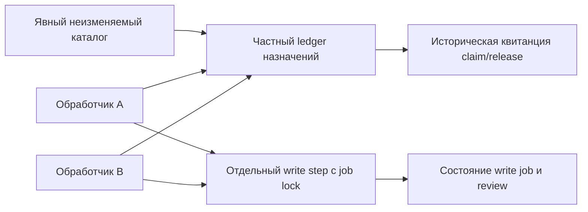

# Локальные аренды позиций каталога заданий записи

Статус: тридцать четвёртый этап локального прототипа. Отдельный частный ledger координирует выбор позиций неизменяемого каталога write jobs. Он сохраняет операции назначения и освобождения в собственной SQLite-транзакции.

- [Явный каталог write jobs](workspace-restore-case-retention-review-write-catalog.md).
- [Поэтапная запись review](workspace-restore-case-retention-review-write.md).
- [Рассмотрение плана и отдельная актуальность](workspace-restore-case-retention-review.md).
- [Дорожная карта](roadmap.md).

## 1. Какую задачу решает аренда

Каталог закрепляет явный состав и порядок заданий, поэтому несколько обработчиков могут независимо прочитать одну и ту же позицию. Для координации выбора нужен общий изменяемый факт: кому сейчас выделена позиция и какая попытка является текущей.

Ledger хранит этот факт отдельно от write intent, review и доменной базы. Успешный claim резервирует ровно одну явно указанную позицию в данном ledger. Другой caller этого же ledger не сможет получить новую аренду той же позиции, пока текущая аренда действует. Освобождение либо истечение срока позволяет сделать новый claim с новым поколением.

Claim использует закреплённую membership и не читает текущий job или review destination. Поэтому completed либо недоступный job тоже может получить назначение. Аренда не устанавливает наличие незавершённой работы; caller выбирает предмет явно и отдельно наблюдает status при необходимости.

Прежний `step_review_write` не принимает lease token и продолжает использовать свою job lock. Caller может вызвать его напрямую. Поэтому эта реализация координирует соблюдающих протокол обработчиков, но не устанавливает обязательную проверку назначения перед каждым файловым действием.

## 2. Четыре разных факта

| Объект | Что он устанавливает |
| --- | --- |
| Неизменяемый каталог | Явный состав, порядок и исторические descriptors выбранных jobs |
| Аренда позиции | Текущую локальную попытку назначения в одном ledger |
| Write status | Наблюдаемую фазу записи закреплённого review |
| Review и план | Историческое самозаявленное мнение и точное рассмотренное основание |

Эти факты меняются по разным правилам. Release не завершает write job. Completed не освобождает аренду автоматически. Истечение аренды не отменяет сохранённый review. Само назначение не проверяет семантику текста или актуальность плана.

Стрелка от обработчиков к write step остаётся отдельным действием. Единой транзакции между SQLite ledger и файловыми переходами write job нет.

## 3. Область исключительности

Исключительность относится к паре «данный ledger, данный индекс». Операции над одной SQLite-базой проходят через writer transaction; одновременно подтверждённые конкурирующие claims не создают две действующие головы одной позиции в этой базе.

Два разных ledger могут захватить один каталог и выдать назначения на одну и ту же позицию независимо. Копия ledger также не является общим центром координации. API не ищет другие каталоги и базы и не доказывает отсутствие внешних исполнителей.

Самозаявленная строка worker обозначает имя участника в запросе. Она не является bearer credential, удостоверенной личностью, правом записи review либо доказательством независимости модели. Caller с доступом к частному ledger может заявить то же имя и передать публичные значения текущей аренды; API не проверяет его личность. Ограничения доступа файловой системы отделены от отсутствующей аутентификации участников.

Граница действует и для документов. Назначение агенту раздела технической вики может уменьшить повторный выбор этой позиции внутри одной группы, но не предотвращает пересечение смысловых зависимостей с другими разделами. Такие зависимости требуют своей описи и согласования.

## 4. Поколения и устаревший обработчик

Каждый успешный новый claim получает собственный lease ID и следующее поколение позиции. Повтор той же сохранённой операции возвращает её прежнюю квитанцию; он не создаёт ещё одно поколение.

После освобождения либо истечения первой аренды позиция может быть назначена повторно. Старый обработчик всё ещё может иметь сохранённый ответ. Проверка текущей головы отличает эту прежнюю попытку от новой по ID, worker и поколению, даже если строка worker повторилась.

Например:

| Шаг | Позиция | Текущий факт ledger |
| --- | --- | --- |
| A получает работу | 1 | Поколение 1, lease A |
| A освобождает её | 1 | Поколение 1, released |
| B получает работу | 1 | Поколение 2, lease B |
| A повторяет старый release с новым operation ID | 1 | Отказ: текущая голова относится к другой попытке |
| A повторяет точный прежний release operation ID | 1 | Историческая квитанция первого release, без изменения поколения 2 |

Release допускается для последней совпадающей головы даже после истечения её срока. Если после неё уже был новый claim, старый release с новым operation ID отказывает. Повтор уже released головы с новым operation ID также отказывает. Точный replay сохранённого release остаётся историческим чтением своего результата.

Это защищает собственные переходы ledger от устаревшей попытки. Внешнее действие требует проверки такого поколения непосредственно в системе, где выполняется действие. Прежний файловый write step пока такой проверки не выполняет; generation не выдаётся за внешний fencing token.

## 5. Исторический replay и текущая действительность

Operation ID закрепляет точные параметры сохранённой операции. Точный повтор возвращает ранее сохранённый результат, без нового назначения, времени, продления или изменения текущей головы. Отличающийся запрос с тем же ID вызывает конфликт.

Только успешные claim/release добавляются в историю. Busy, неверный запрос и другие отказы не занимают operation ID и не создают событие. После изменения головы прежний отказавший запрос может получить другой исход при обычном повторе; он не имеет сохранённой успешной квитанции.

Поэтому успешный replay claim не означает, что аренда продолжает действовать. Она могла быть освобождена, истечь либо смениться новым поколением. Ответ восстанавливает исторический факт принятой операции; текущее состояние следует читать отдельно.

Потеря ответа после commit SQLite не требует нового claim с новым ID. Caller может повторить тот же запрос и восстановить прежнюю квитанцию. Если сама операция не была сохранена, следующий обычный вызов оценивает текущую голову по действующим правилам. API не обещает восстановление повреждённой базы либо неполного начального создания controls.

## 6. Часы и срок

Срок аренды вычисляется из clock успешного claim. Длительность составляет от 1 до 3600 секунд включительно. Продление отдельной командой не предусмотрено. Истечение оценивается при последующих операциях; отдельный фоновый очиститель не требуется. Отсутствие новых операций не создаёт запись о release само по себе.

Новая изменяющая операция отказывает с `clock_regressed`, если её clock оказался раньше `decided_at` последней сохранённой операции либо created_at ledger при пустой истории. Точный исторический replay не получает новый clock и проходит до этой проверки. Такое правило не переписывает прошлое решение при явном обратном ходе часов.

Локальные wall clocks всё равно могут изменяться. Перевод часов вперёд способен сделать аренду наблюдаемо истёкшей раньше ожидаемого реального интервала. Страница вычисляет active/expired по своему `checked_at`, без записи: при переводе часов назад прежняя голова может снова наблюдаться active. Новые мутации при времени раньше последнего решения блокируются, но этот порог не является монотонными распределёнными часами.

Новый claim после истечения разрешает только новую локальную попытку. Он не останавливает зависший процесс прежнего владельца. Для строгого внешнего эффекта нужны проверка поколения в месте эффекта, подходящий источник времени и отдельно обоснованный протокол восстановления.

## 7. Пределы и стоимость координации

Каталог ограничивает область до 256 позиций. История содержит не более 1024 успешно сохранённых claim/release операций. Manifest ограничен 3 MiB, SQLite-база — 8 MiB, каноническая страница — 1 MiB. Страница включает от 1 до 16 позиций; сохраняются также прежние ограничения структуры JSON. Общий cooperative deadline вызова составляет 60 секунд.

Превышение установленной границы вызывает явный отказ. Старые операции не удаляются автоматически ради освобождения места и восстановления возможности replay. Claim и release оба расходуют историю; при полном ledger новый release также может отказать. Планирование ёмкости должно учитывать завершающие операции. Точный replay уже сохранённой операции обрабатывается до проверки лимита новой истории. Небольшая страница ограничивает размер ответа; проверка согласованности ledger всё равно зависит от всей ограниченной истории.

SQLite сериализует изменения этого ledger. Разные позиции могут выполняться разными обработчиками, но короткие операции назначения проходят через общий writer. Более широкий пул процессов не гарантирует больший throughput: конкуренция за базу, write job locks, файловую систему и обработку оснований остаётся общей стоимостью.

Сериализация не обещает FIFO, справедливость очереди либо eventual assignment каждому caller. Очереди ожидающих назначений и команды claim-pending здесь нет. Проигравший claim получает busy; политику выбора следующей позиции и повтора задаёт вызывающая сторона.

Значения лимитов задают допустимый размер этого инструмента. Они не измеряют число одновременно полезных LLM, ёмкость портала документации, токенную стоимость либо снижение частоты смысловых ошибок.

Если каталог содержит M позиций, в одном ledger может наблюдаться не более M действующих голов, где M ≤ 256. Это число зарезервированных позиций. Один worker может получить несколько позиций, а другие workers — только наблюдать или встречать busy; лимита «одна аренда на worker» здесь нет. Поэтому число голов не определяет число процессов либо моделей.

Для практического распределения нужны отдельные измерения:

- Время ожидания claim и доля конфликтующих запросов.
- Время между выдачей аренды, первым полезным действием и освобождением.
- Доля повторов, брошенных назначений и устаревших попыток.
- Доля действительно независимых работ и пересечения их оснований.
- Качество итоговых документов при сопоставимом бюджете источников, токенов и времени.

## 8. Применение к документации и семантике

Для редакционного портала единицей назначения может быть явно указанное рассмотрение, проверка цитаты, обновление примера либо анализ зависимости. Эти единицы должны иметь устойчивую identity и точное основание, чтобы поздний ответ относился к своему исходному материалу.

Одна аренда раздела не решает конфликт смыслов между документами. Например, изменение единицы измерения в API и исправление таблицы документации могут быть двумя разными заданиями с общим требованием. Для их совместного принятия нужна содержательная связь и проверка полного набора затронутых артефактов.

В текущем прототипе имеются отдельные структурированные механизмы комплектов, обязательств, описи обещаний и политики принятия. Новый ledger не изменяет эти правила и не переносит назначение в разрешение `Store.accept`. Он работает с заданиями записи рассмотрений retention plans, без автоматического расширения на весь предметный текст.

Для реального многоагентного редактора следующий шаг включает аутентифицированных участников, протокол принятия внешнего эффекта с текущим поколением, полноту предметной описи и независимое оценивание содержания. Эти задачи следует проверять отдельно от корректной сериализации claims.

## 9. Сохранность и публикация

Ledger и его частные привязки находятся вне Git. Публичные квитанции называют identity назначения и исторический предмет, сохраняя явные признаки отсутствия аутентификации и доменных полномочий. Paths, filesystem pins, request digests и сырые SQLite records не публикуются.

Отдельная база назначений не изменяет каноническую runtime Store, её историю, credentials либо полномочия старых архивов. Карантинные копии остаются историческими; получение аренды не активирует их grants или leases.

Историческое чтение собственной завершённой записи отделяется от текущих каталогов и write jobs. Недоступность прежних путей не должна подменяться реконструкцией их содержимого из названий либо выдачей нового разрешения.

## 10. Частный протокол

Правила имеют имя `workspace-restore-case-retention-review-write-leases-1`. Ledger ID имеет форму `wrrwlgr_` и 32 шестнадцатеричных символа; lease ID — `wrrwl_` и 32 шестнадцатеричных символа.

Каталог ledger имеет права 0700 и содержит три управляющих файла с правами 0600:

| Файл | Назначение |
| --- | --- |
| `.agentwiki-restore-case-retention-review-write-leases.json` | Неизменяемый manifest с собственной identity и захваченной membership |
| `.agentwiki-restore-case-retention-review-write-leases.lock` | Постоянный пустой файл локальной блокировки |
| `.agentwiki-restore-case-retention-review-write-leases.sqlite3` | Ограниченная изменяемая история успешных операций |

Manifest закрепляет публичную квитанцию исходного каталога, упорядоченные descriptor7 участников, частные source pins и собственные directory/database bindings. Полное тело исходного catalog11 или job intents не копируется. При создании захватывается проверенный каталог; последующие show/page/claim/release и точный create replay читают собственные controls ledger.

SQLite хранит append-only операции: последовательность, уникальный operation ID, точный запрос, результат и их контрольные суммы. Текущие головы выводятся из этой ограниченной истории и сверяются с переходами. Отдельная независимо обновляемая таблица голов не создаёт второго источника истины.

Append-only относится к поддержанному API. Владелец файлов может изменить SQLite напрямую либо скопировать файлы вне протокола. Проверка digests, inode bindings и всей сохранённой истории устанавливает внутреннюю согласованность доступного состояния. Без внешнего заверения она не доказывает авторство и полноту истории и не гарантирует обнаружение удаления её хвоста привилегированным владельцем. Tamper-proof журнал здесь не реализован.

Одна `BEGIN IMMEDIATE` транзакция объединяет проверку прежней операции, текущей головы и сохранение нового успешного решения. Сохранённый replay и новая мутация не разделяются на несогласованные чтение и запись. Локальная flock дополнительно защищает собственный протокол controls; она не является распределённой блокировкой.

Неполный bootstrap, изменённые привязки и остаточный SQLite journal остаются неподдержанными состояниями. Reader отказывает; протокол не восстанавливает такую базу автоматически. Поддержанное обычное выполнение и SQLite commit не доказывают обработку всех прерываний процесса, потери питания либо отказов хранилища.

## 11. Публичные формы

Публичные объекты имеют строгий состав полей. Неизвестные поля, булевы значения вместо целых index/duration/generation и несовместимые вложенные формы не принимаются.

| Форма | Поля помимо 13 фиксированных flags |
| --- | --- |
| Ledger20 | `rules_version`, `ledger_id`, `operation_id`, `created_at`, `catalog` прежнего catalog16, `write_count`, `max_operations=1024` |
| Operation27 | `rules_version`, `ledger_id`, `operation_id`, `kind`, `decided_at`, `index`, `write` прежнего descriptor7 и семь полей lease |
| Page22 | `rules_version`, `ledger` прежнего ledger20, `checked_at`, `after_index`, `limit`, `entries`, `next_cursor`, `operation_count`, `job_states_checked=false` |

Семь полей lease: `lease_id`, `generation`, `worker`, `lease_seconds`, `claimed_at`, `expires_at`, `released_at`. Для claim `decided_at=claimed_at`, а released_at=null. Для release `decided_at=released_at`, прежние claimed_at/expires_at/duration сохраняются. Expires_at точно равен claimed_at+lease_seconds.

Entry4 содержит ровно `index`, `write`, `current_lease` и `state`. При `unclaimed` current_lease=null. В остальных состояниях current_lease имеет семь полей:

| State | Правило наблюдения |
| --- | --- |
| `released` | Сохранён released_at; это состояние имеет приоритет над сроком |
| `active` | Released_at=null и checked_at меньше expires_at |
| `expired` | Released_at=null и checked_at не меньше expires_at |

Cursor содержит ровно `ledger_id` и `after_index`. В CLI опции `--ledger-id` и `--after-index` задаются совместно. Начальный after_index равен 0; допустимое значение write_count возвращает terminal empty page с next_cursor=null. Число операций относится к текущей прочитанной истории, а не только к выбранному диапазону.

Прежние девять flags сохраняются: advisory_only и inspection_only равны true; domain_writes_allowed, original_files_modified, archival_authorized, deletion_authorized, actor_authenticated, old_authority_activated и external_fencing_established равны false. Добавлены четыре явные границы:

| Flag | Значение |
| --- | --- |
| `coordination_only` | true |
| `job_steps_enforced` | false |
| `same_ledger_only` | true |
| `worker_authenticated` | false |

Новые управляющие записи ledger допустимы в рамках координации. Flags не означают отсутствия записей в самой частной базе назначений.

## 12. API и команды

Программный интерфейс `agentwiki.workspace_restore_case_retention_review_write_leases`:

~~~python
create_write_lease_ledger(ledger, catalog, operation_id=operation_id)
inspect_write_lease_ledger(ledger)
read_write_lease_page(ledger, limit=16, cursor=None)
claim_write_lease(ledger, index=index, worker=worker,
                 lease_seconds=lease_seconds, operation_id=operation_id)
release_write_lease(ledger, index=index, worker=worker, lease_id=lease_id,
                   generation=generation, operation_id=operation_id)
~~~

Создание ledger по уже существующему явному каталогу:

~~~sh
python3 -m agentwiki workspace-restore-case-retention-review-write-leases create \
  --ledger /tmp/agentwiki-private/write-leases \
  --catalog /tmp/agentwiki-private/write-catalog \
  --operation-id write-leases-01
~~~

Историческая identity и ограниченное текущее наблюдение:

~~~sh
python3 -m agentwiki workspace-restore-case-retention-review-write-leases show \
  --ledger /tmp/agentwiki-private/write-leases
python3 -m agentwiki workspace-restore-case-retention-review-write-leases page \
  --ledger /tmp/agentwiki-private/write-leases --limit 1
~~~

Явное назначение одной позиции:

~~~sh
python3 -m agentwiki workspace-restore-case-retention-review-write-leases claim \
  --ledger /tmp/agentwiki-private/write-leases --index 1 \
  --worker operator-a --lease-seconds 300 --operation-id claim-position-1-a
~~~

Освобождение требует фактических `lease_id` и `generation` полученной квитанции. Возврат прежней исторической квитанции не заменяет чтение текущего состояния. В этих командах отсутствует автоматический write step и запуск внешней модели.

Точные реализации:

- [Core и частная история назначений](../../agentwiki/workspace_restore_case_retention_review_write_leases.py).
- [CLI и строгие публичные схемы](../../agentwiki/workspace_restore_case_retention_review_write_leases_cli.py).
- [Обычный development-сценарий](../../agentwiki/workspace_restore_case_retention_review_write_leases_demo.py).

~~~sh
python3 -m agentwiki workspace-restore-case-retention-review-write-leases-demo \
  --workspace /tmp/agentwiki-review-write-leases-01 --workers 3
~~~

Параметр workers относится к повторяемому прежнему основанию сценария. Конкурирующие callers нового ledger запускаются как обычные локальные CLI-процессы; их число не является количеством внешних LLM.

## 13. Фактический обычный запуск

Development-сценарий завершился с первой попытки. Время отчёта: `2026-10-22T16:36:48.519006+02:00`, Europe/Berlin. Продуктовые данные не исправлялись, повторного запуска сценария не потребовалось.

| Наблюдение | Фактический результат |
| --- | --- |
| Публичные файлы | 395: 379 JSON и 16 Markdown |
| Повторённое основание | 377 прежних публичных файлов |
| Добавлено этим этапом | 18 файлов: шесть этапов, десять data JSON и два отчёта |
| Частные ledgers | Два независимых ledger по одному трёхпозиционному каталогу |
| Закреплённый состав | Шесть вхождений трёх разных write jobs |
| История назначений | 12 различных операций: шесть claim и шесть release |
| Разделение истории | Primary — восемь операций; secondary — четыре |
| Страницы ledger | 12, включая пустую terminal page |
| Новые ordinary CLI | 76: 47 успешных и 29 ожидаемых отказов |
| Lease-команды | 66: 40 успешных и 26 ожидаемых отказов |
| Составной сценарий | 513 ordinary CLI и 14 прежних interrupt workers, всего 527 дочерних процессов |
| Новые jobs и reviews | Ноль; сохранены три прежних write jobs и пять review records |
| Новые fault workers и injected partial writes | Ноль |

Оба ledger явно захватили один expanded catalog. Все три исходных write jobs уже были completed. Начальные страницы показали unclaimed и сохранили порядок descriptor7; назначение не выдавало завершённые jobs за обнаруженную невыполненную работу.

Три обычных CLI-процесса были запущены до сбора ответов. Два запроса претендовали на позицию 1 primary: один получил claim поколения 1, другой — busy. Запрос позиции 2 успешно получил отдельную аренду. Сам факт перекрытия выполнения процессов, задержка ожидания и throughput не измерялись.

Release позиции 1 позволил новый claim поколения 2 с другим lease ID. Устаревший release с новым operation ID отказал; точные повторы прежних claim и release вернули исторические квитанции, сохранив текущую голову поколения 2. Настоящий проверенный ответ claim позиции 3 был отброшен и восстановлен точным replay без продления expiry; сравнительный digest остался только в памяти демонстратора.

Secondary независимо назначил ту же позицию 1, пока primary сохранял поколение 2. Это наблюдение показывает заявленную границу одного ledger. Затем временно отсутствовали восемь captured paths: два write catalogs и шесть job/review directories. Show, page, точный create replay, прежний claim replay и новый claim/release secondary работали по собственным controls. Все восемь путей возвращены в finally; прежние blocked restore jobs не перемещались.

В конце пять когда-либо назначенных позиций двух ledger были released, а позиция 3 secondary осталась unclaimed. Primary position 1 сохранила generation 2. Отдельные старые status и catalog pages вернули прежние результаты; ledger-команды не продвигали write jobs. Проверки metadata страниц не обнаружили изменений controls; при сравнении исходных каталогов исключались directory times, меняющиеся при rename.

Двадцать девять ожидаемых отказов включают четырнадцать lease invalid_input, десять lease conflicts, два busy и три прежних blocked restore status. Проверены пределы index/duration, malformed worker/operation, несовместимые повторные запросы, stale/wrong release, already-released с новым ID, конфликт создания и cursor/limit. Это 26 отказов lease protocol и три прежних отказа restore protocol.

Source сохранил R4/36 событий, живая среда — R5/59. Сравнение публичных Store-наблюдений исключало только верхний вычисляемый governance observed_at. Исходные планы, cases, links, catalogs, jobs и reviews сохранили controls; новые credentials, grants, restore attempts, доменные решения, архивирование и удаление сверх повторённого основания не создавались.

Публичные основания:

- [Читаемый отчёт](../../examples/workspace-restore-case-retention-review-write-leases/results/restore-case-retention-review-write-leases-report.md) и [машинный отчёт](../../examples/workspace-restore-case-retention-review-write-leases/results/restore-case-retention-review-write-leases-report.json).
- [Два ledger](../../examples/workspace-restore-case-retention-review-write-leases/results/restore-case-retention-review-write-leases-ledgers.json), [12 операций](../../examples/workspace-restore-case-retention-review-write-leases/results/restore-case-retention-review-write-leases-operations.json) и [12 страниц](../../examples/workspace-restore-case-retention-review-write-leases/results/restore-case-retention-review-write-leases-pages.json).
- [Конкурирующие запросы](../../examples/workspace-restore-case-retention-review-write-leases/results/restore-case-retention-review-write-leases-competition.json), [CLI-исходы](../../examples/workspace-restore-case-retention-review-write-leases/results/restore-case-retention-review-write-leases-cli-outcomes.json) и [отказы](../../examples/workspace-restore-case-retention-review-write-leases/results/restore-case-retention-review-write-leases-rejections.json).
- [Восстановление потерянного ответа](../../examples/workspace-restore-case-retention-review-write-leases/results/restore-case-retention-review-write-leases-reply-recovery.json), [сохранность controls](../../examples/workspace-restore-case-retention-review-write-leases/results/restore-case-retention-review-write-leases-control-observations.json), [источник](../../examples/workspace-restore-case-retention-review-write-leases/results/restore-case-retention-review-write-leases-source-observations.json) и [живая среда](../../examples/workspace-restore-case-retention-review-write-leases/results/restore-case-retention-review-write-leases-live-observations.json).

Истечение аренды, обратный ход часов, заполнение всей истории, частичный bootstrap, остаточный journal и отказ хранилища этим обычным запуском не воспроизводились. Границы предусмотрены исходным протоколом; этот сценарий не доказывает все аварийные расписания, сохранность при потере питания или смысловое качество документации.

## 14. Отдельные сверки завершённого запуска

После обычного сценария read-only аудиторы читали готовые результаты. Прикладной сценарий для этих проверок повторно не запускался.

- Частная lease-сверка с первой попытки выполнила 504 проверки: два manifest11 с source7, шесть member2, двенадцать сохранённых SQLite-операций и 25 повторных представлений страниц. Согласованы канонические запросы и ответы, их digests, история поколений, derived heads, права и bindings. Байты и metadata собственных controls до и после чтения совпали; частные значения не опубликованы.
- Прежняя частная сверка также прошла с первой попытки: сохранены 19 restore plans, из них 18 действительных и один частичный; 16 завершённых восстановлений с 48 data files и три blocked остатка. Согласованы прежние case/link, retention, review, write-job и catalog controls; ремонт не выполнялся.
- Сверка адресованных публичных оснований с первой попытки восстановила пять full packets, четыре перехода, шесть content-политик, восемь governance-политик, один audit root и три checkpoint edges/scopes. Проверены 3222 повторные acceptance/continuity references; два checkpoint остаются pending и один history_complete. Количество ссылок не означает число независимых решений.
- Публичный аудитор строгих схем с первой попытки согласовал 395 файлов, строгий разбор 379 JSON, 16 Markdown, 373 относительные ссылки результатов, 513 ordinary CLI и 527 различных PID. Проверены все 12 отдельных страниц ledger и полный публичный forest: 39 вхождений ledger20, 33 operation27, 25 page22, 63 entry4, 38 current_lease7 и 206 descriptor7. Это повторные представления шести claims и шести releases, а не число участников или независимых рассмотрений.
- Дополнительный независимый публичный обзор с первой попытки выполнил 167430 логических сравнений, включая 144562 сравнения прежнего основания, и 395 побайтных сравнений экспортов — всего 167825. Согласованы все 76 новых CLI-исходов, двенадцать страниц и шесть этапов. В новых материалах проверены 39 ledger20, 33 operation27, 25 page22, 63 entry4, 38 lease7, 104 descriptor7, 43 catalog16, 11 write17 и по 22 review16/plan17. Пределы количества workers и семантическое качество этими сравнениями не измеряются.
- Privacy/preservation-сверка с первой попытки подтвердила побайтную сохранность 4367 прежних защищённых файлов и 395 экспортированных копий. Разобраны 4436 JSON и 98 Python-исходников; 31 прежний модуль и девять прежних SCHEMA-литералов не изменились. В 4918 кандидатах публикации не обнаружены значения 351 известного credential, их хеши либо 266 частных контрольных сумм/привязок. Два новых manifest, две SQLite-базы и двенадцать операций остались вне Git. Пересчитаны адреса 208 full packet instances, 3222 continuity chains, 228 transitions, 11 audit headers и 13 checkpoints.

Обычный прикладной запуск и все отдельные аудиторы завершились с первой попытки. Исправление данных, ремонт private controls либо повтор исполнения после ошибки не потребовались.

## 15. Дальнейшее развитие

Следующая самостоятельная задача — связать проверку действующей попытки с конкретным разрешённым эффектом, сохранив повтор после потерянного ответа. Это требует явной области действия, аутентифицированных участников и проверки поколения непосредственно там, где изменяется состояние. Для старого файлового write protocol такая связь пока отсутствует.

Отдельно остаются продление либо отмена назначений, политика справедливого выбора, жизненный цикл полной истории, поддержанные окна прерывания SQLite/bootstrap и согласование независимых ledger. Для документации дополнительно нужны содержательная опись, источники, связь затронутых разделов и независимое оценивание смысловых изменений. Корректная история назначений даёт основу для воспроизводимой координации, сохраняя эти предметные вопросы открытыми.
