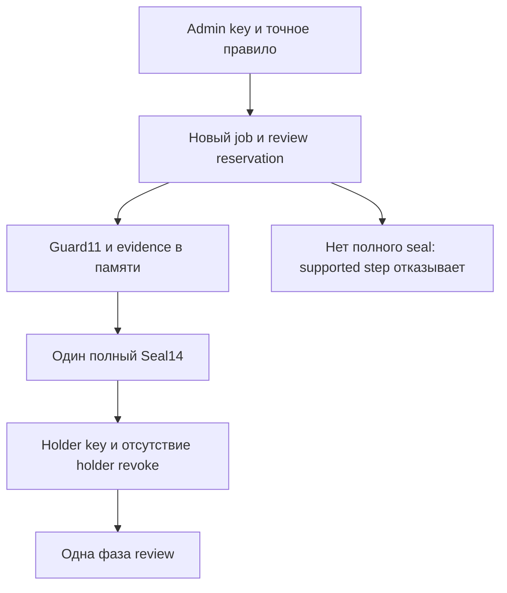

# Sealed review write: задание и свидетельство выдачи в одной записи

Сороковой этап agentwiki вводит отдельное семейство заданий записи review. Его полный логический Guard11 и свидетельство разрешённой выдачи сохраняются одним immutable Seal14. Поддержанный `step` требует полный валидный Seal14, ключ держателя и отсутствие собственного отзыва задания.

Это локальный прототип для одной доверенной файловой среды. Новый формат относится к выбранному sealed пути. Прежние [guarded jobs](workspace-restore-case-retention-review-write-guarded.md) и [managed issuance](workspace-restore-case-retention-review-write-guarded-issuer.md) сохраняют свои форматы и ограничения. Их код и старые примеры не переводятся в sealed автоматически.

- [Прикладной сценарий](../../examples/workspace-restore-case-retention-review-write-sealed/README.md).
- [План развития](roadmap.md).
- [Журнал разработки](activity.md).

## 1. Какой промежуток закрывается

На предыдущем этапе native Guard11 записывается раньше отдельной Issuance16. Если сохранение квитанции не завершится, уже сохранённый guard может допускать holder к дальнейшим шагам. Отказ внешнего issue не означает отсутствия такого задания.

В новом семействе самостоятельный native Guard11 на диске не создаётся. Его полное тело существует только внутри Seal14 вместе с issuer policy, выбранным правилом, запросом и привязкой к плану. Общий digest закрепляет всё содержимое записи. Новый `step` сначала проверяет весь Seal14; частичная либо отсутствующая запись не предоставляет поддержанного пути эффекта.

Инвариант относится к структуре доступного задания: поддержанный активный sealed job содержит и его полномочие, и свидетельство выдачи. Если ошибка возникла после сохранения полного Seal14, действующее задание с обоими элементами может остаться. Откат выдачи и гарантия отсутствия задания при любом error response не реализуются.

## 2. Что меняется в файловом договоре

| Вопрос | Managed native путь предыдущего этапа | Новый sealed путь |
|---|---|---|
| Основной job record | Native Guard11 | Seal14 с полным логическим Guard11 |
| Свидетельство выдачи | Отдельная Issuance16 в другом каталоге | Поля того же Seal14 |
| Возможность supported step без свидетельства | Возможна в описанном окне | Полный Seal14 обязателен до эффекта |
| Каталог отдельной issuance | Требуется | Отсутствует |
| Receipt при недоступном issuer | Своя issuance directory | Своя sealed job directory |
| Receipt при недоступном собственном job | Возможен по отдельной issuance | Не предоставляется: Seal14 находится внутри job |
| Смена прежних заданий | Не выполняется | Не выполняется |

Новый job никогда не содержит старые legacy intent/lock и native guarded intent/lock. Старые public APIs, требующие свои locks, этот формат отвергают. Managed issuer предыдущего этапа также не усыновляет уже существующий sealed job.

Вложенный Guard11 остаётся полным логическим телом: его ID, operation ID, captured review, pins и digests проверяются. Компактный Guard22 в публичной квитанции является metadata этого тела. Самостоятельный старый guarded job на файловой системе из него не появляется.

## 3. Политика и два разных ключа

Родительский issuer использует прежний S39 формат и команды create/show/revoke. Его ordered policy содержит от одного до шестнадцати Rule5:

| Поле | Значение |
|---|---|
| `rule_id` | ID точного правила |
| `principal` | Самозаявленная метка holder |
| `actor` | Самозаявленный actor будущего review |
| `verdict` | `reviewed`, `defer` либо `request_fresh_plan` |
| `plan_id` | Точный сохранённый retention plan ID `wrrp_` +32 hex |

Новая выдача требует ровно одного совпадения principal, actor, verdict и plan ID. Повторные rule IDs и одинаковые scopes отвергаются прежним issuer API. Wildcard, приоритетов и выбора первого частично подходящего правила нет.

Admin key разрешает выдачу и точный её повтор при доступном issuer. Отдельный holder key допускает три фазы sealed job и его собственный отзыв. Значения ключей должны различаться; сравнение хешей выполняется через `compare_digest`.

У прежней Rule5 нет поля семейства job. Поэтому этот же issuer и admin могут разрешить старому S39 API создать другое новое native задание. Ограничение sealed относится к новому выбранному пути и конкретному sealed job; глобальный запрет прежних форматов не вводится.

Principal, administrator и actor не удостоверяют человека, организацию или отдельную модель. Владелец файлов, private helpers, прямые syscalls и другие копии находятся вне этой границы. OS isolation, внешняя identity и распределённое fencing не реализованы.

## 4. Единственная частная запись Seal14

Seal имеет ID `wrrws_` и 32 hex, rules version `workspace-restore-case-retention-review-write-sealed-1`. Запись содержит ровно четырнадцать полей:

```text
schema_version, rules_version, seal_id, operation_id, created_at,
job_path, job_directory, issuer_anchor, issuer, rule, guard,
plan_id, request, request_digest
```

| Поле | Частная привязка |
|---|---|
| `issuer_anchor` | Полные pins issuer record/lock, путь и directory identity |
| `issuer` | Компактный исторический Issuer21 с policy |
| `rule` | Единственное совпавшее Rule5 |
| `guard` | Полный логический Guard11, включая прежний intent13 и review14 |
| `plan_id` | Точный ID полного captured plan внутри review |
| `request` | Полный запрос7 без plaintext credential |
| `request_digest` | Canonical digest всех остальных полей Seal14 |

Request7 содержит `plan_path`, `review_path`, `job_path`, `principal`, `actor`, `verdict`, `holder_credential_hash`. IssuerAnchor4 содержит `issuer_path`, `issuer_directory`, `issuer_record`, `issuer_lock`.

Outer operation ID равен operation ID вложенного guard и будущего review. Outer job path/directory совпадают с вложенными. Holder hash совпадает с hash логического Guard11; principal, actor, verdict и пути — с его точным captured review. `plan_id` совпадает с Rule5 и полным `plan_snapshot.plan_id`. Время Seal14 обозначает выдачу: оно не раньше guard clock, а guard clock не раньше issuer и captured plan.

У Seal14 нет собственного `guard_anchor` с pin того же файла. Такая ссылка создала бы цикл: вычисляемый digest зависел бы от pin записи, содержащей этот digest. Полное логическое тело guard связано общим внешним digest напрямую.

Own read проверяет весь Seal14, полную структуру и digest Guard11, вложенный intent13 и точную offline-реконструкцию известного plan14. Для этого доступны metadata собственного job/parent и сохранённые данные. Живые issuer, plan и review при таком чтении не открываются. Captured issuer anchor остаётся непрозрачной исторической привязкой: собственная квитанция не реконструирует отсутствующий полный issuer record по его компактному публичному виду.

Private paths, pins, digests, hashes, credential и полный Seal14 в публичный экспорт не включаются.

## 5. Имена controls и пределы

Четыре нормализованных каталога issuer, plan, review и job должны быть различными соседями одного private parent. Parent и каталоги имеют режим 0700. Seal, lock, marker и result records имеют режим 0600, текущего владельца и одну ссылку; symlink и посторонние entries отвергаются. Собственный staging и создаваемый review проходят отдельно проверяемую последовательность nlink 1→2→1 во время hardlink-перехода.

Sealed job содержит закрытый набор не более семи имён:

```text
.agentwiki-restore-case-retention-review-write-sealed.json
.agentwiki-restore-case-retention-review-write-sealed.lock
.agentwiki-restore-case-retention-review-write-sealed.revoked.json
.agentwiki-restore-case-retention-review-write-sealed.prepared.result.json
.agentwiki-restore-case-retention-review-write-sealed.ready.result.json
.agentwiki-restore-case-retention-review-write-sealed.linked.result.json
.agentwiki-restore-case-retention-review-write.part
```

Marker и результаты появляются только при соответствующих операциях; staging исчезает после completed. Постоянный sealed lock остаётся пустым. Сам review использует прежние review record/lock и сохраняет совместимость старого reader после завершения.

Новые records создаются эксклюзивно, записываются canonical JSON и проходят fsync файла и каталогов. В процессе выдачи до полного Seal14 могут остаться job lock, review reservation и собственный staging. Эти остатки не усыновляются и не ремонтируются. Публичный reader либо step не считает отсутствие или частичный Seal14 готовой выдачей.

| Ресурс | Предел |
|---|---:|
| Seal14 и live Status23 |16 МиБ |
| Остальные controls и компактные публичные ответы |64 КиБ |
| JSON nodes |200000 |
| Глубина JSON |64 |
| Integer |256 бит |
| Общий deadline операции |60 секунд |
| Слоты фаз одного задания |3 |

Strings должны быть UTF-8, числа конечными. Эти пределы относятся к новому формату; они не обещают принять любой предельный вход прежнего формата вместе с дополнительной оболочкой. Deadline кооперативный: системный вызов не прерывается принудительно и не откатывается по истечении времени.

## 6. Выдача и порядок блокировок

Новая выдача выполняет следующую последовательность:

1. Проверяет четыре разных sibling paths, bounded identifiers, verdict и форматы ключей.
2. Захватывает прежний issuer lock с тем же общим deadline, читает issuer/revoke и проверяет admin key до чтения job seal либо живого plan/review.
3. Для существующего job читает полный собственный Seal14 под новым job lock. Только точный request/op и полная issuer binding допускают исторический replay.
4. Для новой выдачи требует отсутствия issuer revoke и нового незанятого review/job. Предварительно захватывает plan и проверяет точное правило до mkdir.
5. Создаёт новый job, его fsynced lock и новый review с fsynced review lock.
6. Под issuer→job→review locks повторно захватывает plan, сравнивает capture с первоначальным и повторяет policy match. При capture кратко добавляется plan lock.
7. Создаёт review14, собственный пустой staging, прежний intent13 и полный Guard11 в памяти. Ни legacy, ни native guarded intent/lock на диск не записываются.
8. Строит Seal14 с полной issuer binding, request, Rule5 и guard. Проверяет полный record, публичную квитанцию и ресурсные пределы.
9. Эксклюзивно сохраняет единственный Seal14, выполняет fsync job/review/parent и повторно читает полный seal.
10. Возвращает валидированную квитанцию, удерживая locks до завершения своих проверок.



Другая поддержанная sealed операция должна получить тот же job lock. Она не выполняет фазу по одному staging либо по логическому guard, лежащему в памяти другого вызова. После полного Seal14 разрешённый holder действует по правилам задания независимо от будущего issuer revoke.

## 7. Публичные формы

| Форма | Поля основания | Всего полей |
|---|---|---:|
| Receipt27 | rules, seal ID, operation ID, issued clock, Issuer21, Rule5, Guard22, plan ID, policy_authorized |27 |
| Access22 | rules, Receipt27, access_state, revocation |22 |
| Status23 | Access22 плюс прежний write Status17 |23 |
| Step24 | rules, Receipt27, Observation9, credential_verified, revocation_checked, historical_effect_authenticated |24 |
| Revocation5 | rules, seal ID, operation ID, revoked clock, holder_revoked reason |5 |

Общий FLAGS18 включает прежние девять advisory/review признаков и:

```text
local_capability_only=true
external_identity_verified=false
legacy_write_apis_rejected=true
native_guarded_apis_rejected=true
lease_enforced=false
live_issuer_policy_enforced=false
os_isolation_established=false
credential_required_for_step=true
sealed_issuance_required_for_step=true
```

Полный captured policy match обязателен внутри seal. `live_issuer_policy_enforced=false` означает отсутствие чтения текущего issuer при step. Вложенный прежний Guard22 сохраняет свои исходные native flags, включая `issuer_policy_enforced=false`; это metadata логического вложенного тела, не ослабление нового sealed reader.

`policy_authorized=true` описывает сохранённое совпадение issuance policy. Оно не удостоверяет человека и не разрешает Store.accept либо публикацию текста. Компактный Receipt27 не позволяет восстановить отсутствующий полный Seal14.

## 8. Три фазы и исторические результаты

Переходы сохраняют прежние файловые примитивы:

| Expected state | Допустимый PRE | Target |
|---|---|---|
| `prepared` | `prepared` либо доказанный собственный `staging` prefix | `ready` |
| `ready` | Полный собственный stage с одной ссылкой | `linked` |
| `linked` | Доказанный общий inode stage/review с двумя ссылками | `completed` |

Один новый step выполняет один примитив: заполнение/fsync stage; exclusive hardlink назначения; удаление только собственного staging alias после проверки назначения. До completed старый review reader сохраняет прежние ограничения nlink.

Result6 содержит `schema_version`, `rules_version`, `seal_id`, `seal_digest`, `observation`, `result_digest`. Его `seal_digest` закрепляет весь Seal14, включая issuance evidence. Observation9 имеет seal ID, operation ID, expected/target, recorded clock, outcome, observed state и effect flag вместе с rules version.

Новый step сначала проверяет полный own seal и optional revoke marker, затем holder credential и отсутствие отзыва. Только после допуска читаются содержимое result slots и живой review/stage. Changed operation ID занятого слота и использование одного ID для разных фаз вызывают conflict.

Точный saved replay возвращает весь прежний Step24 без нового clock, current status и повторного эффекта. Он по-прежнему требует текущий holder key и отсутствие отзыва. Его observed target исторический: ответ `ready` остаётся таким же после последующих `linked` и `completed`.

Если новая операция наблюдает точный POST без своей квитанции, она может сохранить `expected_phase_observed` с `effect_performed=false`. Более поздняя фаза не превращается в требуемый POST. Это наблюдение не устанавливает, какой вызов вызвал переход или чей fsync сделал его устойчивым.

Время нового результата не раньше seal issue clock и всех сохранённых результатов. Пустые промежутки среди слотов допустимы, частичная result record не считается отсутствием и не ремонтируется. Saved replay выполняется до fresh clock/live checks.

## 9. Отзыв и собственные чтения

| Операция | Авторизация и источники | Значение ответа |
|---|---|---|
| `issue`, новый | Admin key, live issuer/plan, точное правило | Новая sealed выдача |
| Точный `issue` replay | Admin key, live own issuer binding и own Seal14 | Исторический Receipt27, в том числе после обоих отзывов |
| `receipt` | Own Seal14 и закрытые имена job | Историческая выдача, не текущее access state |
| `show` | Own Seal14, marker и все present results | Текущий собственный active/revoked доступ |
| `status` | То же плюс live review под job→review locks | Текущая файловая фаза |
| `step` | Holder key и отсутствие holder revoke | Одна разрешённая фаза либо historical saved response |
| `revoke` | Тот же holder key, own records | Необратимый локальный отзыв этого задания |

Receipt и точный issue replay не разбирают содержимое optional phase results либо holder revoke marker. Историческая выдача независима от последующих step controls; чужие имена в job всё равно отвергаются. Show/status/revoke проверяют все имеющиеся собственные результаты и marker.

Revoke7 содержит rules/schema, seal ID, operation ID, revoked clock, seal digest и собственный request digest. Время не раньше Seal14 и записанных фаз. Тот же operation ID возвращает прежний Access22; другой ID конфликтует. Holder key нужен и для replay. Отмена отзыва, TTL, regrant и общий registry не вводятся.

Отзыв сериализуется job lock и ждёт уже допущенный step. Он не отменяет завершённый эффект, не отзывает возвращённые bytes и не останавливает syscall посередине. После отзыва защищённый cached step закрыт; own receipt остаётся исторически доступным.

Issuer revoke применяется к будущей новой выдаче. Существующий sealed holder не обязан читать живого issuer. Собственные receipt/show/cached step требуют доступного sealed job: его нельзя скрыть и одновременно обещать lookup той же записи.

## 10. Границы ошибок

| Момент ошибки | Поддержанное поведение |
|---|---|
| Policy mismatch до reservation | Новое задание не резервируется |
| Созданы lock/review/stage, полного seal нет | Step не получает валидное задание; bootstrap не ремонтируется |
| Seal частичен, неканоничен или не проходит полную схему | Reader отказывает; частичные bytes не усыновляются |
| Полный Seal14 сохранён, ответ потерян | Может существовать активный job с полной evidence; точный запрос либо own receipt восстанавливает исторический ответ |
| Файловый эффект фазы завершён раньше phase result | Сохраняется прежнее отдельное окно эффекта и квитанции; точный POST наблюдается по своему договору |
| Аппаратный отказ либо потеря питания | Общий rollback, атомарная транзакция ФС и доказательство всех расписаний не заявлены |

Один record устраняет прежнюю возможность поддержанного активного sealed job без собственного issuance evidence. Он не делает всю файловую выдачу или фазу одной транзакцией с внешними эффектами. Изменение owner FS, private helpers и прямой вызов старого примитива остаются вне поддержанного API.

Partial seal и precommit failclosure на этом этапе должны различаться как возможность, поддержанная исходным кодом, и выполненный сценарий. Без отдельного fault injection обычный успешный прогон не демонстрирует процессное либо аппаратное прерывание в этом окне.

## 11. Команды

Сначала создаётся прежний issuer с правилом по ID реального сохранённого плана. В примере `PLAN_ID` нужно взять из публичного retention plan show; каталоги issuer, plan, review и job должны быть соседями одного private parent.

```sh
python3 -m agentwiki workspace-restore-case-retention-review-write-guarded-issuer create \
  --issuer /tmp/agentwiki-private/issuer-a \
  --operation-id issuer-a-create --administrator local-administrator \
  --credential-out /tmp/agentwiki-private/issuer-a-admin.credential \
  --rule allow-sealed local-holder local-reviewer defer "$PLAN_ID"

python3 -m agentwiki workspace-restore-case-retention-review-write-sealed issue \
  --issuer /tmp/agentwiki-private/issuer-a \
  --plan /tmp/agentwiki-private/plan-a \
  --review /tmp/agentwiki-private/review-a \
  --job /tmp/agentwiki-private/sealed-a \
  --operation-id sealed-a-issue --principal local-holder \
  --actor local-reviewer --verdict defer \
  --issuer-credential-file /tmp/agentwiki-private/issuer-a-admin.credential \
  --holder-credential-out /tmp/agentwiki-private/sealed-a-holder.credential
```

Точный issue replay использует тот же запрос и `--prepared-holder-credential` вместо `--holder-credential-out`. Существующий key file не перезаписывается.

```sh
python3 -m agentwiki workspace-restore-case-retention-review-write-sealed receipt \
  --job /tmp/agentwiki-private/sealed-a
python3 -m agentwiki workspace-restore-case-retention-review-write-sealed show \
  --job /tmp/agentwiki-private/sealed-a
python3 -m agentwiki workspace-restore-case-retention-review-write-sealed status \
  --job /tmp/agentwiki-private/sealed-a
python3 -m agentwiki workspace-restore-case-retention-review-write-sealed step \
  --job /tmp/agentwiki-private/sealed-a --operation-id sealed-a-fill \
  --expected-state prepared \
  --credential-file /tmp/agentwiki-private/sealed-a-holder.credential
```

Последующие шаги используют expected states `ready` и `linked` с разными operation IDs. Holder revoke выполняется новым `sealed revoke --job ... --operation-id ... --credential-file ...`. Issuer revoke остаётся прежней командой parent issuer и требует admin key.

Credential принимается только через отдельный direct-sibling `.credential` file в private parent: owner UID, режим 0600, nlink 1, размер до 256 bytes, отсутствие symlink и стабильные metadata. Alias любого из четырёх каталогов и совпадающие admin/holder paths отвергаются до генерации. Файл key и parent fsync происходят до core issue. Если core затем откажет, подготовленный key file может остаться; общей транзакции key file и Seal14 нет. Literal secret в argv и stdout не предусмотрен.

## 12. Методика обычного сценария

Сценарий продолжает прежний S39 demo в новом private workspace и добавляет один parent issuer, одно правило, один новый plan, один sealed job/review и два key files. Согласованный состав — 18 новых публичных файлов: шесть stage JSON, десять data JSON, JSON/Markdown reports. Вместе с прежними 485 это 503 flat public files: 481 JSON и 22 Markdown. Фактическое исполнение и отдельные аудиты описаны в разделе 16.

Отдельно требуется показать:

1. Policy mismatch и неверный admin до reservation, без добавления лишних ключей.
2. Отказ legacy/native guarded APIs для sealed job и запрет усыновления его прежней managed issuance.
3. Отброшенный целый успешный issue response и три holder-фазы после parent issuer revoke.
4. Точный issue replay после завершения при недоступных новых plan/review и доступном issuer для admin-auth.
5. Own receipt/show/cached phase responses при дополнительно недоступном issuer; собственный sealed job остаётся на месте.
6. Отдельный holder revoke, закрытые new/cached steps, finally-восстановление всех трёх новых путей и сохранение старого review reader.

Driver использует только публичные ответы, credential markers и lstat metadata. Он не читает private control bodies, lease SQL rows либо staging contents. Исходные metadata снимаются после Store initialization и первоначального наблюдения. Новые fault workers, partial seal writes, expiry waits и gap injection не добавляются.

Количество процессов и старый размер пула 3 не являются измерением sealed concurrency или максимального числа LLM.

## 13. Что проверяется независимо

Private audit должен связать Seal14 с полным Guard11/intent13/plan14/review14, Issuer12/Rule5/Revoke7, Anchor4, Request7, тремя Result6 и holder Revoke7. Отдельные условия — соответствие credential hashes, full pins/digests, точная реконструкция captured plan, immutable bytes/metadata, отсутствие прежних intent/lock и отдельной Issuance16 для нового job.

Public audit должен сверить закрытые Receipt27/Access22/Status23/Step24/Observation9/Revocation5, exact report summary, ordered CLI outcomes, полные шесть stage payloads и публичные копии. Старые native compatibility objects должны совпадать с точными прежними поддеревьями, а не приниматься как новые sealed records.

Во всём forest нужно различать физические records и логические identities. Два прежних native Guard11 files и один вложенный новый Guard11 дают три guard IDs; это не три самостоятельных native jobs. Новый seal ID имеет отдельный namespace. Исторические retention/reconciliation plan IDs и разные issuer/issuance namespaces также считаются отдельно.

Proof и privacy/preservation сохраняют свои отдельные основания. Canonical digest устанавливает целостность относительно сохранённой записи; без внешней аттестации он не удостоверяет автора, полноту платформенной истории или смысловую истинность.

## 14. Несколько агентов

Для N callers одного parent issuer выдача сериализуется issuer lock. Уже созданные разные jobs выполняют собственные фазы под отдельными job locks. Создание задания и дальнейшее исполнение поэтому имеют разные очереди ожидания.

Для N callers одного sealed job в конкретный момент фазу допускает один holder job lock. Точный operation ID получает одну историческую квитанцию; изменённый ID занятого слота конфликтует. Три слота задают три перехода одного review, не три агента и не измеренную ёмкость.

Jobs с различными назначениями могут перекрывать работу во времени, если разделены их locks и bindings. Одинаковый plan ID не предоставляет исключительную lease на содержание плана: policy может разрешить несколько новых заданий. Глобального дедупликатора, общей очереди и гарантии семантической независимости нет.

Для оценки масштабирования нужны отдельная предметная нагрузка, длины очередей, время ожидания locks, latency, доля конфликтов и полезность рассмотрения. Обычный функциональный прогон не подменяет эти измерения.

## 15. Значение для документации и вики

Объединение capability и evidence в одной валидируемой записи убирает конкретную неопределённость управляющего протокола: продолжение не опирается на отдельную отсутствующую issuance receipt. Это полезно для воспроизводимого распределения review-заданий между соблюдающими API процессами.

План по-прежнему исторический. Sealed policy не перепроверяет живые read/query основания перед каждым смысловым решением. Нужны источники, предметная опись обязательств, stale checks и отдельные полномочия принятия документов. Совпадение rule и plan ID не устанавливает соответствие текста документации поведению программы.

Локальные credentials, несколько issuer и множество квитанций не доказывают независимости моделей. Для технического портала либо энциклопедии содержательная ценность определяется проверяемыми источниками, актуальностью оснований и качеством независимого рассмотрения. Архивирование, удаление, внешняя публикация и доменные writes новым sealed review не разрешаются.

Следующие инженерные шаги — изоляция writer процессов и файлового владельца, доверенный сервис допуска, отдельно обоснованные окна отказа и дальнейшая работа с очередями. Семантическое оценивание и нагрузка требуют собственных воспроизводимых исследований.

## 16. Выполненный запуск и независимые аудиты

Первый обычный запуск завершился с exit code 0 и пустым stderr. Отчёт создан **2026-10-22T22:38:30.645362+02:00**, Europe/Berlin. Workspace этого экземпляра: `/tmp/infod10-workspace-restore-case-retention-review-write-sealed-development-01`, `--workers 3`.

Основания: [отчёт](../../examples/workspace-restore-case-retention-review-write-sealed/results/restore-case-retention-review-write-sealed-report.md), [report JSON](../../examples/workspace-restore-case-retention-review-write-sealed/results/restore-case-retention-review-write-sealed-report.json), [ordered CLI outcomes](../../examples/workspace-restore-case-retention-review-write-sealed/results/restore-case-retention-review-write-sealed-cli-outcomes.json), [восстановление ответа](../../examples/workspace-restore-case-retention-review-write-sealed/results/restore-case-retention-review-write-sealed-reply-recovery.json).

| Наблюдение | Фактический результат |
|---|---:|
| Новые ordinary CLI |92: 52 успешных, 40 ожидаемых отказов |
| Sealed команды |57: 29 успешных, 28 отказов |
| Переиспользованный parent issuer |11: 8 успешных, 3 отказа |
| Вся последовательность |993 CLI и 14 унаследованных interrupt workers |
| Различные PID |1007, без измерения перекрытия процессов |
| Публичные файлы |503: 481 JSON, 22 Markdown |
| Новые файлы |18: 6 stages, 10 data JSON, 2 reports |
| Summary |141 поле |
| Текущие credentials |37, включая 2 новых; не опубликованы |

### 16.1. Выполненные действия

Неверный admin и четыре несовпадающих policy scope отклонены до резервирования job/review. Legacy и native guarded prepare/status/step отвергли новый формат. Прежний managed issue не усыновил sealed job и не создал отдельную issuance directory; sealed issue не усыновил прежний native job.

Целый фактический успешный issue response был отброшен. Parent issuer отозван до всех трёх holder-фаз. Держатель выполнил prepared→ready→linked→completed отдельным ключом; старый review reader прочитал completed review. Changed slot operation ID и повтор ID в другой фазе получили conflict.

После completed и parent revoke новые plan/review временно скрыты. Exact issue replay с admin key и доступным parent восстановил целый первоначальный ответ. Сравнивался canonical JSON с digest, сохранённым только в памяти; digest не экспортировался. Это сравнение всего business response после успешного commit, без утверждения о равенстве сырых stdout bytes или прерывании выдачи до commit.

Затем скрыт parent: own receipt/show и три cached step ответа совпали с прежними ответами при отсутствии issuer/plan/review. Собственный job оставался доступен. В этих условиях holder отдельно отозвал задание. Новые и cached steps отказывали, неверный ключ отклонялся до live reads, own историческая квитанция оставалась прежней. Все три пути восстановлены в `finally`; последующий exact issue replay доступ не возобновил.

Шесть прежних legacy statuses, два native guarded statuses, released lease pages и metadata старых blocked restore jobs сохранились. При сравнении lease pages исключён только новый `checked_at`. Source/live observations сохранили revision/events 4/36 и 5/59. Metadata снимались после Store initialization и начального наблюдения.

Один root export preflight первоначально предположил полный report JSON в stdout. По существующему контракту CLI возвращает `{report, summary}`. Условие исправлено по `__main__` до создания каталога копий. Продукт, runtime и данные не исправлялись; повторного demo запуска не было.

### 16.2. Восемнадцать read-only аудитов

Все 18 аудитов с первого исполнения дали exit code 0 и пустой stderr. Они не импортировали продуктовые модули и не выполняли продуктовые команды. Временные аудиторы до исполнения прошли независимый разбор исходников; full public auditor сохранил все 1129 прежних Assert AST nodes.

| Группа | Число | Основание |
|---|---:|---|
| Private artifact audits |8| Прежние scoped форматы и новая полная Seal14 |
| Public reviews |7| Прежние scopes и новый sealed forest |
| Full public schema |1|503 файла, 141 summary-поле, 92 ordered outcomes, 6 полных payloads |
| Proof |1| Полные packets/policies, references, audit/checkpoints |
| Privacy/preservation |1| Прежние bytes, schemas, ссылки и известные частные значения |

Новый private audit связал Seal14 с полным Guard11/intent13/review14/plan14, parent Issuer12/Rule5/Revoke7, Anchor4/Request7, тремя Result6/Observation9 и holder Revoke7. Проверены canonical digests/full pins, offline-реконструкция captured plan, совпадение hashes ключам и различие admin/holder credentials. Результаты и отзыв закрепляют общий seal digest. Snapshot bytes/metadata **шести новых путей** после аудита неизменен; captured source pins перепроверены отдельно. Standalone native guard, прежние intent/lock, staging и отдельная новая Issuance16 отсутствуют.

Focused public review выполнил 3419557 сравнений, включая 503 byte comparisons. Это проверки JSON shape, связей и копий, без оценки качества текста. В 18 новых файлах сопоставлены 56 Receipt27, 15 Access22, 10 Status23, 18 Step24/Observation9, 9 holder Revocation5; 71 Issuer21, 9 Show19, 7 issuer Revocation5 и 57 логических Guard22. Дополнительно проверены 24 plan17, 18 review16 и 10 write17. Старые native objects совпали с точными прежними поддеревьями. Full public audit независимо подтвердил ordered outcomes, шесть capture-time snapshots, 1007 уникальных PID и 481 относительную ссылку результатов.

Физически сохранены 6 legacy intents; 2 native Guard11 с 6 results/2 revokes; 1 Seal14 с 3 results/1 revoke; 2 managed parents с 2 revokes и одна прежняя отдельная Issuance16. Вложенный Guard11 даёт третий логический guard. Всего 9 логических write jobs, 11 reviews, 7 retention plans. Сохранены 5 catalogs/5 lease DB/20 operations, 12 actions/10 results/2 pending, 7 permits/3 revokes, 2 old issuers/2 revokes/3 Issuance15. Typed plan IDs: 7 `wrrp` и 4 `rcp`; issuer IDs 4, прежних issuance IDs 4, отдельный seal ID 1.

Первый privacy PASS: 7049 прежних файлов byte-for-byte, 49 frozen modules, 10 schema literals, 7085 JSON, 116 Python AST, 8457 локальных Markdown links. Просканированы 7732 файла публикации и подтверждены 503 точные runtime copies. Не обнаружены 598 известных credentials вместе с их хешами и 457 частных hashes; 37 credentials относятся к текущему workspace. Это проверка известных значений и bearer pattern, без заявления универсального обнаружения любых секретов.

Proof: 5 полных packets, 4 transition bodies, 6 content policy и 8 governance policy versions, 3798 references, 1 audit root и 3 checkpoint links: 2 pending, 1 history_complete. Privacy дополнительно пересмотрел 244 packet instances, 228 transitions, 11 audit headers и 13 checkpoints. После замораживания документации архив, ссылки и privacy/preservation проверяются повторно.

### 16.3. Граница результата

Новый путь требует capability и свидетельство выдачи в одной полной записи. Отказ при precommit partial/absent seal проверен по исходникам; искусственного частичного сохранения и нового аварийного прогона не было. Демонстрирован postcommit response loss после успешной выдачи. Postcommit error всё ещё может оставить полный active seal. Прежние форматы, общий rollback, все power-loss расписания, OS isolation, внешняя identity и семантическое принятие не добавлены. Новые tests/suites, fault workers, expiry waits и нагрузочные измерения не выполнялись.

Для многоагентной документации следующий практический шаг — изолированный доверенный writer и явная предметная политика допуска. Затем нужны измерения очередей и независимое оценивание смысловых изменений на размеченном корпусе. 1007 PID этой последовательности не обозначают 1007 одновременно работающих агентов или LLM.
