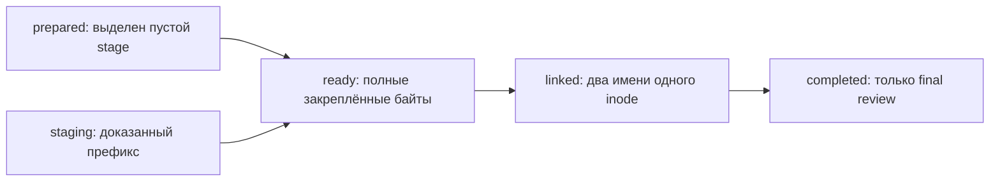

# Поэтапная запись неизменяемого рассмотрения

Статус: тридцать второй этап локального прототипа. Отдельное write job заранее сохраняет точное будущее рассмотрение и привязку собственного staging-файла. Последующие шаги завершают запись в прежнем формате review.

Обычный development-сценарий завершился с первой попытки. После него выполнены отдельные независимые сверки публичных результатов, частных привязок и сохранности публикации; их границы приведены ниже.

- [Рассмотрение плана и отдельная актуальность](workspace-restore-case-retention-review.md).
- [Сохраняемый план удержания](workspace-restore-case-retention.md).
- [Поэтапное восстановление workspace](workspace-restore-job.md).
- [Дорожная карта](roadmap.md).

## 1. Зачем сохранять отдельное write job

Review связывает самозаявленное мнение участника с точным историческим планом. Завершённую запись можно прочитать повторно без прежнего plan, каталога и случаев. Для продолжения самой записи требуется заранее закрепить будущие байты, назначение и собственный рабочий файл.

Write job сохраняет такой intent один раз. Он содержит полную будущую частную review14, её неизменяемые ID и clock, каталог назначения, пустую review lock и выделенный inode staging-файла. Дальнейшие команды получают эти данные из intent; исходный plan повторно не захватывается.

Новый протокол сохраняет прежний формат review. После завершения действуют обычные `show`, точный `record` replay и отдельный `revalidate` предыдущего этапа. Состояние write job описывает прогресс сохранения; основания и verdict будущего рассмотрения остаются прежними.

## 2. Подготовка и граница продолжения

`prepare` выполняет metadata-only preflight исходного plan, освобождает его lock, затем резервирует отдельные job и review directories. Выделяются частные lock-файлы и пустой staging-файл. После повторного захвата и сравнения основания сохраняется полный канонический intent.

Job, review и plan находятся отдельными соседями под одним private parent. Пути назначения также отделены от захваченного каталога и выбранных case paths. Каталоги имеют права 0700, файлы — 0600; ссылки и типы файлов проверяются по предусмотренному контракту.

Граница поддержанного продолжения начинается с полного действительного intent. Окна до него, включая созданные каталоги, пустые controls либо частично записанный intent, остаются неподдержанными. Остатки без доказанного intent не усыновляются, не удаляются и не достраиваются автоматически.

Подготовка фиксирует самозаявленные actor и verdict. Значения `reviewed`, `defer` и `request_fresh_plan` сохраняют смысл предыдущего этапа. Создание write job не удостоверяет личность и не выдаёт разрешения архивирования, удаления или публикации документации.

## 3. Состояния и обычные шаги

| State | Поддержанное наблюдение |
| --- | --- |
| `prepared` | Собственный staging inode существует и пуст; final review отсутствует |
| `staging` | Тот же inode содержит непустой правильный префикс ожидаемых байтов |
| `ready` | Собственный stage содержит точные полные байты и имеет одну ссылку; final отсутствует |
| `linked` | Stage и final являются двумя именами одного inode, имеют точные байты и число ссылок 2 |
| `completed` | Stage отсутствует, final сохраняет тот же закреплённый inode с одной ссылкой |

В обычном полном проходе нужны три команды `step` после `prepare`:

1. Достроить собственный stage до закреплённых байтов и выполнить предусмотренный fsync; получить `ready`.
2. Создать final через hard link без перезаписи назначения и синхронизировать каталоги; получить `linked`.
3. После проверки обоих имён убрать только собственное staging-имя и синхронизировать изменения; получить `completed`.

`status` наблюдает физическое состояние файлов без исправления и не заверяет его долговечность. Предусмотренная синхронизация выполняется во время шагов записи. Повторный `step` завершённого job возвращает сохранённый результат без нового review ID либо времени. Каждая команда выполняет один предусмотренный переход; произвольная точка прерывания или callback в API и CLI не принимается.

Состояние `staging` предусмотрено для продолжения доказанного собственного префикса. Обычный development-сценарий этого этапа не вводит прерывание посреди записи; фактическая проверка таких прерываний остаётся отдельной работой.

## 4. Почему важен закреплённый inode

Одного ожидаемого имени файла либо похожего JSON-префикса недостаточно для продолжения. Intent содержит static pin выделенного stage: device, inode, owner UID и mode 0600. Перед дописыванием сверяются эта привязка, тип, число ссылок и точный ожидаемый префикс.

Дописываться может только доказанный собственный inode с одной ссылкой и правильным префиксом. Несовпадающие байты, другой inode, неподдержанный тип либо неожиданный состав каталога блокируют действие. Замена чужого файла и восстановление произвольного повреждённого final не предусмотрены.

Hard link создаёт новое имя уже подготовленного файла без замены существующего назначения. Если final появился на другом inode, одинаковое содержимое само по себе не устанавливает владение. Для состояния `linked` требуются один и тот же inode, две ссылки и точные полные байты.

Завершающий шаг удаляет собственное staging-имя только после такой проверки. Final review остаётся на месте. Эта операция завершает публикацию управляющей записи; она не удаляет исходные cases, jobs, планы или данные workspace.

## 5. Совместимость с прежним review reader

Завершённый review directory содержит ровно два прежних control files: `.agentwiki-restore-case-retention-review.json` и `.agentwiki-restore-case-retention-review.lock`. Канонический record сохраняет прежнюю частную форму из 14 полей и публичную форму из 16 полей.

Состояние `linked` ещё не является завершённым review: record имеет две ссылки. Прежний reader проверяет единственность ссылки и отказывает при таком состоянии. Удаление доказанного staging-имени возвращает final к требуемой одной ссылке; после этого старые команды читают обычное рассмотрение.

Новый публичный status заранее показывает `intended_review`, чтобы caller мог назвать закреплённый предмет работы. Поле `result` появляется только при `completed`. Предполагаемый результат до завершения не выдаётся за уже доступный прежнему reader факт.

Исторические причины плана сохраняются. Текущую доступность plan, catalog, cases и связанных попыток наблюдает отдельный `revalidate` предыдущего этапа. Само завершение write job не подтверждает актуальность этих входов.

## 6. Публичный status17

Правила имеют имя `workspace-restore-case-retention-review-write-1`; `write_id` имеет вид `wrrw_` и 32 шестнадцатеричных символа. Ответы `prepare`, `status` и `step` используют одну точную форму из 17 полей:

| Поля | Содержание |
| --- | --- |
| `rules_version`, `write_id` | Версия правил и собственный ID write job |
| `operation_id`, `created_at` | Зафиксированные запрос и clock |
| `state`, `completed` | Одно из пяти состояний и признак завершения |
| `intended_review` | Полный закреплённый публичный review16 |
| `result` | Тот же review16 при завершении, иначе `null` |
| Девять flags | Прежние фиксированные границы review |

`completed=true` допустим ровно при `state=completed`. Непустой `result` должен канонически совпадать с `intended_review`. Operation ID и created_at согласуются с закреплённой review; повторный вызов не добавляет новый clock.

Девять flags сохраняются на каждом состоянии:

~~~json
{
  "advisory_only": true,
  "inspection_only": true,
  "domain_writes_allowed": false,
  "original_files_modified": false,
  "archival_authorized": false,
  "deletion_authorized": false,
  "actor_authenticated": false,
  "old_authority_activated": false,
  "external_fencing_established": false
}
~~~

Запись новых управляющих job/review files отделена от доменных изменений и изменения исходных материалов. Публичный ответ не включает private paths, inode pins, stage contents, request digests либо контрольные суммы.

## 7. Частный intent13

Job directory содержит следующие предусмотренные controls:

| Файл | Назначение |
| --- | --- |
| `.agentwiki-restore-case-retention-review-write.json` | Неизменяемый канонический intent |
| `.agentwiki-restore-case-retention-review-write.lock` | Пустой файл локальной блокировки |
| `.agentwiki-restore-case-retention-review-write.part` | Закреплённый собственный stage до завершения |

После завершения staging-имя отсутствует; intent и lock сохраняются. Intent ограничен 16 MiB вместе с прежним ограничением структуры JSON. Поддержанный вход обязан удовлетворять обоим ограничениям.

В intent ровно 13 полей: `schema_version`, `rules_version`, `write_id`, `operation_id`, `created_at`, `job_path`, `parent`, `job_directory`, `review_path`, `review_lock`, `review_record`, `stage_pin`, `request_digest`.

`review_record` — полный будущий review14. Он связывает точный прежний plan snapshot, anchor5 и source7. Прежние проверки восстанавливают известный исходный plan14 из захваченных данных и сверяют собственный request digest, канонические SHA/размер. Для этой offline-проверки не читается живой plan либо catalog; неизвестные поля повреждённых restore plans не реконструируются.

`review_lock` сохраняет полный pin пустого target lock. `stage_pin` закрепляет static identity заранее выделенного regular file с правами 0600. Собственный request digest intent связывает остальные сохранённые поля, включая job, назначение и точные будущие данные.

Частные pins и digests являются локальными контрольными привязками. Они не удостоверяют человека, не доказывают независимость редакторов и не создают внешнего заверения истории.

## 8. Offline-продолжение и точный повтор

После полного intent `status` и `step` используют собственные job controls, закреплённое назначение и сохранённые будущие байты. Исходный plan, каталоги, case/job directories и backup bundle для продолжения не требуются.

Точный повтор `prepare` сверяет прежние plan/review/job paths, operation ID, actor и verdict, затем возвращает текущий status того же job. Изменение параметров конфликтует с сохранённым запросом. Replay не создаёт новый intent и не перезахватывает сегодняшнее основание.

Успешный ответ может быть потерян после завершения перехода. Повторное чтение status позволяет узнать фактическое поддержанное состояние. Повторный step продолжает от него, сохраняя write ID, review ID, actor, verdict и clock. Гарантия относится к распознаваемым сохранённым состояниям и предусмотренному порядку команд.

Для восстановления отброшенного ответа step используется read-only status: повторный step уже может продвинуть следующую фазу. Точный prepare replay также возвращает текущую фазу того же job; совпадение полного ответа с прежним наблюдается, пока фаза не изменилась.

## 9. Блокировки и границы времени

Команды используют единый кооперативный deadline 60 секунд. Порядок локальных блокировок — job lock, затем review lock. Захват plan metadata выполняется с освобождением preflight lock до резервирования каталогов и с повторной проверкой предусмотренного основания.

Один и тот же job сериализует согласованные обращения через lock. Несколько callers могут последовательно продвигать его, не переписывая intent и не выдавая разные будущие review. `status` сохраняет read-only поведение при каждом распознанном состоянии.

Локальные flocks работают в принятой модели доверия владельца файлов. Протокол не предоставляет общей SQL/filesystem транзакции, глобального fencing или непрерывной гарантии неизменности после ответа. Успешный fsync в локальном сценарии не является измеренной гарантией после потери питания, сбоя ядра или хранилища.

## 10. Несколько агентов и смысловое содержание

Теоретически N callers могут обращаться к одному write job; переходы этого job сериализуются. Другие jobs используют отдельные каталоги и review destinations. Из этого не следует измеренный предел N, ускорение или справедливое распределение работы: ограничение параллелизма и нагрузку нужно оценивать отдельно.

Такой протокол полезен для сохранения одного точного предмета рассмотрения при смене исполнителя. Первый процесс закрепляет байты, другой продолжает предусмотренный шаг, последующие читатели получают ту же историческую review. Номер процесса и его завершение не устанавливают независимость экспертных мнений.

Для документации похожая граница нужна между предложенным текстовым снимком, мнением редактора и сохранённым фактом рассмотрения. Поэтапная запись помогает сохранить этот факт и его основание. Содержательная проверка утверждений, источников, противоречий и полноты описи требует отдельных предметных правил.

В этом этапе write job записывает рассмотрение retention plan. Семантический редактор вики, разрешение противоречащих текстовых правок, внешние учётные записи и право публикации текста не реализованы. Сохранность review не устанавливает истинность документации или корректность поведения предложенного кода.

## 11. API и команды

Программный интерфейс `agentwiki.workspace_restore_case_retention_review_write`:

- [Реализация протокола](../../agentwiki/workspace_restore_case_retention_review_write.py).
- [CLI и строгий публичный status](../../agentwiki/workspace_restore_case_retention_review_write_cli.py).

~~~python
prepare_review_write(
    plan_directory,
    review_directory,
    job_directory,
    operation_id=operation_id,
    actor=actor,
    verdict="reviewed",
)
inspect_review_write(job_directory)
step_review_write(job_directory)
~~~

Подготовка выполняется один раз для отдельных private siblings:

~~~sh
python3 -m agentwiki workspace-restore-case-retention-review-write prepare \
  --plan /tmp/agentwiki-private/retention-plan \
  --review /tmp/agentwiki-private/retention-review \
  --job /tmp/agentwiki-private/retention-review-write \
  --actor reviewer-01 --verdict reviewed \
  --operation-id retention-review-write-01
~~~

Наблюдение и один переход:

~~~sh
python3 -m agentwiki workspace-restore-case-retention-review-write status \
  --job /tmp/agentwiki-private/retention-review-write
python3 -m agentwiki workspace-restore-case-retention-review-write step \
  --job /tmp/agentwiki-private/retention-review-write
~~~

При обычном `prepared` команда step вызывается три раза для `ready`, `linked` и `completed`. После завершения используется прежний `workspace-restore-case-retention-review show --review ...`. Дополнительные зависимости, внешние модели и новый сервер для этого формата не требуются.

Обычный [демонстратор](../../agentwiki/workspace_restore_case_retention_review_write_demo.py) запускается из корня checkout в новом каталоге:

~~~sh
python3 -m agentwiki workspace-restore-case-retention-review-write-demo \
  --workspace /tmp/agentwiki-restore-case-retention-review-write-01 --workers 3
~~~

Он повторяет прежнее основание, затем использует новые ordinary prepare/status/step. Параметр workers относится к прежнему локальному пулу. Запуск двух step callers до сбора ответов рассматривается отдельно от измерения временного перекрытия процессов, throughput и предельной ёмкости.

## 12. Фактические результаты

Обычная команда завершилась с первой попытки. Время отчёта: `2026-10-21T23:58:59.081997+02:00`, Europe/Berlin. Публичные результаты находятся в `examples/workspace-restore-case-retention-review-write/results`; private controls остались вне Git.

| Наблюдение | Фактический результат |
| --- | --- |
| Публичные файлы | 359: 345 JSON и 14 Markdown |
| Повторённое основание | 341 прежний публичный файл |
| Добавлено этим этапом | 18 файлов: шесть этапов, десять data JSON и два отчёта |
| Write jobs | Два новых job; четыре выбранные строки в каждом intended plan |
| Review records | Две новые review, всего четыре с прежним основанием |
| Новые ordinary CLI | 58: 41 успешный ответ и 17 ожидаемых отказов |
| Составной сценарий | 371 ordinary CLI и 14 прежних interrupt workers, всего 385 различных PID |
| Восстановленные ответы | Два реально полученных и отброшенных ответа: prepare и ready-step |
| Offline-продолжение | Завершён один заранее подготовленный job без 14 исходных live paths |
| Новые прерывания | Ноль новых fault workers и injected partial writes |

Первый моделируемый actor закрепил `reviewed` для minimum plan, второй — `defer` для long plan. Оба intended reviews сохраняют точные прежние планы, их причины, собственные ID и clocks. После завершения старые show и record replay вернули ровно эти intended reviews.

Для minimum два обычных CLI-процесса step запущены до сбора любого из ответов. Получены различные последовательные состояния `ready` и `linked`; порядок их получения не использован как гарантия порядка исполнителей. Третий step завершил запись. Временное перекрытие процессов, ожидание lock, throughput и предельная ёмкость этим наблюдением не измерялись.

Для long заранее выполнен prepare, затем временно переименованы четыре plan directories, два каталога, четыре case directories, три attempt jobs и source bundle. При отсутствии этих 14 путей работали exact prepare replay, status и три шага до completed. Обычные старые show/record также вернули сохранённое рассмотрение. Все имена возвращены в finally; старые blocked jobs никогда не перемещались.

Настоящий ответ prepare проверен, отброшен и восстановлен точным prepare replay до смены фазы. Настоящий ответ ready-step восстановлен read-only status. Повторный step для восстановления этого ответа не вызывался, поскольку он мог бы продвинуть job в linked. Эфемерные сравнительные digests не экспортированы.

В артефакте states сохранены 22 отдельных успешных status17: шесть prepared, два ready, четыре linked и десять completed. Состояние staging не создавалось искусственно. Старый reader ожидаемо отказал дважды для ещё не опубликованного review и дважды для linked с двумя ссылками. Среди остальных отказов — пять invalid_input, пять конфликтов точного запроса и три прежних blocked status.

После возврата live paths две отдельные revalidations подтвердили совпавшее наблюдаемое основание. Minimum сохранил две held-строки с неизвестной исходной identity, long — четыре held-строки из-за срока, включая две неизвестные identity. Verdict, завершение записи и совпадение основания сохранили advisory-статус.

Прежние review records, планы, catalog pages, case details и blocked jobs остались прежними. Полные file metadata и static directory identities сравнивались без directory times, меняющихся при rename. Source сохранил R4/36 событий, живая история — R5/59; публичное сравнение исключает только верхний вычисляемый governance observed_at. Новых attempts, credentials, grants, доменных решений, архивирования и удаления сверх повторённого основания нет.

Публичные основания:

- [Читаемый отчёт](../../examples/workspace-restore-case-retention-review-write/results/restore-case-retention-review-write-report.md) и [машинный отчёт](../../examples/workspace-restore-case-retention-review-write/results/restore-case-retention-review-write-report.json).
- [Состояния](../../examples/workspace-restore-case-retention-review-write/results/restore-case-retention-review-write-states.json), [CLI](../../examples/workspace-restore-case-retention-review-write/results/restore-case-retention-review-write-cli-outcomes.json) и [отказы](../../examples/workspace-restore-case-retention-review-write/results/restore-case-retention-review-write-rejections.json).
- [Восстановление ответов](../../examples/workspace-restore-case-retention-review-write/results/restore-case-retention-review-write-reply-recovery.json), [два запущенных caller](../../examples/workspace-restore-case-retention-review-write/results/restore-case-retention-review-write-launched-callers.json) и [совместимость review](../../examples/workspace-restore-case-retention-review-write/results/restore-case-retention-review-write-review-compatibility.json).
- [Сохранность controls](../../examples/workspace-restore-case-retention-review-write/results/restore-case-retention-review-write-control-observations.json), [отдельное текущее основание](../../examples/workspace-restore-case-retention-review-write/results/restore-case-retention-review-write-current-basis-observations.json), [источник](../../examples/workspace-restore-case-retention-review-write/results/restore-case-retention-review-write-source-observations.json) и [живая среда](../../examples/workspace-restore-case-retention-review-write/results/restore-case-retention-review-write-live-observations.json).

После запуска выполнены отдельные независимые сверки:

- Частный read-only аудитор завершился с первой попытки. Проверены два intent13 и четыре review14, включая две прежние и две новые записи. Точная историческая реконструкция plan14, request digests, канонические SHA/размер, полный target lock pin и права 0700/0600 согласованы. Final имеет ровно закреплённый stage inode с одной ссылкой, staging-имя отсутствует. Публичные status17, intended/result, 58 CLI и последовательные состояния двух запущенных caller согласованы с частными controls.
- Та же частная сверка сохранила четыре retention plans с 16 members, четыре case и четыре link, два каталога с семью members и 18 страницами. Из 19 restore plans действительны 18, один остаётся частичным; проверены 16 завершённых восстановлений с 48 data files и три blocked остатка. Байты равны источнику, origin/quarantine и точный частичный prefix сохранены. SQLite integrity/foreign keys и R4/36, R5/59 с одним отзывом согласованы. Ремонт и реконструкция неизвестной полной identity частичного plan не выполнялись.
- Сверка адресованных оснований восстановила пять различных full packets, четыре перехода, шесть content-политик, восемь governance-политик, один audit root и три checkpoint edges с scope. Согласованы 3030 acceptance/continuity references; два checkpoint остаются pending, один history_complete. Это повторяющиеся ссылки в публичных материалах, а не число независимых решений.
- Самостоятельный публичный аудит с первой попытки подтвердил 359 файлов, строгий разбор 345 JSON, 337 относительных ссылок в 14 Markdown-результатах, все 371 CLI и 385 различных PID. Пересчитаны flags, identity, причины и сравнения, все stage payloads, replay и source-free последовательности.
- Строгие схемы согласованы для 48 вхождений write17, 133 review16, 34 revalidation16, 136 comparison4, 98 binding2, 160 plan17, по 777 row5 и observation3, 205 catalog12, 39 page8, 111 catalog entry3, 1712 case13, 924 link14, 813 show5, 1886 status15 и 1110 summary18. Эти повторные вхождения не означают новые независимые observations или участников.
- Privacy/preservation-сверка сохранила побайтно 3617 прежних защищённых файлов и 359 экспортированных копий. Разобраны 3689 JSON и 92 Python-исходника; 25 прежних модулей и девять SCHEMA остались прежними. В 4124 публичных кандидатах не обнаружены значения 305 известных credentials, их хеши, 228 частных контрольных сумм/привязок либо частные controls. Четыре review records и два write intents остались вне публикации, staging-имена отсутствуют. Пересчитаны адреса 196 full packet instances, 3030 continuity chains, 228 transitions, 11 audit headers и 13 checkpoints.
- Дополнительный независимый публичный обзор с первой попытки выполнил 71034 логических сравнения, включая 31805 сравнений прежнего основания, и 359 побайтных сравнений экспортов — всего 71393. Согласованы 345 strict JSON, 14 Markdown и 337 ссылок, четыре review, два write jobs, 22 сохранённых ответа states и 48 вхождений write17. Новая часть материалов содержит 91 вхождение review16, четыре revalidation16, 93 plan17 и 388 row5; это повторённые представления сохранённых данных. Сценарий и учёт 58 новых CLI, 371 ordinary CLI и 385 различных PID подтвердились.

Проверки подтверждают согласованность предусмотренных файловых состояний, данных и адресованных оснований. Они сохраняют ограничения прикладного сценария: смысловая истинность текста, независимость участников и промышленная ёмкость этим результатом не установлены.

Новый write workflow не добавляет fault workers, SIGKILL или инъекций ошибок к повторённому основанию. Частичная запись stage не воспроизводилась. Путь продолжения доказанного префикса предусмотрен реализацией; демонстрация нормальных полных переходов не подтверждает все аварийные расписания.

## 13. Следующие задачи

Отдельно остаются проверка поддержанных прерываний записи, поведение хранения после аппаратных отказов, политика аутентифицированного рассмотрения и отдельная операция с актуальной проверкой основания перед действием. Неполные controls до первого durable intent требуют самостоятельного протокола.

Для портала документации следующая содержательная работа включает полноту предметной описи, независимую разметку и оценивание того, сохраняет ли каждый reviewer точный смысл цитат и изменений. Число процессов и корректный filesystem protocol таких выводов не дают.
