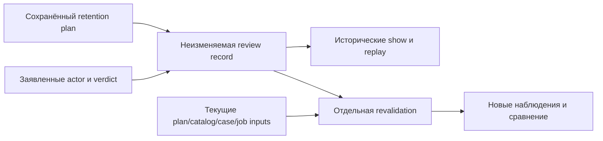

# Рассмотрение плана удержания и отдельная проверка текущего основания

Статус: тридцать первый этап локального прототипа. Отдельная review record связывает заявленный итог рассмотрения с точным сохранённым retention plan. Историческое чтение review и новая проверка текущих входов имеют разные результаты и время.

**Обычный development-запуск успешно завершён 21 октября 2026 года с первой попытки.** Две review records сохранили целые исторические планы; 15 отдельных revalidations показали неизменившееся, изменившееся и недоступное основание. Независимые публичные, частная и privacy-сверки завершены успешно. Результаты приведены в разделе 12.

- [Сохранённый план удержания](workspace-restore-case-retention.md).
- [Явный каталог случаев](workspace-restore-case-catalog.md).
- [Исторический случай и отдельная попытка](workspace-restore-cases.md).
- [Дорожная карта](roadmap.md).
- [Запуск примера](../../examples/workspace-restore-case-retention-review/README.md).
- [Фактический отчёт](../../examples/workspace-restore-case-retention-review/results/restore-case-retention-review-report.md).

## 1. От оценки к сохраняемому рассмотрению

Retention plan сохраняет выбранную область, срок, один clock и причины `held` либо `review_candidate`. Последующий процесс должен уметь назвать точный рассмотренный снимок и заявленный итог, сохраняя его строки и известные ограничения.

Review record фиксирует такой итог для всего плана. Она сохраняет исходные case receipts, позиции, причины удержания и момент оценки. Неизвестная исходная identity остаётся неизвестной; завершение новой попытки не дописывает параметры прежнего запроса.

Текущая доступность исходных путей может измениться после рассмотрения. История review продолжает отвечать на вопрос, какой снимок был рассмотрен. Новая `revalidate` отдельно наблюдает текущие control bindings, case details и классификацию на новом clock.

## 2. Заявленный итог и actor

Предусмотрены три значения verdict:

| Verdict | Значение сохранённой записи |
| --- | --- |
| `reviewed` | Caller заявил, что рассмотрел точный план |
| `defer` | Caller зафиксировал отложенное рассмотрение |
| `request_fresh_plan` | Caller заявил необходимость отдельной новой оценки |

Actor является самозаявленным идентификатором caller. `actor_authenticated=false` сохраняет эту границу: идентификатор не удостоверяет человека, организацию или независимость модели. Verdict не подтверждает внимательное чтение каждого документа и не заменяет проверку полномочий последующего действия.

Каждый вариант сохраняет `advisory_only=true`, `archival_authorized=false` и `deletion_authorized=false`. Review не активирует старые grants/leases, не архивирует и не удаляет исходные case/job/DB files. Сам факт рассмотрения также не меняет причины `held`.

## 3. Три слоя основания

| Слой | Что он сохраняет или наблюдает |
| --- | --- |
| Retention plan | Историческую политику, clock, выбранные case receipts и подробности |
| Review record | Точный рассмотренный план, заявленный actor/verdict и собственную identity |
| Revalidation | Новые датированные наблюдения привязок и подробностей, затем отдельное сравнение с историей |

Снимок review не становится изменяемой головой прогресса. Новое рассмотрение получает собственную запись; новая проверка текущих входов не переписывает прежний verdict либо время.

## 4. Публичная запись рассмотрения

Review использует `rules_version=workspace-restore-case-retention-review-1` и ID вида `wrrv_` с 32 шестнадцатеричными символами. Публичная запись имеет ровно 16 полей:

| Поля | Содержание |
| --- | --- |
| `rules_version`, `review_id`, `operation_id`, `created_at` | Версия правил, собственная identity и момент записи рассмотрения |
| `actor`, `verdict` | Самозаявленный участник и один итог для всего плана |
| `plan` | Полный прежний публичный retention plan из 17 полей |
| Девять flags | Фиксированные границы ответа |

Одинаковые девять flags применяются к review и revalidation:

~~~json
{
  "advisory_only": true,
  "inspection_only": true,
  "domain_writes_allowed": false,
  "original_files_modified": false,
  "archival_authorized": false,
  "deletion_authorized": false,
  "actor_authenticated": false,
  "old_authority_activated": false,
  "external_fencing_established": false
}
~~~

Вложенный план сохраняет собственные прежние восемь flags; новый признак `actor_authenticated` принадлежит review и revalidation. Рассмотрение не редактирует строки плана, не добавляет quorum и не принимает список разрешений. Значения actor и operation ID проходят предусмотренную проверку ограниченного идентификатора.

## 5. Историческое чтение и точный replay

Сохранённая review читается без текущего доступа к исходному plan, каталогам, case directories, jobs и backup bundle. Для этого она содержит проверенный публичный plan snapshot и частные привязки, достаточные для проверки самой записи.

Точный replay `record` использует те же plan path, review directory, operation ID, actor и verdict. Он сохраняет review ID, время и весь исходный план; повторный live read исходного plan для завершённой записи не требуется. Изменение параметров вызывает конфликт. История не переоценивается по сегодняшнему состоянию файлов.

Восстановление реально полученного и отброшенного ответа проверяется отдельно от прерывания записи review control file. Чтение завершённой записи само по себе не подтверждает восстановление после всех возможных сбоев.

## 6. Что сравнивает новая проверка

Revalidation возвращает исходный review и отдельно проверяет текущую доступность и идентичность plan/catalog controls. Затем выбранные case details наблюдаются последовательно по закреплённым исходным receipts и private pins. Исчезновение plan либо catalog не исключает эти строки из результата: обе control bindings и все выбранные случаи наблюдаются отдельно.

Новые строки используют прежние `retain_seconds`, case receipts, индексы и выбранный диапазон, а возраст рассчитывается на новом `checked_at`. Условие достаточного возраста — `case.created_at <= checked_at - retain_seconds`. Поэтому истёкший срок может изменить причины и disposition при тех же файлах. Такая смена классификации остаётся видимой. Revalidation не создаёт новый plan ID и не выдаёт изменённые строки за прежний неизменяемый plan.

Сравнение разделяет три признака:

- `observations_equal`: совпадают ли канонические представления полных сохранённых и новых observations.
- `classification_equal`: совпадают ли disposition и полный упорядоченный список reasons.
- `observations_verifiable`: являются ли оба observations доступными, с `original_evidence.state=unchanged` и `current_attempt.state` из `available` либо `not_linked`.

Равные ответы `unavailable` сохраняют одну и ту же ограниченную ошибку. Эти ответы не устанавливают сохранность недоступных файлов. Изменённое либо недоступное evidence или attempt остаётся самостоятельным основанием непроверяемости.

Доступная явно отсутствующая link может наблюдаться как `not_linked`; соответствующая причина удержания сохраняется. Неизвестная исходная identity также остаётся причиной `held`, даже если доступные ограниченные observations совпали. Проверяемое неизменившееся основание удержания допустимо: совпадение не требует, чтобы строка была кандидатом.

## 7. Схема датированного результата

Публичная revalidation имеет ровно 16 полей:

| Поля | Содержание |
| --- | --- |
| `rules_version`, `review`, `checked_at` | Версия правил, полный исторический review16 и новый clock |
| `plan_binding`, `catalog_binding` | Независимые наблюдения текущих управляющих привязок |
| `entries` | По одному сравнению для каждой выбранной строки |
| `observed_basis_unchanged` | Вычисляемая совокупность сравнений |
| Девять flags | Те же фиксированные ограничения |

Каждая binding содержит ровно `state` и `error_code`:

| State | Plan error code | Catalog error code |
| --- | --- | --- |
| `unchanged` | `null` | `null` |
| `changed` | `workspace_restore_case_retention_review_plan_changed` | `workspace_restore_case_retention_review_catalog_changed` |
| `unavailable` | `workspace_restore_case_retention_review_plan_unavailable` | `workspace_restore_case_retention_review_catalog_unavailable` |

Каждый элемент `entries` имеет ровно четыре поля: `current`, `observations_equal`, `classification_equal`, `observations_verifiable`. Поле `current` — строка прежней формы из пяти полей: `index`, `case`, `observation`, `disposition`, `reasons`. Её `observation` сохраняет форму `state`, `detail`, `error_code`; причины заново вычисляются на `checked_at` по прежним правилам retention.

`observed_basis_unchanged=true` допустим ровно при двух bindings `unchanged` и всех трёх истинных признаках каждой строки. Результат проверяется из вложенных данных, а не принимается на доверии к переданному boolean. Одинаковые `unavailable` дают `observations_equal=true`, но `observations_verifiable=false`, поэтому совокупный результат остаётся false.

Новый clock устанавливает время отдельного прохода, а не атомарное состояние всех объектов. Clock override в API и CLI не предусмотрен. Датированный ответ не сохраняется как новая управляющая запись, не меняет review и не разрешает исполнение.

## 8. Значение для нескольких процессов и документации

Несколько callers могут читать одну неизменяемую review и сравнивать её с отдельно полученными текущими результатами. Это сохраняет предмет разговора: участники видят один рассмотренный plan, его исходные причины и конкретные новые расхождения. Другой actor может записать собственное рассмотрение того же plan в новом review directory; общий изменяемый verdict не требуется.

Такая запись не распределяет исключительные work leases и не доказывает независимость участников. Два одинаковых verdicts или совпавших observations не становятся двумя независимыми предметными подтверждениями.

Практический цикл для команды состоит из трёх отдельных обращений: сохранить review точного плана, дать другим процессам исторический show, затем получить revalidation перед новым решением. Сохранённая ссылка на review позволяет обсуждать разные текущие результаты без подмены общего прошлого. Пока новый verdict только запрошен, `request_fresh_plan` не создаёт план автоматически.

Теоретически N reviewers могут иметь N записей для одного снимка, а N readers — читать одну запись. Предельное число одновременно работающих агентов этим этапом не измерено. Ограничение плана в 16 выбранных строк из каталога до 256 участников задаёт объём одного прохода, а не количество агентов или документов портала. Дополнительные читатели увеличивают число файловых чтений и конкуренцию за локальные locks; производительность требует отдельного измерения.

Для портала документации полезно отдельно сохранять предложение редактора, замечания проверяющего и основание принятия с адресом конкретного текстового снимка. Рассмотрение retention plan показывает принцип сохранения точного предмета обсуждения и отдельного текущего сравнения. Этот этап работает со случаями восстановления, их controls и попытками; роли семантического редактора, проверку ссылок на источники и разрешение конфликтующих утверждений он не реализует.

Файловое основание восстановления помогает сохранять историю работы над документацией и программным кодом. Оно не устанавливает истинность текста, полноту семантической описи, корректность поведения программы либо право публикации результата. Эти основания требуют отдельных содержательных правил и текущих полномочий.

## 9. Частное основание и самостоятельность истории

Review directory создаётся отдельным соседом plan под тем же private parent. Review, plan, source catalog и выбранные case paths должны оставаться предусмотренными раздельными каталогами. Каталоги требуют права 0700, файлы — 0600. Внутри review directory допустимы ровно два файла:

| Файл | Ограничение |
| --- | --- |
| `.agentwiki-restore-case-retention-review.json` | Каноническая неизменяемая запись не более 16 MiB |
| `.agentwiki-restore-case-retention-review.lock` | Постоянный пустой файл локальной блокировки |

Байтный предел применяется вместе с прежними ограничениями JSON-структуры. Writer проверяет будущий record до сохранения по предусмотренным reader limits. Произвольный JSON того же размера не является поддержанным входом.

Частная запись имеет ровно 14 полей: `schema_version`, `rules_version`, `review_id`, `operation_id`, `created_at`, `review_path`, `parent`, `review_directory`, `actor`, `verdict`, `plan_anchor`, `plan_snapshot`, `plan_source`, `request_digest`.

Поле `plan_anchor` имеет пять полей: `plan_path`, `plan_directory`, `plan_record`, `plan_lock`, `plan_request_digest`. Поле `plan_snapshot` — точный прежний публичный plan17. Поле `plan_source` сохраняет прежние семь полей source: `catalog_path`, `catalog_directory`, `catalog_record`, `catalog_lock`, `catalog_request_digest`, `catalog`, `members`.

Эти захваченные данные и общий private parent достаточны, чтобы при историческом чтении точно восстановить прежнюю частную plan14: известные сохранённые поля сверяются с её собственным request digest, каноническим SHA и размером record. Чтение live plan либо catalog для такой проверки не требуется. Это восстановление состава ранее сохранённой записи; неизвестная исходная case identity из него не выводится.

Полное тело исходного catalog по-прежнему не скопировано. Его request digest остаётся ранее захваченным opaque anchor; пересчёт digest отсутствующего catalog body не заявляется. Собственный request digest review связывает actor/verdict, plan snapshot, anchors, source и остальные сохранённые поля.

## 10. Границы захвата и блокировки

Операция использует единый кооперативный deadline 60 секунд для ожидания и чтений. Plan/catalog metadata locks освобождаются до последовательных подробных чтений case/job; собственная review lock может оставаться удержанной. Одновременно не удерживается более одной case и одной job lock; общий SQL/filesystem snapshot не заявляется. Истечение общего deadline завершает всю revalidation ошибкой; успешная частичная страница не возвращается. Локальные flocks координируют предусмотренные callers, сохраняя границу доверия владельца файлов.

Частные source anchors, пути, request digests, filesystem pins и контрольные суммы остаются вне публикации. Публичные ответы содержат только предусмотренные безопасные snapshots и ограниченные состояния ошибок.

Revalidation повторно наблюдает предусмотренные control bindings и использует сохранённые pins выбранных случаев. Такой проход выявляет поддержанные изменения или недоступность входов. Результат не заверяет владельца файлов и не гарантирует, что входы останутся теми же после завершения ответа.

## 11. API и воспроизведение

Программный интерфейс модуля `agentwiki.workspace_restore_case_retention_review`:

~~~python
record_review(
    plan_directory,
    review_directory,
    operation_id=operation_id,
    actor=actor,
    verdict="reviewed",
)
inspect_review(review_directory)
revalidate_review(review_directory)
~~~

Сохранение совещательного рассмотрения всего плана:

~~~sh
python3 -m agentwiki workspace-restore-case-retention-review record \
  --plan /tmp/agentwiki-private/retention-plan \
  --review /tmp/agentwiki-private/retention-review \
  --actor reviewer-01 --verdict reviewed \
  --operation-id retention-review-01
~~~

Историческое чтение и отдельная текущая проверка:

~~~sh
python3 -m agentwiki workspace-restore-case-retention-review show \
  --review /tmp/agentwiki-private/retention-review
python3 -m agentwiki workspace-restore-case-retention-review revalidate \
  --review /tmp/agentwiki-private/retention-review
~~~

Для другого рассмотрения требуется новый review directory. Значения `defer` и `request_fresh_plan` используют тот же контракт. CLI не принимает правки отдельных строк, quorum, разрешение удаления либо подмену clock. Дополнительные зависимости для этого формата не требуются: используются Python, стандартная библиотека и прежние требования POSIX private permissions.

Обычный составной демонстратор запускается из корня checkout в новом каталоге:

~~~sh
python3 -m agentwiki workspace-restore-case-retention-review-demo \
  --workspace /tmp/agentwiki-restore-case-retention-review-01 --workers 3
~~~

Он заново выполняет основание предыдущего этапа. Параметр workers относится к прежнему локальному worker pool; новая review не запускает внешние LLM и не измеряет число одновременно работающих редакторов портала.

## 12. Фактические результаты

Обычная команда успешно завершилась с первого запуска. Время отчёта: `2026-10-21T22:55:13.893172+02:00`, Europe/Berlin. Публичный экспорт находится в `examples/workspace-restore-case-retention-review/results`; private control records остались вне Git. Это локальный сценарий с двумя моделируемыми самозаявленными участниками; человеческое рассмотрение и внешняя LLM не заявлены.

| Рассмотрение | Actor и verdict | Исторический plan | Отдельная текущая проверка |
| --- | --- | --- | --- |
| `minimum` | `simulated-operator-a`, `reviewed` | Кандидаты 1 и 3; позиции 2 и 4 удержаны из-за неизвестной исходной identity | Обе bindings unchanged, все сравнения true; прежние два удержания остаются |
| `missing_attempt` | `simulated-operator-b`, `request_fresh_plan` | Кандидат 1; позиция 3 удержана с `attempt_unavailable`, позиции 2 и 4 — с `original_identity_unknown` | Попытка позиции 3 уже доступна, текущие кандидаты 1 и 3; все три сравнения позиции 3 false, совокупное основание false |

Во втором случае текущий кандидат не доказывает прежнюю доступность попытки. Исторический review и plan сохранили старую причину удержания. Verdict `request_fresh_plan` зафиксирован без автоматического создания нового плана.

| Наблюдение | Результат запуска |
| --- | --- |
| Публичные файлы | 341: 328 JSON и 13 Markdown |
| Новые материалы | 18: шесть этапов, десять файлов данных и два отчёта; повторённое основание — 323 файла |
| Сохранённые review records | Две записи по четыре строки исторического плана |
| Отдельные revalidations | 15 датированных результатов по четыре текущие строки |
| Новые ordinary CLI | 45: 34 успешных ответа и 11 ожидаемых отказов |
| Составной сценарий | 313 ordinary CLI и 14 workers прежнего основания, всего 327 дочерних процессов |
| Новые прерывания | Новых workers или SIGKILL этого этапа нет |
| Потеря ответа | Один полученный и проверенный review-ответ отброшен; точный replay восстановил тот же публичный результат |
| Чтение без live inputs | Два исторических show и точный review replay при временном отсутствии 14 путей |
| Историческое состояние | R4/36 событий; действующая среда — R5/59 |
| Архивирование и удаление | Не выполнялись; разрешающие flags остались false |

Для `minimum` отдельно временно скрывались attempt job позиции 3 и case directory этой позиции. Первый проход сохранил доступный case detail с `current_attempt=unavailable` и причиной `attempt_unavailable`; второй — case observation unavailable с `case_unavailable`. Все три сравнения затронутой строки стали false. После возврата каждого исходного пути новые наблюдения вновь совпали с историческим планом; review не переписывался.

Отдельно временно отсутствовали source catalog и исходный plan. Соответствующая binding становилась unavailable, другая оставалась unchanged; все четыре выбранные строки продолжали наблюдаться и совпадали с историей. Совокупное основание оставалось false. При отсутствии plan исторический show и exact replay также сохранили прежний ответ.

Замена исходного plan directory другим существующим plan дала `plan_binding.state=changed`. Исходные файлы обоих plans не редактировались; каталоги вернулись на прежние пути в finally. Текущие строки оставались совпадающими, но изменившаяся control binding удержала совокупный результат false.

В общем offline-проходе временно отсутствовали четыре plan directories, два каталога, четыре case directories, три attempt job directories и source bundle. Исторические show/replay работали по собственным review controls. Отдельный revalidate дал unavailable для обеих bindings и всех четырёх случаев; все сравнения и `observed_basis_unchanged` стали false. Все 14 путей возвращены в finally. Старые blocked job directories не перемещались.

Один успешный record-ответ действительно получен и проверен до отбрасывания. Его сравнительный адрес использовался только внутри демонстратора; digest не опубликован. Это восстановление потерянного ответа, а не прерывание записи review record.

Одиннадцать ожидаемых отказов состоят из четырёх invalid_input нового протокола, четырёх конфликтов и трёх прежних blocked status. Неподдержанные запросы включали слишком длинные actor и operation ID, actor с недопустимым символом и совпадение review/plan directory. Конфликты относились к другому operation ID, actor, verdict и plan path того же review. Прежние jobs сохранили два manifest-invalid и один job-conflict.

Финальные show двух reviews, minimum plan, обе catalog pages и три case details совпали с основанием. Полные file metadata управляющих файлов и статические directory identities сохранились; изменяемые rename timestamps каталогов не сравнивались. Источник R4/36 и действующая среда R5/59 сохранили публичные наблюдения с исключением только вычисляемого верхнего `governance.observed_at`. Новых restore attempts, credentials, grants и предметных решений сверх повторённого основания не создавалось.

Публичные основания:

- [Читаемый отчёт](../../examples/workspace-restore-case-retention-review/results/restore-case-retention-review-report.md) и [машинный отчёт](../../examples/workspace-restore-case-retention-review/results/restore-case-retention-review-report.json).
- [Два рассмотрения](../../examples/workspace-restore-case-retention-review/results/restore-case-retention-review-records.json), [15 текущих результатов](../../examples/workspace-restore-case-retention-review/results/restore-case-retention-review-revalidations.json) и [сравнения](../../examples/workspace-restore-case-retention-review/results/restore-case-retention-review-comparisons.json).
- [CLI-исходы](../../examples/workspace-restore-case-retention-review/results/restore-case-retention-review-cli-outcomes.json), [ожидаемые отказы](../../examples/workspace-restore-case-retention-review/results/restore-case-retention-review-rejections.json) и [восстановление ответа](../../examples/workspace-restore-case-retention-review/results/restore-case-retention-review-reply-recovery.json).
- [Сохранность controls](../../examples/workspace-restore-case-retention-review/results/restore-case-retention-review-control-observations.json), [case details](../../examples/workspace-restore-case-retention-review/results/restore-case-retention-review-restored-detail-observations.json), [исторический источник](../../examples/workspace-restore-case-retention-review/results/restore-case-retention-review-source-observations.json) и [действующая среда](../../examples/workspace-restore-case-retention-review/results/restore-case-retention-review-live-observations.json).

После запуска выполнены отдельные независимые сверки:

- Сверка адресованных публичных оснований восстановила пять различных полных пакетов, четыре перехода, шесть content-политик, восемь governance-политик, один аудит и три checkpoint edges с соответствующим scope. Согласованы все 2934 вхождения acceptance references; это повторяющиеся ссылки в публичных материалах, а не число независимых решений или агентов.
- Публичный аудит подтвердил 341 файл, 319 относительных ссылок в 13 Markdown-результатах, 45 новых CLI-исходов и 327 различных PID составного сценария. Схемы, flags, вложенные данные, текущие reasons, три сравнения, aggregate и шесть этапов независимо согласованы.
- Строгая публичная проверка охватила 42 вхождения review16, 30 revalidation16, 120 comparison4, 90 binding2, 67 plan17, по 389 row5 и observation3, 110 catalog12, 37 page8, 104 catalog entry3, 926 case13, 526 link14, 422 show5, 1099 status15 и 623 summary18. Это вхождения в повторяющихся материалах, а не разные независимые наблюдения.
- Отдельная частная сверка root проверила две review14, восемь выбранных members и все 15 revalidations. Точные прежние plan14 восстановлены из захваченных данных и сверены по собственным request digests, каноническим SHA/размеру, pins и правам 0700/0600. Сохранены четыре retention plans с 16 выбранными members, четыре case, четыре link, два каталога с семью members и 18 страницами.
- Та же частная сверка подтвердила 19 прежних restore plans: 18 действительных и один частичный; 16 завершённых восстановлений с 48 data files и три blocked остатка. Данные источника и результатов побайтно равны, origin/quarantine и точный частичный prefix сохранены, SQLite integrity/foreign keys согласованы. История остаётся R4/36 и R5/59; неизвестная исходная identity частичных records не реконструировалась. Ремонт не выполнялся, частные значения не раскрывались.
- Независимая дополнительная публичная сверка выполнила 31805 логических сравнений и 341 побайтное сравнение экспортированных копий, всего 32146. Подтверждены два records, 15 revalidations и 60 текущих логических строк, строгий разбор 328 JSON, 13 Markdown и 319 ссылок результатов. Повторные вхождения review/revalidation сохраняют точное совпадение с двумя исходными records.
- Privacy/structure-сверка root сохранила побайтно 3269 прежних защищённых файлов и все 341 экспортированные копии. Разобраны 3341 JSON и 89 Python-исходников; 22 прежних модуля и девять SCHEMA остались прежними. В 3754 проверенных публичных кандидатах не обнаружены значения 282 известных credentials, их хеши и 220 частных контрольных сумм/привязок. Частные controls, SQLite и credentials остались вне публикации.

Успешные сверки сохраняют границы сценария. Обычный запуск не воспроизводил частичную запись review, новые отказы хранения, все расписания конкуренции либо промышленный предел нагрузки. Сохранность файлов и адресованных оснований не подтверждает смысловую истинность документации или независимость участников.

## 13. Следующие задачи

Отдельно остаются устойчивость записи control records к прерываниям, политика полномочий возможного действия, долговременное хранение и проверка актуального основания непосредственно перед исполнением. Revalidation не предоставляет разрешение на исполнение.

Измерение конкуренции, полнота истории, внешнее удостоверение actor, качество смыслового содержания и независимость редакторских решений требуют самостоятельной оценки.
