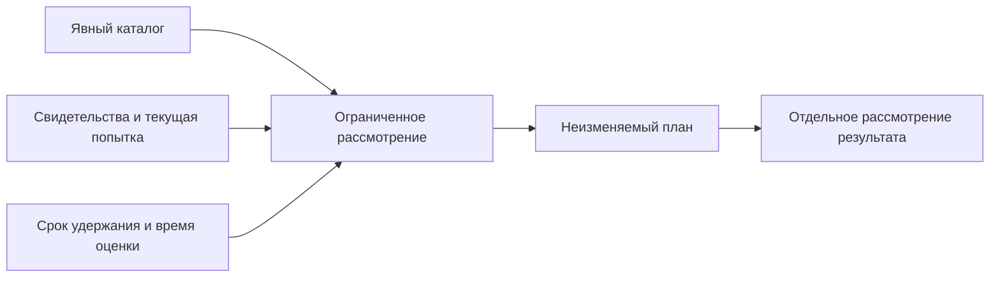

# Сохранённый план удержания случаев восстановления

Статус: тридцатый этап локального прототипа. Отдельный план сохраняет выбранную область каталога, параметры удержания и результаты ограниченного рассмотрения случаев. Оценка остаётся совещательной; исходные case records, jobs, DB и архивы сохраняются.

**Обычный development-запуск успешно завершён 21 октября 2026 года с первой попытки.** Четыре плана сохранили разные пороги и текущие препятствия; потерянный ответ восстановлен точным replay. Исторические show/replay работали без live source paths. Независимые публичная, частная и privacy-сверки завершены успешно. Результаты приведены в разделе 13.

- [Случай отказа и отдельная попытка](workspace-restore-cases.md).
- [Постраничный явный каталог](workspace-restore-case-catalog.md).
- [Пошаговое восстановление](workspace-restore-job.md).
- [Дорожная карта](roadmap.md).
- [Запуск примера](../../examples/workspace-restore-case-retention/README.md).
- [Фактический отчёт](../../examples/workspace-restore-case-retention/results/restore-case-retention-report.md).

## 1. Зачем сохранять основание удержания

Каталог закрепляет выбранный состав и порядок случаев. Его страница показывает доступность управляющих записей, сохраняя историческую квитанцию при исчезновении пути. Для решения о дальнейшем хранении этого недостаточно: нужно явно назвать срок, доступное основание и причины, по которым запись следует удерживать.

Сохранённый retention plan фиксирует такую оценку. Другой процесс может прочитать тот же результат или восстановить потерянный ответ без подмены прежнего наблюдения новым. Изменение файлов после создания плана требует новой оценки с отдельной идентичностью.

Возраст записи сам по себе не подтверждает завершение попытки, сохранность исходных свидетельств либо известность исходного запроса. Эти основания проверяются и сохраняются раздельно.

## 2. Четыре основания процесса

| Основание | Что оно сохраняет |
| --- | --- |
| Case receipt | Историческое наблюдение поддержанного раннего отказа |
| Catalog membership | Явно выбранный состав и устойчивый порядок |
| Retention plan | Выбранные параметры, момент оценки и результаты рассмотрения ограниченной области |
| Отдельное рассмотрение | Последующее решение с собственными полномочиями и требованиями к сохранности |

План помогает восстановить ход работы между процессами. Его результат не активирует исторические grants или leases и не создаёт разрешения на изменение документов, DB либо файлов восстановления.

## 3. Время оценки и возраст case

В плане фиксируется один момент оценки и явно переданный срок удержания. Возраст относится к сохранённому времени создания case record. Он не восстанавливает неизвестное время первоначального сбоя и не удостоверяет показания внешних часов.

`retain_seconds` — выбранный caller локальный совещательный порог от 0 до 315360000 секунд. Он не задаёт внешнюю или правовую политику хранения. Единственный сохранённый `created_at` плана используется как clock сравнения: условие возраста выполнено, когда `case.created_at <= plan.created_at - retain_seconds`. Будущее время case оставляет причину `retention_period_not_elapsed`.

Один момент оценки даёт общее основание для возрастных сравнений внутри плана. Текущие свидетельства разных участников всё равно наблюдаются последовательно; общий момент SQL или файловой системы этим не устанавливается.

Старый неизменяемый план продолжает содержать прежнюю оценку после истечения дополнительного времени. Его повторное чтение не пересчитывает возраст и не превращает удерживаемый случай в новый кандидат.

## 4. Кандидат и причины удержания

Оценка разделяет `review_candidate` и `held`. Кандидат означает, что предусмотренные ограниченные условия выполнены для сохранённого наблюдения и запись можно передать на отдельное рассмотрение. Удержание сохраняет причины отсутствия такого основания.

Для кандидата требуются достаточный возраст, известная исходная identity, неизменившиеся исходные свидетельства и доступная завершённая карантинная попытка. Само наличие исторической link receipt не устанавливает её текущий прогресс: зафиксированный `prepared` может относиться к уже завершённому job, а прежний `completed` не доказывает сегодняшнюю доступность файлов.

Известная identity из плана и состояние evidence `unchanged` сохраняют прежнюю причину отказа. Они не устанавливают доказанную принадлежность исходного target: отсутствие либо недействительная форма owner остаётся историческим фактом. Кандидат передаёт эти границы на отдельное рассмотрение.

Отсутствующая исходная identity у `plan_invalid` сохраняется как неизвестная. Параметры прежнего worker, знакомое имя каталога либо знания caller не дописывают её задним числом. Успешная связанная попытка также не восстанавливает неизвестные поля исходного запроса.

Недоступные или изменённые свидетельства, отсутствие link, непроверяемая либо незавершённая попытка остаются явными основаниями удержания. Запись не исключается из выбранной области ради увеличения числа кандидатов.

Правило известной исходной identity является консервативным условием отдельного рассмотрения этого прототипа. Оно не устанавливает принадлежность исходного target и не заменяет предметную политику хранения. Доля кандидатов относится к выбранной области и заявленным условиям; она не измеряет качество документации либо полноту всех случаев на машине.

## 5. Текущие наблюдения и сохранённый результат

План использует закреплённую квитанцию участника каталога. При текущем изменении или недоступности case path исторический участник сохраняется в результате вместе с ограниченным состоянием наблюдения.

Доступная case record позволяет отдельно наблюдать старое evidence и связанную попытку. Обычный текущий status завершённого job может читать данные, полную историю и DB в режиме чтения. Такой объём работы отличается от metadata-only страницы каталога и требует собственного ограничения.

Сохранённый результат содержит безопасные публичные наблюдения. Частные пути, полные планы, ownership records, request digests, filesystem pins и контрольные суммы остаются в частном основании.

## 6. Блокировки и границы захвата

При создании плана входной каталог проверяется как ограниченная неизменяемая запись. Выбирается непустой последовательный диапазон: `after_index` от 0 до `catalog.case_count - 1`, `limit` от 1 до 16. Число выбранных участников равно `min(limit, case_count - after_index)`; исходные индексы и порядок сохраняются. Пустая конечная страница остаётся возможностью прежнего catalog page; сохранённому retention plan нужны выбранные случаи.

Каждый запрос создания имеет общий срок 60 секунд. Перед резервированием plan directory выполняется предварительное чтение catalog metadata, после которого catalog lock освобождается. Под собственной plan lock каталог повторно читается и сверяется с предварительным основанием. Catalog lock освобождается до дорогих подробных наблюдений. Далее под plan lock берётся не более одной case-блокировки; внутри неё старый и связанный jobs наблюдаются по очереди под отдельными job locks.

Одновременное удержание всех case locks или двух job locks не требуется. Совпадение наблюдений не объявляется общей транзакцией каталога, файлов и SQLite.

Общий срок охватывает весь вызов, включая ожидание блокировок и последовательное чтение. Нельзя выдавать истёкший общий бюджет за успешно завершённый план с незаметно пропущенными участниками.

Валидация входа читает всю ограниченную запись каталога до 2 MiB и проверяет её состав до 256 участников. Подробное текущее чтение ограничено выбранными позициями до 16. Проверка completed attempt может хешировать её файлы и выполнять read-only inspect/SQL; лимит позиций не является измеренным ограничением времени на произвольном хранилище или числом LLM-агентов.

Неполная либо неподтверждённая запись самого плана должна оставаться блокирующей. Восстановление результата по сохранённой записи отделяется от ремонта частичного control file.

## 7. Повторы и потеря ответа

Создание плана имеет собственный operation ID и точные неизменяемые параметры. Точный повтор возвращает сохранённый исторический результат. Другая область или политика требует отдельной операции; она не переписывает исходный план.

Чтение сохранённого плана не требует текущей доступности исходного каталога, case directories, jobs или backup bundle. Доступность такого ответа показывает сохранность самого плана и его привязок, сохраняя прежний момент оценки.

Если ответ успешного создания был получен и отброшен, точный replay может вернуть тот же безопасный результат. Такой сценарий отличается от прерывания внутри записи control file; отдельное подтверждение каждого из них сохраняется явно.

## 8. Применение к нескольким процессам

Один процесс выбирает явный каталог и параметры удержания. Другие процессы могут получать сохранённые планы для выбранных областей, читать причины и готовить отдельное рассмотрение. Повтор чтения не создаёт новую независимую экспертизу.

Сам план не резервирует случаи за исполнителями и не удостоверяет личность оператора. Для исключительного владения нужны отдельные аренды, учёт результатов и правила повторной доставки. Число вызывающих процессов не определяет число независимых оснований.

Та же схема полезна для многоагентной работы с техническим порталом: сохраняется область рассмотрения, заявленная политика и видимые препятствия, а последующий редактор может воспроизвести основание. Текущий протокол рассматривает операционные случаи восстановления. Полнота смысловой описи, истинность текста, корректность кода и независимость редакторов требуют собственных предметных оснований.

## 9. Публичный план: 17 полей

Идентификатор плана имеет вид `wrrp_` и 32 шестнадцатеричных символа. Публичный ответ plan и show содержит ровно 17 полей:

| Поле | Значение |
| --- | --- |
| `rules_version` | `workspace-restore-case-retention-1` |
| `plan_id` | Локальная идентичность сохранённого плана |
| `operation_id` | ID точного запроса plan |
| `created_at` | Единственный фиксированный момент возрастной оценки |
| `catalog` | Историческая публичная 12-полевая квитанция каталога |
| `policy` | Ровно `{retain_seconds}` |
| `after_index` | Число пропущенных исходных позиций |
| `limit` | Запрошенная граница от 1 до 16 |
| `entries` | Непустой выбранный диапазон с исходными индексами |
| `advisory_only` | `true` |
| `inspection_only` | `true` |
| `domain_writes_allowed` | `false` |
| `original_files_modified` | `false` |
| `archival_authorized` | `false` |
| `deletion_authorized` | `false` |
| `old_authority_activated` | `false` |
| `external_fencing_established` | `false` |

Флаг `original_files_modified=false` относится к исходным материалам; создание собственных частных plan controls сохраняется как действие команды. Кандидаты также сохраняют `archival_authorized=false` и `deletion_authorized=false`.

Счётчик `catalog.case_count` относится ко всему исходному составу. `entries` охватывает только выбранный диапазон; вне его не выводятся ни оценки, ни доля выполнения условий. Входные `retain_seconds`, `after_index` и `limit` являются целыми числами; bool не принимается за integer.

## 10. Строка и причины удержания

Каждая строка содержит ровно пять полей:

| Поле | Значение |
| --- | --- |
| `index` | Исходный 1-based индекс в каталоге |
| `case` | Закреплённая историческая case receipt из 13 полей |
| `observation` | `state`, `detail`, `error_code` |
| `disposition` | `review_candidate` либо `held` |
| `reasons` | Упорядоченный список предусмотренных причин |

Наблюдение имеет ровно три поля:

| State | Detail | Error code |
| --- | --- | --- |
| `available` | Публичный case show из пяти полей | `null` |
| `changed` | `null` | `workspace_restore_case_retention_case_changed` |
| `unavailable` | `null` | `workspace_restore_case_retention_case_unavailable` |

Доступный `detail.case` совпадает с закреплённой квитанцией участника. Его `original_evidence` и `current_attempt` сохраняют прежние строгие схемы show; историческая link и текущий status остаются разными основаниями. Состояние `completed` проверяется вместе с полным историческим результатом и фиксированными карантинными flags валидатора status15/summary18. Неподдержанные safety facts не дают допустимый completed status.

Причины собираются в следующем фиксированном порядке:

1. `retention_period_not_elapsed`, если возрастного основания ещё нет.
2. `original_identity_unknown`, если исходная identity закреплённой case равна `null`.
3. `case_changed` либо `case_unavailable` при соответствующем текущем case observation. При такой ошибке подробных причин evidence/attempt нет: `detail=null`.
4. При доступном detail — `original_evidence_changed` либо `original_evidence_unavailable`, если старое evidence не подтверждено как `unchanged`.
5. При доступном detail — одна из `attempt_not_linked`, `attempt_changed`, `attempt_unavailable`, `attempt_not_completed`, если предусмотренного завершённого текущего результата нет.

`review_candidate` допустим ровно при пустом `reasons`; непустой список означает `held`. Причины не удаляются ради смены disposition и не сортируются произвольно. Исчезнувший участник остаётся на своём индексе с исторической case receipt и доступными основаниями удержания.

Примеры применения правила к уже проверенным входам:

| Сохранённое основание | Reasons | Disposition |
| --- | --- | --- |
| Возраст достаточен, исходная identity известна, evidence unchanged, текущая попытка completed | `[]` | `review_candidate` |
| Те же наблюдения при неизвестной исходной identity | `[original_identity_unknown]` | `held` |
| Срок не истёк, identity известна, case path недоступен | `[retention_period_not_elapsed, case_unavailable]` | `held` |
| Возраст достаточен, identity известна и старое evidence unchanged, но текущая попытка недоступна при исторической completed-link | `[attempt_unavailable]` | `held` |

Последняя строка сохраняет различие исторической link и текущего attempt status. Она не выводит текущий результат из прежней квитанции.

## 11. Частное основание и сохранность

Plan directory является отдельным соседом выбранного каталога под тем же private parent. Каталоги требуют права 0700, файлы — 0600. Внутри допустимы ровно два управляющих файла:

| Файл | Ограничение |
| --- | --- |
| `.agentwiki-restore-case-retention.json` | Каноническая неизменяемая запись, не более 8 MiB |
| `.agentwiki-restore-case-retention.lock` | Постоянный пустой файл локальной блокировки |

Байтный предел применяется вместе с прежними ограничениями JSON-структуры. До сохранения writer проверяет размер и допустимую форму будущего record по предусмотренным reader limits; произвольный JSON того же размера не считается поддержанным входом.

Частная запись содержит 14 полей: `schema_version`, `rules_version`, `plan_id`, `operation_id`, `created_at`, `plan_path`, `parent`, `plan_directory`, `source`, `policy`, `after_index`, `limit`, `entries`, `request_digest`.

Сохранённый source имеет семь полей: `catalog_path`, `catalog_directory`, `catalog_record`, `catalog_lock`, `catalog_request_digest`, `catalog`, `members`. В нём закреплены статическая идентичность каталога, полные pins record/lock, исходный частный digest, публичная квитанция и только выбранные member records.

Каждый member сохраняет прежние шесть полей: `index`, `case_path`, `case`, `case_directory`, `case_record`, `case_lock`. Весь исходный catalog body в plan не копируется. При его недоступности source digest остаётся ранее захваченным адресом; пересчёт из отсутствующего тела не заявляется. Собственный request digest плана связывает все сохранённые поля, включая выбранные members и наблюдения.

Пути, private request digests и pins не выводятся в публичный результат. Эти привязки обнаруживают поддержанные расхождения, сохраняя локальную границу доверия владельца файлов; внешнее заверение автора или защита от самого владельца этим не устанавливается.

## 12. API и воспроизведение

Программный интерфейс модуля `agentwiki.workspace_restore_case_retention`:

~~~python
create_retention_plan(
    catalog_directory,
    plan_directory,
    operation_id=operation_id,
    retain_seconds=retain_seconds,
    after_index=0,
    limit=16,
)
inspect_retention_plan(plan_directory)
~~~

Создание совещательного плана для выбранных позиций:

~~~sh
python3 -m agentwiki workspace-restore-case-retention plan \
  --catalog /tmp/agentwiki-private/case-catalog \
  --plan /tmp/agentwiki-private/retention-plan \
  --retain-seconds 86400 --after-index 0 --limit 4 \
  --operation-id retention-plan-01
~~~

Чтение сохранённого результата:

~~~sh
python3 -m agentwiki workspace-restore-case-retention show \
  --plan /tmp/agentwiki-private/retention-plan
~~~

Повтор plan использует те же параметры. Другой operation ID, catalog path, срок либо диапазон для того же plan directory вызывает конфликт; неподдержанные типы и границы вызывают invalid input. CLI не принимает catalog cursor или `--catalog-id`: выбранная область задаётся `--after-index` и `--limit`. Значения по умолчанию — 0 и 16.

Для обычного демонстратора из корня checkout укажите новый каталог запуска:

~~~sh
python3 -m agentwiki workspace-restore-case-retention-demo \
  --workspace /tmp/agentwiki-restore-case-retention-01 --workers 3
~~~

Дополнительные зависимости для нового формата не требуются: используются Python, стандартная библиотека и прежние требования POSIX private permissions. Составной сценарий заново выполняет основание предыдущего этапа; worker pool относится к этому локальному основанию.

## 13. Фактические результаты

Обычная команда успешно завершилась с первого запуска. Время отчёта: `2026-10-21T20:52:38.223647+02:00`, Europe/Berlin. Публичный экспорт находится в `examples/workspace-restore-case-retention/results`; private control records остались вне Git.

Четыре плана выбрали исходные позиции 1–4 расширенного каталога. Порядок и case receipts сохранились; каждый план получил собственный неизменяемый evaluation clock.

| План | Retain seconds | Review candidate indices | Held indices | Дополнительное основание |
| --- | --- | --- | --- | --- |
| `minimum` | 0 | 1, 3 | 2, 4 | Две неизвестные исходные identity удержаны |
| `long` | 315360000 | Нет | 1, 2, 3, 4 | Срок не истёк ни у одного случая; причины неизвестной identity также сохранены |
| `missing_case` | 0 | 1 | 2, 3, 4 | Позиция 3 сохранила case receipt и `case_unavailable` |
| `missing_attempt` | 0 | 1 | 2, 3, 4 | У доступной позиции 3 старое evidence unchanged, но текущая попытка unavailable |

Исходная identity неизвестна на позициях 2 и 4 каждого плана. Она не реконструировалась из неполного plan. Два кандидата первого плана сохранили прежние причины owner_invalid/ownership_unproven и не получили разрешений на архивирование или удаление.

| Наблюдение | Результат запуска |
| --- | --- |
| Публичные файлы | 323: 311 JSON и 12 Markdown |
| Новые материалы | 18: 6 этапов, 10 файлов данных и 2 отчёта; повторённое основание — 305 файлов |
| Сохранённые планы | Четыре плана по четыре строки, всего 16 выбранных member records |
| Новые ordinary CLI | 38: 23 успешных ответа и 15 ожидаемых отказов |
| Составной сценарий | 268 ordinary CLI и 14 workers прежнего основания, всего 282 различных PID |
| Новые прерывания | Новых workers или SIGKILL этого этапа нет |
| Потеря ответа | Один действительно полученный и проверенный plan-ответ отброшен; exact replay восстановил тот же публичный результат |
| Историческое состояние | R4/36 событий; действующая среда — R5/59 |
| Архивирование и удаление | Не выполнялись; `archival_authorized=false`, `deletion_authorized=false` у всех планов |

При временном отсутствии case directory известного участника на позиции 3 новый план сохранил `observation.state=unavailable`, `detail=null` и причину `case_unavailable`. Возвращение того же пути не изменило уже сохранённый план.

В отдельной попытке временно отсутствовал связанный attempt job этого участника. Case controls оставались доступны, original evidence — unchanged, но current attempt — unavailable. Причина стала `attempt_unavailable`, а обычный case show совпал с захваченным detail. После возврата пути show плана сохранил прежнее наблюдение.

Затем временно скрывались десять live paths: два каталога, четыре case directories, три attempt job directories и source bundle. Все четыре show и точный plan replay работали по сохранённым records без этих входов. Пути возвращены в finally. Старые blocked job directories никогда не перемещались; их полные fingerprints сохранились.

Проверенный successful plan-ответ действительно существовал до отбрасывания. Сравнительный адрес безопасного публичного результата использовался только внутри демонстратора; сам digest не экспортировался. Этот случай не объявляется прерыванием записи plan record.

Пятнадцать ожидаемых CLI-отказов включают восемь invalid_input нового протокола, четыре конфликта и три прежних blocked status. Проверены отрицательный и превышающий предел срок, limit 0/17, отрицательное начало, пустой terminal range, неподдержанная длина operation ID и совпадение plan/catalog directory. Конфликты относятся к другому operation ID, сроку, source catalog и выбранному диапазону того же плана. Прежние jobs дали два manifest-invalid и один job-conflict.

Финальные страницы обоих каталогов и три подробных case show совпали с основанием. Control file identities и static directory identities сохранились; изменяемые rename timestamps каталогов не входили в это сравнение. Source/живые публичные наблюдения сохранили R4/36 и R5/59. Сравнение исключало лишь верхний вычисляемый governance.observed_at. Новых restore jobs, credentials, grants или решений участников сверх повторённого основания не создавалось.

Публичные основания:

- [Читаемый отчёт](../../examples/workspace-restore-case-retention/results/restore-case-retention-report.md) и [машинный отчёт](../../examples/workspace-restore-case-retention/results/restore-case-retention-report.json).
- [Четыре плана](../../examples/workspace-restore-case-retention/results/restore-case-retention-plans.json), [политики и причины](../../examples/workspace-restore-case-retention/results/restore-case-retention-policy-observations.json) и [восстановление ответа](../../examples/workspace-restore-case-retention/results/restore-case-retention-reply-recovery.json).
- [CLI-исходы](../../examples/workspace-restore-case-retention/results/restore-case-retention-cli-outcomes.json), [ожидаемые отказы](../../examples/workspace-restore-case-retention/results/restore-case-retention-rejections.json) и [чтение без live paths](../../examples/workspace-restore-case-retention/results/restore-case-retention-offline-observations.json).
- [Наблюдения control files](../../examples/workspace-restore-case-retention/results/restore-case-retention-control-observations.json), [подробные case observations](../../examples/workspace-restore-case-retention/results/restore-case-retention-restored-detail-observations.json), [исторический источник](../../examples/workspace-restore-case-retention/results/restore-case-retention-source-observations.json) и [действующая среда](../../examples/workspace-restore-case-retention/results/restore-case-retention-live-observations.json).

После запуска выполнены отдельные независимые сверки:

- Публичный аудит подтвердил 323 файла, точные коды всех 38 новых CLI-исходов и 282 различных PID составного сценария. Кандидаты 2/0/1/1, причины, диапазоны, неизменяемые clocks и offline observations согласованы. Разрешена 301 относительная ссылка в 12 отчётах Markdown результатов.
- Строгая проверка охватила 24 вхождения plan17, 96 row5, 96 observation3, 65 catalog12, 35 page8, 97 catalog entry3, 334 case13, 227 link14, 130 show5, 517 status15 и 268 summary18. Это вхождения в повторяющихся публичных материалах, а не число разных независимых оснований. Сканирование публичных полей и строк не обнаружило private keys, реальных private paths, bearer tokens, raw streams или сравнительного digest.
- Privacy/structure-сверка root сохранила побайтно 2939 прежних защищённых файлов и все 323 экспортированные копии. Разобраны 3010 JSON и 86 Python-исходников. В 3402 публичных кандидатах не обнаружены проверенные значения 259 известных credentials, их хеши и 216 частных контрольных сумм/привязок. Четыре recovery-плана, 19 restore plans, два частичных control records, четыре case, четыре link, два каталога и четыре retention plans остались вне публикации.
- Отдельная частная сверка root проверила четыре plan records и 16 точных выбранных members, канонические source catalog anchors, pins, request digests, policies, возрастной clock, причины, flags и offline results. Source хранит выбранные records, без подстановки целого отсутствующего catalog body.
- Прежние 19 restore plans включают 18 действительных и один частичный; сохранены 16 завершённых восстановлений с 48 data files и три блокирующих остатка, четыре case, четыре link и два каталога. Проверены побайтное равенство данных источника и результатов, полный origin/quarantine, UID и права 0700/0600, SQLite integrity/foreign keys. Ремонт не выполнялся, частные значения не раскрывались.
- Сверка адресованных оснований восстановила пять различных полных пакетов, четыре перехода, шесть content-политик, восемь governance-политик, один аудит и три checkpoint edges. Все 2838 acceptance/continuity references и три ребра с их scope совпали. Сохранность этих материалов не подтверждает предметную истинность документов или независимость участников.

Успешные сверки сохраняют границы сценария. Они не устанавливают устойчивость к прерываниям записи plan record, всем возможным расписаниям, отказу хранилища либо содержательную правильность документации.

## 14. Границы и следующие задачи

План не выполняет архивирование, удаление, перенос владения или активацию старых полномочий. Последующее действие требует самостоятельного протокола с проверкой актуального основания и сохранности данных.

Открытыми остаются устойчивость записи плана к прерываниям, политика долговременного хранения и отдельная авторизация исполнения. Оценка нагрузки, смыслового содержания документов и независимости участников не выводится из сохранности retention records.
