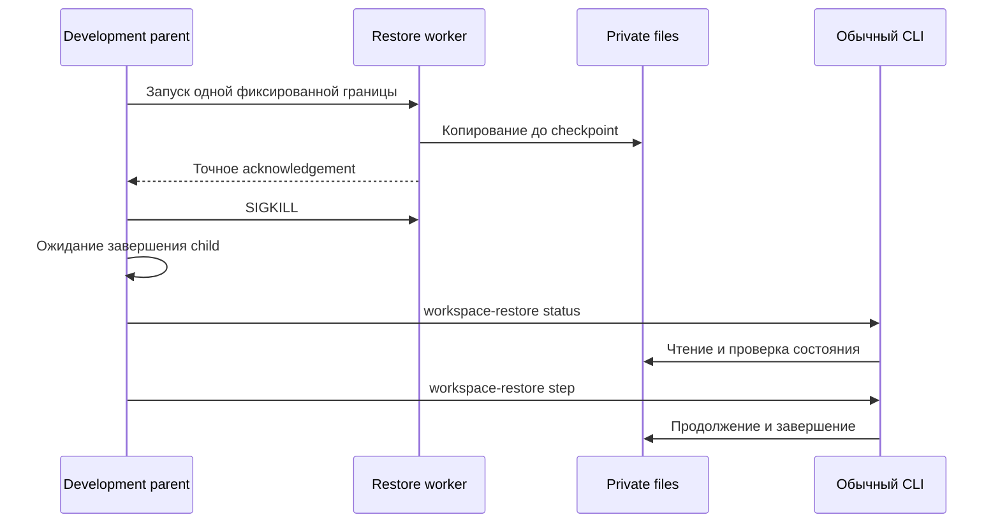

# Прерывание процесса пошагового восстановления

Статус: двадцать шестой этап локального прототипа. Development-сценарий останавливает отдельный процесс восстановления через `SIGKILL` в пяти заранее определённых точках. Затем обычные команды `workspace-restore status` и `step` проверяют состояние и продолжают ту же операцию.

**Обычный development-запуск успешно завершён 21 октября 2026 года.** Все пять workers достигли выбранных границ, завершились от `SIGKILL`, а обычные status/step продолжили их задания. Независимые сверки публичных результатов, частных артефактов и приватности публикации также завершены успешно; основания и границы приведены в разделе 12.

- [Контракт пошагового restore job](workspace-restore-job.md).
- [Полный workspace backup](workspace-backup.md).
- [Прикладной сценарий](../../examples/workspace-restore-interrupt/README.md).
- [Отчёт запуска](../../examples/workspace-restore-interrupt/results/restore-interrupt-report.md).
- [Машинный отчёт](../../examples/workspace-restore-interrupt/results/restore-interrupt-report.json).

## 1. Какой вопрос проверяется

Предыдущий этап выполняет ограниченные файловые шаги отдельными CLI-процессами. Обычное завершение шага сохраняет checkpoint; последующий вызов продолжает известное состояние. Такое выполнение не создаёт частично записанный staging и не останавливает процесс между установкой hard link и удалением его промежуточного имени.

Новый сценарий предназначен для наблюдения этих более узких состояний. Копирующий процесс действительно завершается принудительно; его обычный return, блоки finally и последующее удаление staging не выполняются. Продолжение использует уже предусмотренный протокол восстановления.

Задача ограничена локальным процессом, частными файлами и выбранными границами операции. Она не устанавливает результат при отключении питания, остановке ядра, повреждении носителя или произвольной подмене файлов владельцем.

## 2. Исходное состояние и независимые задания

Development-демонстратор сначала повторяет сценарий двадцать пятого этапа. Он получает полный исторический bundle, текущую действующую среду и прежние публичные основания. Для каждой из пяти точек создаётся отдельное новое restore job со своим планом, owner record, lock и назначением.

В предусмотренном основании исторический комплект содержит DB ревизии 4 с 36 событиями и два предковых архива. Действующая среда уже продолжила работу до ревизии 5 с поздним отзывом reviewer-допуска. Эти разные временные границы сохраняются при восстановлении.

Повторённый baseline и пять новых прерываний образуют один составной демонстратор. Выполненный запуск сохранил 227 публичных файлов baseline и добавил 19 файлов этого этапа. Результат каждой границы закреплён отдельно в [пяти случаях](../../examples/workspace-restore-interrupt/results/restore-interrupt-cases.json).

## 3. Изоляция development-механизма

В ядре предусмотрен частный no-op checkpoint:

~~~python
_checkpoint(boundary: str, *, item_index: int | None = None)
~~~

Обычные production-команды продолжают вызывать тот же код установки файлов. Checkpoint не принимает callback от пользователя, путь для записи, bytes файла, checksum или публичный status.

Только доверенный development worker в отдельном дочернем процессе заменяет этот no-op на фиксированное ожидание заранее выбранной границы. Первые три границы относятся только к файлам данных; worker выбирает основную DB с индексом 3 в предусмотренном порядке элементов задания.

Worker выполняет один `step_restore(limit=16)` над новым заданием фиксированного примера с тремя файлами данных. Общий протокол допускает до 17 файлов данных; этот worker не обещает достичь `data_ready` или `completed` для любого такого комплекта за один вызов. Если выбранная граница не достигнута, он завершает сценарий фиксированной безопасной ошибкой.

Публичные `prepare`, `step` и `status` не получают флаги принудительного отказа. Переменные среды не выбирают callback или точку остановки в production CLI. Механизм не является интерфейсом исполнения произвольного кода либо записи по переданному fault-path.

## 4. Подтверждение достигнутой точки и SIGKILL

Worker отправляет ограниченное подтверждение, сбрасывает stdout и ожидает сигнал. Фиксированный acknowledgement содержит только:

| Поле | Значение |
| --- | --- |
| `rules_version` | `workspace-restore-interrupt-1` |
| `boundary` | Один из пяти предусмотренных идентификаторов |
| `checkpoint_reached` | `true` |

В нём нет частных путей, размеров, inode, hashes, плана или ответа восстановления. Это служебное подтверждение development-сценария, а не business response обычного `workspace-restore`.

Родитель проверяет точную форму acknowledgement, соответствие ожидаемой границе и то, что его дочерний процесс ещё работает. Затем он посылает `SIGKILL` именно этому процессу и ожидает его завершения. Для напрямую запущенного POSIX child `Popen` наблюдает завершение от сигнала как отрицательный номер сигнала.

Ожидание подтверждения ограничено монотонным сроком 60 секунд и 4096 bytes; чтение выполняется через selector, без неограниченного `readline`. После сигнала родитель отводит 15 секунд на ожидание child и собирает оставшиеся stdout/stderr. Для успешного случая они должны быть пустыми. Обработка выхода и ошибок также завершает и ожидает собственного child.

У worker отдельно включён фиксированный POSIX alarm на 90 секунд с обычным действием `SIGALRM`. Он ограничивает жизнь остановленного worker, если development parent исчезнет. Срабатывание alarm не засчитывается как успешный `SIGKILL`-случай. Эти сроки принадлежат демонстратору и не добавляют fault-параметры в production CLI.

Сам факт отправки сигнала недостаточен. В выполненных материалах должны быть подтверждены достигнутая граница, принадлежность процесса, завершение от `SIGKILL` и исход последующих обычных команд.

## 5. Пять границ

Для фиксированного примера восстанавливаются три файла данных: основная DB и два архива. Метаданные не увеличивают `copied_file_count`.

| Граница | Место остановки | Наблюдённый status | `copied_file_count` | Returncode | DB inode сохранён |
| --- | --- | --- | ---: | ---: | --- |
| `staging_partial` | Записан, flush и fsync выполнены для правильного непустого префикса staging; остаток ещё не записан | `prepared` | 0 | `-9` | `null` |
| `staging_synced` | Полный staging проверен, flush и fsync завершены; установка target ещё не выполнялась | `prepared` | 0 | `-9` | `null` |
| `target_linked` | Hard link установлен и каталог target синхронизирован; промежуточное имя ещё существует | `copying` | 1 | `-9` | `true` |
| `data_ready` | Все три файла данных установлены и проверены; общий manifest ещё не завершён | `ready` | 3 | `-9` | `true` |
| `completed` | Полный completed status уже подтверждён; API ещё не вернул результат вызывающему коду | `completed` | 3 | `-9` | `true` |

Наблюдения совпали с ожидаемыми состояниями протокола: 0, 0, 1, 3, 3 установленных файлов. Последний столбец относится к сравнению после SIGKILL и после обычного step; для первых двух границ target DB до продолжения отсутствовала. Основания: [случаи](../../examples/workspace-restore-interrupt/results/restore-interrupt-cases.json) и [исходы workers](../../examples/workspace-restore-interrupt/results/restore-interrupt-worker-outcomes.json).

### 5.1. Неполный staging

`staging_partial` достигается после записи правильного префикса, длина которого строго больше нуля и меньше полного ожидаемого файла. Flush и fsync делают этот префикс наблюдаемым до принудительного завершения. Остаток исходного блока должен записываться только после возвращения из checkpoint.

Временный файл имеет собственное известное имя задания. Основной целевой DB ещё нет, поэтому счётчик установленных данных остаётся нулевым. Неполный staging не становится принимаемой DB и не открывает назначение для новых записей.

Обычный step проверяет неизменность входного bundle, распознаёт собственный staging cache и может создать его заново. Такая обработка относится к распознаваемому рабочему файлу данного плана; повреждённый опубликованный target этим путём не заменяется.

### 5.2. Полный синхронизированный staging

`staging_synced` находится после проверки полных bytes и fsync временного файла, но до создания целевого hard link. Полный staging всё ещё является рабочим промежуточным именем. Его наличие не увеличивает счётчик принятого назначения.

Восстановление не должно выдавать такой cache за уже установленный файл. Предусмотренный step может пересоздать собственный cache и повторить установку с проверкой исходного bundle.

### 5.3. Установленная пара имён

В `target_linked` staging и target обозначают один inode. У этой известной пары две ссылки, а полный целевой файл уже имеет ожидаемые bytes. Операция остановлена до удаления staging.

Read-only status распознаёт только доказанную пару по ожидаемым именам, устройству, inode, числу ссылок, правам и содержимому. Он учитывает один логический файл данных и сохраняет оба имени без ремонта.

Обычный step удаляет только доказанное собственное промежуточное имя, синхронизирует нужные каталоги и продолжает перенос. Неизвестный alias или другое содержимое остаются блокирующими; общая очистка либо перезапись target не разрешается.

### 5.4. Все данные перед общим manifest

В `data_ready` уже доступны основная DB и оба архива. Общая проверка полного destination и запись внешнего manifest ещё предстоят. Поэтому status показывает `ready`, а `full_history_preserved` остаётся false.

Следующий step может выполнить проверку и завершение по точному плану и локальным данным без исходного bundle. В выполненном сценарии исходный путь временно убран на время восстановления и возвращён в finally.

### 5.5. Завершение перед выдачей ответа

В `completed` результат уже прошёл полную проверку, но worker ещё не вернулся из API и не отправил business response. После SIGKILL обычный status заново подтверждает готовый bundle и выводит фиксированный результат.

Равенство проверяется между восстановленным status, повторным step, параметрами prepare и результатом полного inspect. Выданного до аварии business response в этом случае нет; сравнение с его утраченными точными bytes не является основанием вывода.

Двадцать пятый этап отдельно моделирует отбрасывание уже доступного ответа успешной команды. Текущая граница проверяет завершение операции до возврата результата из API.

## 6. Почему процессная блокировка освобождается

Worker удерживает прежний POSIX flock задания. При `SIGKILL` пользовательские обработчики и finally процесса не исполняются. Операционная система закрывает принадлежащие ему файловые дескрипторы; после завершения worker следующий отдельный CLI-процесс должен суметь получить блокировку.

Доказательством продолжения служит завершившийся обычный status или step после ожидания смерти child. Наличие файла lock не является признаком живого владельца и не требует удаления lock для повторного запуска.

Это поведение локальной процессной блокировки. Оно не предоставляет внешний lease, распределённое согласование, выбор лидера между машинами или гарантию при отказе ядра.

## 7. Наблюдение и ремонт

Status остаётся read-only во всех пяти случаях. Он использует план, owner record и файлы назначения; недостающий исходный путь не требуется для наблюдения сохранённого продвижения.

Development-наблюдатель сопоставляет файловую топологию до и после status. В публичные материалы достаточно вывести boolean равенства и признаки ожидаемого staging/alias. Частные размеры, inode, пути и hashes не публикуются.

Если основная DB уже установлена к моменту SIGKILL, наблюдатель также сопоставляет её устройство и inode до и после step и публикует только `installed_database_inode_preserved`. В запуске получено `true` для `target_linked`, `data_ready` и `completed`. Для `staging_partial` и `staging_synced` DB ещё нет, поэтому значение — `null`. Сами идентификаторы остаются частными.

Ремонт собственного cache и известной пары выполняет только step под flock. Для новых недостающих файлов он проверяет исходный полный bundle. Когда данные уже перенесены, ready-finalization и completed replay могут использовать только назначение и закреплённый план.

Разделение чтения и ремонта позволяет наблюдать состояние после смерти worker, не стирая само свидетельство прерванной операции. Сигнал завершения процесса не разрешает обойти owner record либо принять произвольный существующий каталог.

## 8. Связь с многоагентной работой

Job ID и operation ID обозначают одну операцию независимо от числа вызывающих процессов. Новый caller может продолжить прежний план; количество callers и число установленных файлов описывают разные величины.

В случае `target_linked` два имени файла не означают два принятых результата. Проверенный target представляет один логический файл, а известное промежуточное имя удаляется при продолжении. Смерть прежнего держателя flock позволяет следующему процессу продолжить ту же последовательность.

Свойство однократного business effect в этом ограниченном протоколе опирается на неизменяемые ожидаемые bytes, установку без замены, проверку уже принятого файла и стабильный повтор результата. Рабочий staging может копироваться повторно; это не создаёт новое содержательное принятие.

Такое локальное свойство не является distributed exactly-once delivery или consensus. Один файловый результат также не подтверждает смысловую истинность документов, независимость моделей или максимальное число LLM-агентов. Семантическое рассмотрение и координация авторских предложений сохраняют собственные основания.

## 9. Сохранность карантина и истории

Восстанавливаемая основная DB уже содержит постоянный quarantine marker. Когда target установлен, он сохраняет исторический origin, зависимости, grants, leases, решения и receipts исходного снимка.

Готовый результат остаётся полным bundle прежнего формата из шести записей. Job plan, owner, lock и staging расположены отдельно. Обычный `workspace-backup inspect` должен подтвердить DB и всю локальную цепочку архивов после восстановления.

SIGKILL не переоформляет прежние полномочия и не активирует восстановленную среду. Действующий источник может иметь более позднюю ревизию и поздние отзывы. Исторический статус скопированного grant не становится текущим правом записи.

## 10. Команды и воспроизведение

Нужны Python 3.10+, стандартная библиотека, POSIX-права частных файлов, hard links и сигналы процессов. Укажите новый пустой workspace из корня существующего checkout:

~~~sh
python3 -m agentwiki workspace-restore-interrupt-demo \
  --workspace /tmp/agentwiki-restore-interrupt-01 --workers 3
~~~

Демонстратор управляет только созданными им дочерними workers. После подтверждённого SIGKILL продолжение выполняется обычными командами:

~~~sh
python3 -m agentwiki workspace-restore status \
  --job /tmp/agentwiki-private/restore-job

python3 -m agentwiki workspace-restore step \
  --job /tmp/agentwiki-private/restore-job --limit 16

python3 -m agentwiki workspace-backup inspect \
  --bundle /tmp/agentwiki-private/job-restore
~~~

Последние пути обозначают частное задание и назначение конкретного запуска. Production CLI не требует включать режим сбоя для чтения или продолжения уже сохранённых файлов.

## 11. Какие свидетельства сохранять

Публичный отчёт должен связывать каждое независимое задание с точной границей и последующим результатом:

| Свидетельство | Что оно позволяет проверить |
| --- | --- |
| Safe acknowledgement и живой child перед сигналом | Worker достиг ожидаемой точки |
| PID, номер SIGKILL и код завершения | Остановлен созданный процесс, завершившийся от сигнала |
| Safe status до продолжения | Наблюдённое состояние и число принятых файлов |
| Boolean неизменности топологии после status | Чтение не выполнило cleanup |
| Признаки ожидаемого staging либо известной alias-пары | Получено предусмотренное частичное файловое состояние |
| Boolean сохранения inode ранее установленной DB | Step сохранил установленный файл при удалении промежуточного имени и продолжении |
| Результат обычного step и полного inspect | Готовый исторический bundle проверен |
| Равенство повторов и публичных Store-снимков | Стабильность результата и сохранность содержимого |

Формат acknowledgement ограничен тремя полями, status использует прежние 15 полей, вложенный результат — прежние 18 полей workspace backup. Ни один из них не требует публикации частного плана, request digest или fingerprint.

## 12. Фактический запуск

Обычная команда успешно завершилась с первого запуска:

~~~sh
python3 -m agentwiki workspace-restore-interrupt-demo \
  --workspace /tmp/infod10-workspace-restore-interrupt-development-01 --workers 3
~~~

Время завершения: `2026-10-21T17:14:37.890063+02:00`, Europe/Berlin. Публичный экспорт находится в `examples/workspace-restore-interrupt/results`; частные рабочие данные остались в каталоге запуска вне Git.

| Наблюдение | Результат запуска |
| --- | --- |
| Публичные файлы | 246: 238 JSON и 8 Markdown |
| Новые материалы этапа | 19: 7 этапов, 10 файлов данных и 2 отчёта; baseline — 227 файлов |
| Новые дочерние процессы | 20 обычных CLI и 5 interruption workers, всего 25 |
| Составной сценарий | 76 обычных CLI; вместе с 5 interruption workers — 81 процесс |
| Достигнутые границы | Все пять; точное acknowledgement, живой child перед сигналом, SIGKILL и reap с returncode `-9` |
| Состояния после SIGKILL | `prepared/0`, `prepared/0`, `copying/1`, `ready/3`, `completed/3` |
| Наблюдение status | Во всех пяти случаях staging/target metadata сохранились; чтение не выполнило cleanup |
| Продолжение step | Все пять заданий завершены; известная hardlink-пара исправлена только step; ранее установленная DB сохранила inode |
| Ready и completed без source bundle | Status, step, inspect и чтение DB/архивов выполнены при временно недоступном исходном пути; путь возвращён в finally |
| Исторические данные | В каждом результате R4, 36 событий и два архива; полная история и зависимости сохранены |
| Действующая среда | R5, 59 событий; её публичные записи не изменились |
| Полный inspect и повтор | Для пяти результатов `integrity=ok`, `foreign_keys=ok`; summary совпал с completed result, обычный step — с последующим status |
| Карантин | 10 отказов enqueue/publish, по два на каждое назначение; новые записи и публикация не выполнены |
| Полномочия и измерения | Старые права не активированы; внешний fencing, LLM и предельная нагрузка не установлены |

В `completed` до сигнала не выдавался business response. Совпали восстановленный status и последующие обычные step/status, а полный inspect подтвердил тот же результат. Равенство несуществовавшему прежнему ответу не заявляется.

Публичные основания:

- [Читаемый отчёт](../../examples/workspace-restore-interrupt/results/restore-interrupt-report.md) и [машинный отчёт](../../examples/workspace-restore-interrupt/results/restore-interrupt-report.json).
- [Пять случаев](../../examples/workspace-restore-interrupt/results/restore-interrupt-cases.json), [workers](../../examples/workspace-restore-interrupt/results/restore-interrupt-worker-outcomes.json) и [обычные CLI](../../examples/workspace-restore-interrupt/results/restore-interrupt-cli-outcomes.json).
- [Отказы записи и публикации](../../examples/workspace-restore-interrupt/results/restore-interrupt-rejections.json), [восстановленные DB](../../examples/workspace-restore-interrupt/results/restore-interrupt-target-observations.json) и [архивы](../../examples/workspace-restore-interrupt/results/restore-interrupt-archive-observations.json).
- [Действующая DB](../../examples/workspace-restore-interrupt/results/restore-interrupt-live-observations.json) и [исходная сводка](../../examples/workspace-restore-interrupt/results/restore-interrupt-source-summary.json).

После запуска выполнены отдельные независимые сверки:

- Проверка публичных оснований выполнила 259 сравнений содержимого, схем, идентичности, топологии и ссылок и сравнила все 246 экспортированных файлов с сохранёнными копиями; все 505 сравнений прошли без расхождений. Сравнение публичных Store-наблюдений исключает только верхний `governance.observed_at`; адресованные основания, timestamps и признаки истечения сохраняются.
- Частная проверка root обнаружила ровно семь ожидаемых jobs: два baseline и пять новых. Сверены каноническая форма планов и метаданных, привязка запроса и публичной identity, owner и физическое назначение, точный состав шести записей и двух архивов, а также полные bytes трёх файлов данных каждого задания.
- Отдельно подтверждены отсутствие staging, одна ссылка у конечных файлов, типы и владелец по lstat, точные права 0700/0600 без специальных битов, постоянный quarantine/origin и SQLite integrity/foreign keys. Исторические R4/36 и действующие R5/59 с поздним отзывом reviewer-допуска сохранились.
- Сверка публикации подтвердила сохранность прежних материалов, корректное чтение JSON/Python и отсутствие известных credentials, частных fingerprints и значений восстановительных планов в публичных кандидатах. Проверены и полные адресованные основания прежних этапов; это проверка сохранности и связи свидетельств, а не смысловой истинности документов.

Частные планы, request digests, owner records, inode, checksums и SQL-отпечатки не включаются в отчёт. Эти независимые сверки дополняют наблюдённый запуск в пределах его пяти фиксированных границ.

## 13. Ограничения и следующие задачи

Пять выбранных границ не исчерпывают все инструкции файловой операции. Ранние окна создания job plan, mkdir назначения, первого intent и owner record остаются вне обещания автоматического продолжения.

Сценарий останавливает отдельный процесс и сохраняет работающую ОС. Fsync префикса и полного staging не моделируют отключение питания или произвольный отказ контроллера. Повреждение SQL, утрата plan/owner, неизвестные hard links и замена уже принятого файла остаются отдельными блокирующими случаями.

Дополнительный fsync префикса и development-checkpoints могут менять число файловых операций и стоимость копирования. Сценарий предназначен для разбора состояний; throughput, задержки и предельная нагрузка по его результату не измеряются.

Дальнейшая работа может расширять набор явно поддерживаемых границ и политику хранения заданий. Каждое расширение должно сохранять распознавание собственной операции, запрет замены неподтверждённых данных и карантин исторической DB.
