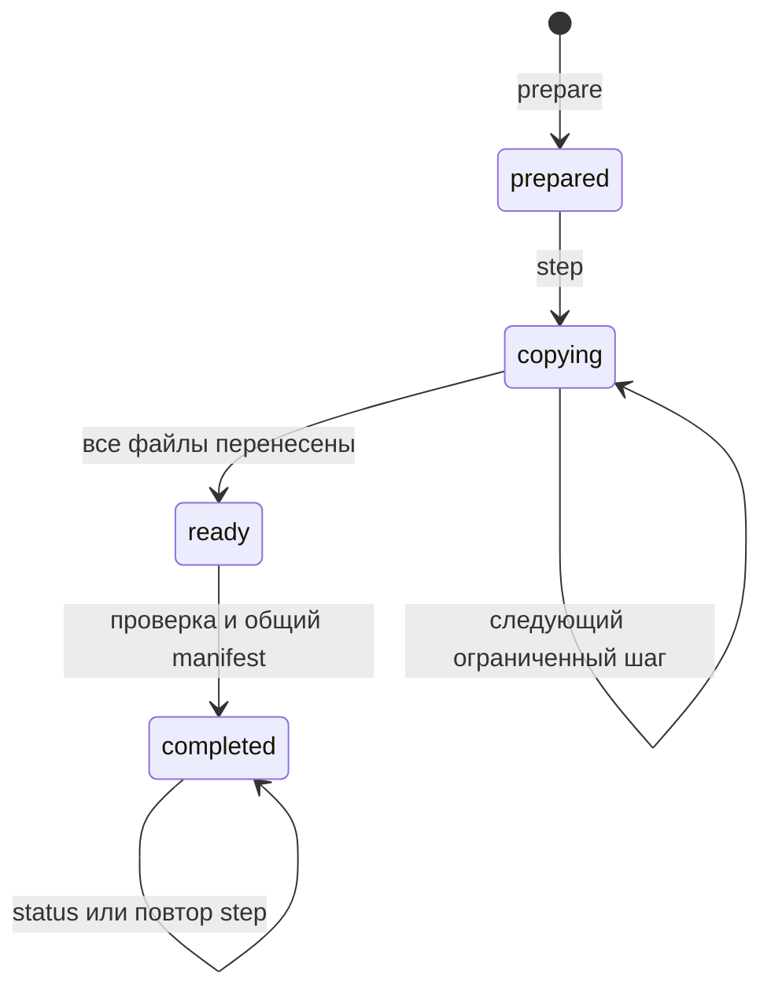

# Пошаговое восстановление полного комплекта

Статус: двадцать пятый этап локального прототипа, правила `workspace-restore-job-1`. Восстановление полного backup разбивается на ограниченные файловые шаги. Неизменяемый частный план связывает входной комплект, назначение и operation ID; отдельный status позволяет обнаружить уже завершённый результат после потери ответа.

- [Полный workspace backup](workspace-backup.md).
- [Прикладной сценарий](../../examples/workspace-restore-job/README.md).
- [Фактический отчёт](../../examples/workspace-restore-job/results/restore-job-report.md).

## 1. Задача и граница результата

Предыдущий этап создаёт и восстанавливает текущую карантинную DB со всеми архивами предков. Его restore выполняет весь перенос за один вызов и требует нового каталога. При прерывании вызова может остаться часть файлов, а при потере ответа клиент может не знать, завершён ли результат.

Новый протокол сохраняет параметры операции до копирования, переносит ограниченное число файлов за вызов и устанавливает завершение последним manifest. При следующем вызове проверяются уже существующие результаты. Точные файлы используются повторно; несовпадение принятого целевого файла останавливает продолжение.

Этот этап относится к файловому восстановлению исторического комплекта. Новая рабочая среда, продление прежних аренд, переоформление полномочий и активация скопированных credentials из него не возникают. Восстановленная DB сохраняет постоянный карантин.

## 2. Три отдельных объекта

| Объект | Назначение |
| --- | --- |
| Исходный полный bundle | Проверенный комплект `workspace-backup` с карантинной DB и всей заявленной цепочкой архивов |
| Каталог задания | Неизменяемый частный план, постоянная блокировка и распознаваемые промежуточные файлы |
| Назначение | Постепенно создаваемый восстановленный bundle в прежнем формате полного backup |

Каталог задания и назначение должны быть соседями с одним частным родительским каталогом. Это условие обеспечивает размещение промежуточных и целевых файлов в одной файловой системе для предусмотренной атомарной установки. Исходный bundle находится отдельно от них.

После завершения назначение содержит прежние шесть записей:

| Запись | Содержание |
| --- | --- |
| `state.sqlite3` | Карантинная DB сохранённой рабочей среды |
| `.agentwiki-snapshot-intent.json` | Намерение штатного snapshot restore |
| `.agentwiki-snapshot-manifest.json` | Завершение копии одной базы |
| `.agentwiki-workspace-intent.json` | Намерение восстановления полного комплекта |
| `.agentwiki-workspace-manifest.json` | Завершение DB и всей цепочки архивов |
| `archives/` | Точные standalone SQLite-файлы предковых архивов |

Метаданные задания остаются снаружи. Готовый bundle проверяется прежним `workspace-backup inspect`; расширять состав старого формата для plan, lock или журнала продвижения не требуется.

Каталог задания имеет собственный ограниченный состав:

| Запись | Назначение |
| --- | --- |
| `.agentwiki-restore-job-plan.json` | Неизменяемый план, не более 256 KiB |
| `.agentwiki-restore-job-owner.json` | Однократно записанное подтверждение собственного назначения, не более 8 KiB |
| `.agentwiki-restore-job.lock` | Постоянный пустой файл POSIX-блокировки |
| `.restore-<job_id>-<index>.part` | Только предусмотренные планом промежуточные файлы |

Частные каталоги имеют права 0700, plan, lock, metadata и файлы данных — 0600. Неизвестная запись не считается допустимым расширением задания.

## 3. Неизменяемый план

План закрепляет одну конкретную операцию:

- локальный job ID и явно заданный operation ID;
- канонические пути исходного bundle, задания и назначения;
- полный проверенный исходный manifest;
- заранее сформированный manifest будущего restore;
- фиксированную отметку создания результата и частную привязку запроса.

Будущий restore manifest создаётся один раз. Повтор шага не назначает ему новое время и не превращает повторную доставку в новую файловую операцию. Публичная сводка завершения выводится из того же плана и готового комплекта.

Request digest, manifests, контрольные суммы, абсолютные частные пути и весь plan не публикуются в CLI, отчётах или Git. Job ID и operation ID служат локальными идентификаторами, без удостоверения личности человека или внешней подписи.

Отдельной изменяемой головы задания не требуется: продвижение определяется по проверенным файлам назначения и предусмотренным промежуточным состояниям. Это исключает необходимость согласовывать файл счётчика с каждым уже установленным архивом.

Owner record фиксирует job ID, request digest, канонический путь назначения, устройство и inode его каталога. Он создаётся только после собственного успешного exclusive mkdir назначения и записывается один раз. Совпадение старых sidecars или отметки времени не заменяет это подтверждение принадлежности.

Его точные семь полей: `schema_version`, `rules_version`, `job_id`, `request_digest`, `destination_path`, `device`, `inode`. Это частное подтверждение принадлежности каталога, без изменяемого счётчика продвижения.

## 4. Состояния

| Состояние | Значение |
| --- | --- |
| `prepared` | Параметры задания сохранены; данные ещё не установлены |
| `copying` | Часть ожидаемых файлов установлена и подтверждена |
| `ready` | Все файлы данных доступны, но завершение требует предусмотренного действия step |
| `completed` | Полный целевой bundle проверен и его общий manifest завершён |

Последний обычный step может сразу перейти к `completed`. Промежуточный `ready` не обязан появляться в каждом выполненном сценарии. Статус отражает наблюдённое состояние файлов, а не число вызовов клиента.

Ошибки проверки и неподдерживаемые остатки не считаются новым разрешённым состоянием. Отсутствие manifest само по себе не разрешает заменить существующий файл или начать новую активную DB.

## 5. Подготовка

`prepare_restore` проверяет полный исходный bundle, пути и параметры запроса. Затем сохраняется частный план задания и подготавливается назначение. Каталог назначения создаётся исключительно этой операцией; его идентичность закрепляет отдельный owner record в каталоге задания.

Порядок назначения сохраняет прежний защитный барьер:

1. После собственного exclusive mkdir стандартный snapshot intent записывается первым файлом назначения.
2. В каталоге задания сохраняется однократный owner record устройства и inode назначения.
3. Создаются соответствующие workspace intent, каталог архивов и предусмотренные snapshot metadata.
4. Файлы данных устанавливаются последующими шагами.
5. Общий workspace manifest появляется только после полной проверки назначения.

До установки основной DB обычный Store видит intent и блокирует создание новой активной базы. Атомарно установленная основная DB уже содержит постоянный quarantine marker.

Повтор подготовки собственного задания сверяет точные исходные параметры. Другой operation ID, назначение или источник не переопределяет сохранённый план. Существующий неизвестный каталог не становится заданием только из-за подходящего имени.

Существующее назначение без точного owner record отклоняется даже при совпадении штатных metadata. Если owner record уже есть, исчезновение или замена каталога назначения также блокирует продолжение; его путь автоматически не создаётся заново.

Для уже сохранённого задания повтор использует прежние параметры и проверенный статус назначения. Чтение исходных байтов снова требуется перед копированием недостающих файлов; повтор подготовки готового результата может обойтись без исходного bundle.

## 6. Ограниченный файловый шаг

Данными считаются основная DB и каждый архив. При пределе 16 архивов заданию требуется установить не более 17 файлов данных. Метаданные завершения учитываются отдельно от этого счётчика.

`step_restore` получает `limit` от 1 до 16, по умолчанию 1. Один вызов устанавливает не более указанного числа недостающих файлов данных. Файл переносится целиком; лимит не задаёт число SQLite-страниц или байтов.

Для каждого ожидаемого целевого файла:

- отсутствие разрешает подготовить новую проверенную копию;
- точное совпадение размера и SHA позволяет использовать уже установленный результат;
- несовпадение, неподдерживаемые права или неизвестная связь файла останавливают продолжение.

Перед переносом недостающих данных исходный полный bundle снова проверяется и сопоставляется с закреплённым manifest. Новая версия bundle по прежнему пути не подменяет вход задания.

Когда все данные уже доступны в назначении, завершение может использовать их и сохранённый план без исходного bundle. Проверяются текущая карантинная DB, локальные архивы, цепочка квитанций и импортные anchors. При успехе общий manifest устанавливается последним.

## 7. Атомарная установка файла

Собственный промежуточный файл создаётся в частном каталоге задания. Его содержимое проверяется по заранее закреплённому размеру и контрольной сумме, затем выполняется `fsync`.

Установка использует hard link, который отказывается заменять уже существующее назначение. После установки синхронизируется целевой каталог; собственное промежуточное имя удаляется, затем синхронизируется каталог задания. Предварительная проверка имени вместе с обычным POSIX rename не даёт такого запрета замены, поскольку rename способен заменить существующий файл.

При остановке между link и удалением промежуточного имени могут сохраниться два имени одного inode. Продолжение допускает только строго распознанную пару:

- оба имени предусмотрены данным планом;
- совпадают устройство и inode;
- число ссылок соответствует этой паре;
- права, владелец, размер и закреплённые байты проходят проверку.

Исправление такой пары выполняет `step`. Обычный `status` не удаляет файлы. Неизвестная дополнительная ссылка или несовпадающее содержимое не преобразуется в разрешение на общую очистку каталога.

Распознавание относится к состояниям с уже сохранённым owner record. Самый ранний промежуток между mkdir назначения, первым intent и owner record остаётся отдельной неподдерживаемой границей.

Незавершённый собственный staging cache с одной ссылкой может быть создан заново в пределах предусмотренного плана. Уже установленный целевой файл при этом не перезаписывается. Чужие или неподтверждённые записи не удаляются.

## 8. Блокировка и параллельные вызовы

Постоянный частный lock задания используется для POSIX flock. Вызовы одного задания сериализуют проверку, установку и завершение. Разные процессы продолжают один сохранённый план; повтор команды не создаёт новую рабочую среду.

Одна блокировка задания не является глобальным арбитром файловой системы. Защита назначения дополнительно опирается на точные intents, ожидаемые имена и установку без замены. Владелец файлов и часы остаются доверенными.

Операции имеют общий срок 60 секунд на один вызов. Ожидание блокировки и проверка полного комплекта входят в этот срок. Пошаговый интерфейс не обещает малой задержки отдельного допустимого файла на произвольном носителе.

## 9. Status и восстановление потерянного ответа

`restore_status` читает план и проверяет назначение. Для наблюдения продвижения исходный bundle не требуется. Его отсутствие понадобится устранить только для шага, которому ещё нужно скопировать недостающие данные.

После завершения status подтверждает полный целевой bundle и возвращает сохранённый результат. Повтор `step` готового задания возвращает тот же факт. Отметка создания результата и его идентификаторы не обновляются.

Если клиент не сохранил ответ последнего шага, он может получить его через status. Это восстановление ответа о проверенном результате; новый snapshot исходной среды при таком чтении не создаётся.

Полнота истории устанавливается только после проверки всей цепочки и общего manifest. Наличие основной DB или успешное чтение её snapshot не заменяет это завершение.

## 10. Публичная сводка

Ответ содержит фиксированный набор из 15 полей:

| Группа | Поля |
| --- | --- |
| Формат и задание | `rules_version`, `job_id`, `operation_id`, `created_at` |
| Рабочая среда | `workspace_id` |
| Продвижение | `state`, `copied_file_count`, `total_file_count`, `completed` |
| Граница использования | `inspection_only`, `domain_writes_allowed`, `full_history_preserved`, `old_authority_activated`, `external_fencing_established` |
| Результат | `result` |

`inspection_only=true`, `domain_writes_allowed=false`, `old_authority_activated=false` и `external_fencing_established=false` сохраняют прежнюю границу исторического чтения. `full_history_preserved` становится true только для завершённого проверенного результата.

До завершения `result` равен null. После завершения он содержит прежнюю безопасную 18-полевую сводку `workspace-backup` для операции `kind=restore`, включая упорядоченные публичные квитанции архивов. Частные manifests и контрольные суммы туда не добавляются.

Счётчик `copied_file_count` описывает подтверждённые файлы назначения. Он не является количеством агентов, мерой скорости копирования или числом независимых оснований истинности текста.

## 11. Команды и API

Нужны Python 3.10+, стандартная библиотека и POSIX-права частных файлов. Родительский частный каталог уже должен иметь права 0700. Каталог задания и назначение выбираются соседними.

~~~sh
python3 -m agentwiki workspace-restore prepare \
  --bundle /tmp/agentwiki-private/full-backup \
  --destination /tmp/agentwiki-private/job-restore \
  --job /tmp/agentwiki-private/restore-job \
  --operation-id restore-example-01

python3 -m agentwiki workspace-restore step \
  --job /tmp/agentwiki-private/restore-job --limit 1

python3 -m agentwiki workspace-restore status \
  --job /tmp/agentwiki-private/restore-job

python3 -m agentwiki workspace-backup inspect \
  --bundle /tmp/agentwiki-private/job-restore
~~~

Команды restore работают с уже сохранённым частным историческим комплектом. Они не требуют bearer credential прежнего администратора и не создают новый grant. Доступ к частным файлам остаётся частью локальной границы доверия.

Программный интерфейс находится в `agentwiki.workspace_restore_job`:

~~~python
prepare_restore(bundle_path, destination, job_directory, operation_id=operation_id)
step_restore(job_directory, limit=1)
restore_status(job_directory)
~~~

Точный повтор использует прежний каталог задания и operation ID. Для другого назначения требуется новая операция с отдельным новым каталогом; существующий неподтверждённый target не заменяется.

Основные коды нового API:

| Код | Причина отказа |
| --- | --- |
| `workspace_restore_job_invalid_input` | Неподдерживаемые параметры, limit или расположение каталогов |
| `workspace_restore_job_conflict` | Повтор не соответствует сохранённому запросу |
| `workspace_restore_job_incomplete` | Нет необходимого сохранённого состояния |
| `workspace_restore_job_manifest_invalid` | План, metadata или состав файлов не проходят проверку |
| `workspace_restore_job_source_changed` | Исходный bundle отличается от закреплённого входа |
| `workspace_restore_job_checksum_mismatch` | Файл расходится с ожидаемыми байтами |
| `workspace_restore_job_destination_exists` | Существующее назначение не может быть принято данной операцией |
| `workspace_restore_job_private_path_required` | Путь, права или файловый объект не соответствуют частному формату |
| `workspace_restore_job_limit_exceeded` | Превышен срок или поддерживаемый объём |
| `workspace_restore_job_io_failed` | Обработка или ввод-вывод не завершились |

Ошибки шага сохраняют частные файлы для последующего распознавания или разбирательства. Сообщение об ошибке не является разрешением на общую очистку назначения.

CLI отдельно использует `unknown_restore_job_command`, `workspace_restore_job_summary_invalid` и безопасный общий отказ `workspace_restore_job_command_failed`. Неподдерживаемый `--limit` отклоняется разбором аргументов до запуска шага.

## 12. Частичные состояния и пределы восстановления

Поддерживаемое продолжение относится к заданию с корректным сохранённым планом и распознаваемыми собственными файлами. Старые неполные каталоги одношагового restore без такого плана автоматически не усыновляются.

Между созданием каталога задания и достаточным plan, а также между mkdir назначения, первым intent и owner record могут остаться промежутки без подтверждённой принадлежности. Непроверяемые метаданные, неизвестные staging names и несовпадающие целевые файлы остаются блокирующими. Их наличие не разрешает удалить данные или переписать план задним числом.

| Ограничение | Значение |
| --- | --- |
| Архивы предков | От 1 до 16 |
| Основная DB и каждый архив | Не более 256 MiB на файл |
| Совокупный размер архивов | Не более 1 GiB |
| Файлы данных назначения | От 2 до 17 для импортированного комплекта |
| Файлы данных за шаг | От 1 до 16, по умолчанию 1 |
| Частный план | Не более 256 KiB |
| Однократный owner record | Не более 8 KiB |
| Срок вызова | 60 секунд на prepare, step или status |

Пределы размера полного комплекта сохраняются из `workspace-backup`. Разбиение на шаги не снимает их и не предоставляет бесконечного времени одному файлу. Проверка файлов и всей истории требует чтения закреплённых байтов.

Распознавание собственной пары hard links и перестроение staging cache не означают восстановления после любого аппаратного отказа. Произвольное повреждение SQLite, утрата плана, удаление файла уже завершённого комплекта или подмена данных владельцем требуют отдельного разбирательства.

До общего завершения отсутствующий ожидаемый файл может быть снова скопирован по сохранённым pins. Без отдельного изменяемого журнала нельзя отличить его удаление от ещё не выполненной установки. В обоих случаях остаётся обязательным точное подтверждение входа и запрет замены существующего несовпадающего файла.

## 13. Карантин и полнота истории

При первом установленном `state.sqlite3` база уже сохраняет quarantine marker. Если штатные snapshot metadata готовы, обычный Store может читать её историческое состояние до переноса всех архивов. Новые изменения, публикация, backup из копии и использование её как действующего источника остаются запрещёнными.

Полный `workspace-backup inspect` требует общего manifest и всех архивов. Таким образом, доступность исторического чтения одной DB и завершение полной истории имеют разные проверяемые границы.

Сохранённые credentials, leases, решения и receipts описывают прежнюю авторизацию. Пошаговое копирование не продлевает их сроки и не превращает историю в разрешение новых действий. Активную среду и её текущие отзывы необходимо рассматривать отдельно.

## 14. Прикладной сценарий и дальнейшая работа

Демонстратор начинает с выполненного полного backup предыдущего этапа. Он подготавливает задание, делает ограниченные файловые шаги отдельными CLI-процессами, читает продвижение и восстанавливает результат после отброшенного ответа. Готовый комплект сопоставляется с исходным историческим состоянием; прежние пути могут временно отсутствовать.

Фактические счётчики, порядок вызовов, наблюдения и границы выполненного находятся в [отчёте запуска](../../examples/workspace-restore-job/results/restore-job-report.md). Обычная пауза после завершённого файлового шага сама по себе не является моделированием аварии процесса или проверкой всех расписаний отказов.

Протокол остаётся локальным и кооперативным. Старые программы, прямой SQL владельца и внешние эффекты публикации не входят в атомарную файловую операцию восстановления. Полная история не устанавливает семантическую полноту документов, независимость проверяющих или предельное число агентов.

Следующие задачи — более широкий договор восстановления повреждённых метаданных, политика хранения завершённых заданий и отдельное согласование внешних операций. Расширение продолжения должно сохранять правило: неподтверждённый целевой файл не перезаписывается ради успешного завершения.
